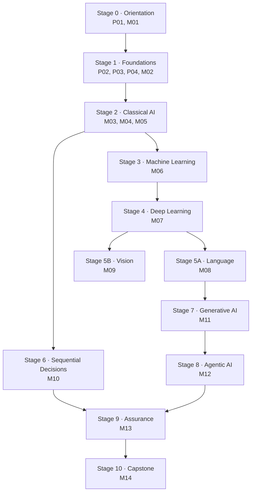

# Artificial Intelligence — A Complete Course for Self-Study

**From first principles to modern AI systems: fourteen modules, guided laboratories, runnable
notebooks and a capstone project — written so that you can learn Artificial Intelligence without
an instructor in the room.**

This is a university-level course designed for independent study. Every lesson begins with
intuition, works through examples by hand, and then implements the idea in Python. Every
laboratory gives you a realistic problem with a stakeholder, a deadline and a rubric. Nothing
here assumes that someone will explain it to you later.

**Instructor:** Engr. Dr. Muhammad Nadeem Majeed, Professor, Department of Data Science (PUCIT),
University of the Punjab, Lahore, Pakistan.

**Start here →** [Learning paths](docs/learning-path.md) · [Prerequisites](prerequisites/README.md) ·
[All modules](modules/README.md) · [Glossary](resources/glossary.md) · [FAQ](docs/faq.md)

---

## Contents

- [1. Welcome to the Course](#1-welcome-to-the-course)
- [2. What Is Artificial Intelligence?](#2-what-is-artificial-intelligence)
- [3. Why Should You Learn AI?](#3-why-should-you-learn-ai)
- [4. What You Will Learn](#4-what-you-will-learn)
- [5. Who This Course Is For](#5-who-this-course-is-for)
- [6. Prerequisites and Where Beginners Should Start](#6-prerequisites-and-where-beginners-should-start)
- [7. Course Learning Outcomes](#7-course-learning-outcomes)
- [8. Complete Course Roadmap](#8-complete-course-roadmap)
- [9. Module-Wise Navigation](#9-module-wise-navigation)
- [10. Recommended Learning Sequence](#10-recommended-learning-sequence)
- [11. How to Study Each Lesson](#11-how-to-study-each-lesson)
- [12. How to Use the Jupyter Notebooks](#12-how-to-use-the-jupyter-notebooks)
- [13. How to Complete the Practical Labs](#13-how-to-complete-the-practical-labs)
- [14. How to Attempt Assignments and Quizzes](#14-how-to-attempt-assignments-and-quizzes)
- [15. Project-Based Learning](#15-project-based-learning)
- [16. Software and Tools You Will Need](#16-software-and-tools-you-will-need)
- [17. A Weekly Self-Study Schedule](#17-a-weekly-self-study-schedule)
- [18. Using the Additional Learning Resources](#18-using-the-additional-learning-resources)
- [19. Frequently Asked Questions](#19-frequently-asked-questions)
- [20. About the Instructor](#20-about-the-instructor)

---

## 1. Welcome to the Course

Artificial Intelligence is unusual among computing subjects: it borrows its mathematics from
statistics, its language from philosophy, its engineering from software systems, and its ethics
from law and the social sciences. That breadth is what makes it fascinating, and it is also why
most beginners stall — not because any single idea is too hard, but because the ideas arrive from
five directions at once.

This course is organised to remove that difficulty. It moves in a deliberate order:

1. **Foundations** — what AI is, what an agent is, how we describe a problem precisely.
2. **Classical AI** — search, logic and reasoning under uncertainty: the ideas that made the
   field, and that still power planning systems, scheduling engines and expert tools.
3. **Machine learning** — how systems improve from data, and how to tell whether they actually do.
4. **Deep learning** — neural networks, and the architectures behind modern language and vision.
5. **Applied AI** — reinforcement learning, generative models, language models and agents.
6. **Responsibility** — fairness, explainability, privacy and security, which are engineering
   requirements rather than closing remarks.
7. **Capstone** — one substantial project that pulls the whole course together.

Each module is self-contained enough to be studied on its own once its prerequisites are met, and
sequenced so that the course also works read from beginning to end. You always know what you are
learning, why it comes now, and what you should be able to do afterwards.

**A note on honesty.** The course is published module by module. Each module page states exactly
what is available today, so you are never sent to a lesson that has not been written yet. Where
something is still in preparation, the page says so.

## 2. What Is Artificial Intelligence?

Artificial Intelligence is the study of building systems that do things which, until recently,
required human intelligence: recognising a face, understanding a sentence, planning a route
through a city, recommending a film, or diagnosing a disease from a scan.

Three ideas are worth separating at the start, because beginners often mix them up.

**AI is a goal, not a technique.** "Make a machine that can translate Urdu into English" is an AI
goal. The techniques used to reach it have changed several times in seventy years — symbolic
rules in the 1970s, statistical learning in the 2000s, deep neural networks in the 2010s. The goal
is stable; the methods are not.

**AI is not one field.** It contains search and planning (how to find a sequence of actions),
knowledge representation (how to write down what a system knows), machine learning (how to improve
from experience), perception (how to interpret images and sound), natural language processing (how
to work with human language), robotics, and multi-agent systems. A course that teaches only
machine learning leaves out half the field — and most of the ideas that make modern systems
reliable.

**Modern AI is mostly engineering under uncertainty.** Real sensors are noisy, real data is
incomplete, and real users behave unpredictably. Much of the intellectual content of AI is about
acting sensibly when you cannot be certain — which is why probability appears early and often.

By the end of this course you will be able to look at a system that claims to be "AI" and say
what kind it is, what it assumes, where it will fail, and how you would measure whether it works.
That ability is more valuable than familiarity with any particular library.

## 3. Why Should You Learn AI?

**Because it is now part of ordinary software.** A generation ago, a recommendation engine, a
speech interface or a document classifier were specialist projects. Today they are features.
Whether you build them or only use them, understanding what is happening inside changes the
quality of your decisions.

**Because the demand is for people who understand, not only people who can call an API.**
Anyone can follow a tutorial that loads a model and prints a score. Far fewer people can explain
why the score is misleading, notice that the test set leaked into training, or recognise that a
model with 97% accuracy is useless because the rare class is the one that matters. Those
judgements come from the fundamentals this course teaches.

**Because AI decides things about people.** Models rank job applicants, triage patients, flag
transactions and gate access to services. Building such systems without understanding bias,
explainability, privacy and failure modes is not a technical shortcut; it is a professional
risk — and, increasingly, a legal one.

**Because the ideas are genuinely beautiful.** A\* search, Bayes' rule, backpropagation and
attention are elegant constructs. Learning them changes how you think about problems, in the same
way that learning to program changes how you think about processes.

**Because it is learnable.** The mathematics required is real but bounded: vectors and matrices,
probability, derivatives, and the discipline of careful counting and measurement. This course
supplies all of it in the prerequisite track, starting from the assumption that you may have
forgotten your school mathematics.

## 4. What You Will Learn

By working through the course you will be able to:

- **Formulate problems** precisely enough for a computer to solve them — as state spaces,
  constraint problems, or decision problems under uncertainty.
- **Choose and justify algorithms** rather than pattern-matching them: when breadth-first search
  is the right answer, when A\* is, and when neither will finish in time.
- **Write down knowledge** in propositional and first-order logic, and derive conclusions that
  follow from it by sound inference.
- **Reason under uncertainty** with conditional probability, Bayesian networks and fuzzy
  inference, and explain when each representation is appropriate.
- **Run a complete machine-learning workflow** from raw data to a defended conclusion, including
  the parts tutorials skip: leakage, validation design, baselines and error analysis.
- **Build and debug neural networks** — implement backpropagation by hand once, then train models
  competently with a framework.
- **Work with language and images**: tokenisation, embeddings, fine-tuning, convolutional and
  transformer architectures, and honest evaluation of what they get wrong.
- **Train agents that learn from interaction**, and understand the difference between value
  iteration, Q-learning and policy gradients by implementing all three.
- **Build with modern generative models** — prompting, retrieval-augmented generation, fine-tuning
  and evaluation of large language model systems.
- **Assemble an AI agent** that uses tools, and secure it against the failure modes agents
  introduce.
- **Audit an AI system** for bias, privacy and security, and document it in a model card.
- **Deliver a capstone project** that someone else could run, understand and critique.

## 5. Who This Course Is For

**Undergraduate and postgraduate students** in computer science, data science, software
engineering, electrical engineering, mathematics or a related discipline, who want a course that
explains rather than lists.

**Students preparing for a university AI course** who want a second explanation, worked examples
and code they can run before the exam.

**Working developers and analysts** moving into machine learning who need the conceptual
foundations that make libraries make sense — and the evaluation habits that keep them out of
trouble.

**Researchers from other fields** — medicine, agriculture, economics, linguistics, education —
who need to understand what these systems can and cannot support in their own domain.

**Teachers** looking for a structure, laboratory scenarios and assessment material they can adapt.

**Self-taught programmers** filling the gaps that tutorials leave: why the maths matters, what
"generalisation" really means, and why a model that scores well can still be worthless.

You do **not** need prior AI experience. You do need to be willing to write code regularly and to
work through mathematics on paper rather than only reading it.

## 6. Prerequisites and Where Beginners Should Start

The course is designed to be entered from several starting points. Be honest with yourself about
which one is yours; skipping ahead is the most common reason students fail at Module 6.

| Your background | Start at | Notes |
| :--- | :--- | :--- |
| New to programming | [P01 Python Programming](prerequisites/P01-python-programming/README.md) | Complete P01 before anything else. Expect three to four weeks if you are entirely new. |
| Can program, weak mathematics | [P02](prerequisites/P02-mathematics-for-ai/README.md), then P03 and P04 | The mathematics track exists precisely for this case. Do not skip it; Module 6 will be painful if you do. |
| Comfortable with Python and first-year mathematics | [M01 Introduction](modules/README.md) | The normal entry point. |
| Strong mathematics and programming, no AI | M01, then skim M02–M05 | Skim means: read the concept sections and attempt the quizzes. |
| Already know machine learning, new to classical AI | M03, M04, M05 | Then rejoin at M06 to fill gaps in evaluation and deep learning. |
| Returning after a long break | [Learning paths](docs/learning-path.md) | Use the diagnostic self-checks to find your re-entry point. |

**The prerequisite track** covers four sections, each with lessons, a notebook you run and a lab you
build:

| Section | Topic | Hours |
| :--- | :--- | ---: |
| [P01](prerequisites/P01-python-programming/README.md) | Python programming for AI | 14 |
| [P02](prerequisites/P02-mathematics-for-ai/README.md) | Mathematics for AI: vectors, matrices, derivatives, optimisation | 24 |
| [P03](prerequisites/P03-probability-and-statistics/README.md) | Probability and statistics | 10 |
| [P04](prerequisites/P04-data-preparation-and-visualization/README.md) | Data preparation and visualisation | 8 |

Full details, including a readiness self-check you can take today: [prerequisites/README.md](prerequisites/README.md).
When you have finished all four, the [prerequisite diagnostic](prerequisites/diagnostic.md) tells you
whether to start M01 or revisit a section.

**If you are a complete beginner**, the recommended route is P01 → M01 → P02 → P03 → P04 → M02 →
M03. Interleaving the mathematics with the early modules keeps it motivated: you meet matrix
multiplication because a search algorithm needs it, not in the abstract.

## 7. Course Learning Outcomes

| ID | On completing the course you can |
| :--- | :--- |
| CLO1 | Explain what AI is, how the field evolved, and how agents perceive, decide and act in an environment |
| CLO2 | Formulate a problem as a search or constraint problem and justify a search strategy with its complexity trade-offs |
| CLO3 | Represent knowledge in propositional and first-order logic and derive conclusions by sound inference |
| CLO4 | Quantify uncertainty with probability, build and query Bayesian networks, and design a fuzzy inference system |
| CLO5 | Run a leakage-free machine-learning workflow and evaluate models with appropriate metrics |
| CLO6 | Build, train, debug and evaluate neural networks for tabular, text and image data |
| CLO7 | Implement reinforcement-learning and generative systems, and assemble a tool-using AI agent |
| CLO8 | Audit an AI system for fairness, explainability, privacy and security, and deliver a documented capstone project |

Each module states which outcomes it serves, so you can always see why a topic is in the course.
The full mapping is in the [curriculum map](docs/CURRICULUM-MAP.md).

## 8. Complete Course Roadmap

The course has two tracks and eleven stages. The **prerequisite track** closes gaps in programming
and mathematics; the **module track** is the course proper.



*Text description of the diagram:* orientation leads to foundations; foundations lead to the three
classical-AI modules; classical AI leads to machine learning and then deep learning; deep learning
branches into language and vision; classical AI also feeds reinforcement learning, which joins
language and vision in generative AI and then agentic AI; assurance draws on agentic AI and
reinforcement learning; the capstone comes last.

| Stage | Modules | What changes in your ability |
| :--- | :--- | :--- |
| 0 Orientation | P01, M01 | You can write and run Python, and describe an AI system in the vocabulary of agents |
| 1 Foundations | P02, P03, P04, M02 | You can handle vectors, matrices, probability and data with confidence |
| 2 Classical AI | M03, M04, M05 | You can solve new problems by search, logic and probabilistic reasoning |
| 3 Machine Learning | M06 | You can take a dataset to a defended, well-evaluated model |
| 4 Deep Learning | M07 | You can build, train and debug neural networks |
| 5 Language and Vision | M08, M09 | You can fine-tune models for text and images and explain their errors |
| 6 Sequential Decisions | M10 | You can train an agent that improves from its own experience |
| 7 Generative AI | M11 | You can build and evaluate a system around a large language model |
| 8 Agentic AI | M12 | You can build a tool-using agent that is observable and bounded |
| 9 Assurance | M13 | You can audit a system for bias, privacy and security, and document it |
| 10 Capstone | M14 | You can deliver a reproducible AI project and defend its limits |

Full descriptions, dependencies and sequencing rationale: [course roadmap](docs/course-roadmap.md).

## 9. Module-Wise Navigation

Every module has its own page, and each page lists its lessons, notebooks, labs, assignment,
quiz and mini-project in reading order. Use this table as your map.

| Module | Title | Level | Hours | Prerequisites |
| :--- | :--- | :--- | ---: | :--- |
| [M01](modules/README.md#m01) | Introduction and Foundations of Artificial Intelligence | 100 | 10 | None |
| [M02](modules/README.md#m02) | Intelligent Agents and Environments | 200 | 18 | P01 |
| [M03](modules/README.md#m03) | Problem Solving and Search Algorithms | 200 | 26 | P01, P02 |
| [M04](modules/README.md#m04) | Knowledge Representation and Logical Reasoning | 200 | 21 | P02 |
| [M05](modules/README.md#m05) | Uncertainty, Bayesian Reasoning and Fuzzy Logic | 300 | 24 | P03 |
| [M06](modules/README.md#m06) | Machine Learning Fundamentals and Algorithms | 300 | 31 | P02, P03, P04 |
| [M07](modules/README.md#m07) | Artificial Neural Networks and Deep Learning | 300 | 27 | M06, P02 |
| [M08](modules/README.md#m08) | Natural Language Processing | 300 | 22 | M07 |
| [M09](modules/README.md#m09) | Computer Vision | 300 | 22 | M07 |
| [M10](modules/README.md#m10) | Reinforcement Learning | 400 | 25 | M06, M05, P03, P02 |
| [M11](modules/README.md#m11) | Generative AI and Large Language Models | 400 | 24 | M07, M08 |
| [M12](modules/README.md#m12) | AI Agents and Agentic AI Systems | 400 | 19 | M11, M02 |
| [M13](modules/README.md#m13) | Responsible, Explainable and Secure AI | 300 | 19 | M06 |
| [M14](modules/README.md#m14) | Advanced AI Applications and Capstone Projects | 400 | 30 | M13 + your brief |

**Level** indicates how much background a module assumes, not its difficulty in a league table:
100 assumes nothing, 200 assumes programming and basic mathematics, 300 assumes linear algebra and
probability, 400 assumes the preceding chain. **Hours** is total study effort — reading, notebooks,
labs, assignments — not lecture time.

**Availability.** Every module has a section in this index, and eleven of them have their own
page. M01, M06, M07, M11, M13 and M14 are complete; M02 and M04 are in progress; M08, M10 and M12
publish reference code while their lessons are written; M03, M05 and M09 are syllabus entries only.
Each module page states what exists today, so no link leads to a page that is not there.

A complete index with overviews, outcomes and available content: [modules/README.md](modules/README.md).

## 10. Recommended Learning Sequence

There are two main routes. Choose one now and write it down; drifting between them is how students
end up with gaps.

| Path | Composition | Effort | Best for |
| :--- | :--- | ---: | :--- |
| **Core path** (one semester) | P01, the essentials of P02–P04, and M01–M06 | ≈ 165 hours | A 3-credit course, or a focused first pass |
| **Core plus deep learning** | Core path, then M07 | ≈ 192 hours | Anyone who wants the foundation for modern applications |
| **Full programme** (two semesters) | Every unit and module, including M08–M12 and a full capstone | ≈ 374 hours | Honours students, MSc preparation, career change |
| NLP and generative AI | Core plus M07, then M08, M11, M12 | ≈ 257 hours | Language technology careers |
| Vision | Core plus M07, then M09 and full M13 | ≈ 223 hours | Imaging, medical and industrial applications |
| Decision systems | Core plus M07, then M10 and M12 | ≈ 236 hours | Operations research, control, robotics |
| Responsible AI | Core plus M07, then full M13, M12, M11 | ≈ 244 hours | Policy, audit and governance roles |

**The order matters more than the speed.** Do not start M07 before M06, and do not attempt M11
without M07 — those two shortcuts account for most of the frustration students report. Week-by-week
plans for every path are in [learning paths](docs/learning-path.md).

## 11. How to Study Each Lesson

Every lesson in this course follows the same eleven-part structure. Learn the structure once and
you will always know where to find what you need.

| Part | What it contains | How to use it |
| :--- | :--- | :--- |
| 1. Learning objectives | What you should be able to do afterwards | Read first; return at the end and check yourself honestly |
| 2. Prerequisite knowledge | What the lesson assumes, with links | Read first. If it is unfamiliar, follow the link before continuing |
| 3. Conceptual explanation | Intuition, then the formal idea | Read actively, with a pen. Reproduce the argument in your own words |
| 4. Worked examples | Fully traced examples | Cover the solution and work it yourself first. Then compare |
| 5. Visual explanation | A diagram and its text description | Trace the diagram with your finger and predict the next step |
| 6. Mathematical formulation | The formal statement and symbols | Copy the symbol table by hand; notation becomes familiar through writing |
| 7. Python implementation | Complete runnable code | Run it. Then change one thing and predict what happens |
| 8. Practical applications | Where this is used, and what it buys | Ask: would this technique help in a system I know? |
| 9. Common mistakes | Symptom, cause, fix | Read twice. These are the errors you are about to make |
| 10. Self-assessment | Questions with hidden answers | Answer before opening the answer. This is the step students skip and most need |
| 11. Further reading | Annotated sources | Follow up only on what you are curious about — not everything |

**Page conventions.** Lessons follow one structure, so you always know where to look:

- **Examples** sit under `### Example` headings, numbered, with every intermediate step shown.
- **Practice** lives in a `## Exercises` section near the end, with the answers hidden.
- **Answers** are inside a collapsible `<details>` block, so you can attempt the question first.
- **Mistakes** are collected in a `## Common Mistakes` table: symptom, cause, fix.
- **Notes, warnings and asides** are blockquotes that open with a bold label — **Note**,
  **Warning**, **Example**, **Exercise** — so you can tell what kind of help you are being given
  before you read it.

Diagrams are Mermaid flowcharts, each followed by a *Text description of the diagram* paragraph. That
description is the accessible version of the image, and every diagram is written to make sense with
the image removed. Code blocks are complete and runnable, and each output block shows what the code
actually printed.

**A forty-five minute lesson, done properly:**

1. **Five minutes** — read objectives and prerequisites; write down what you already know.
2. **Fifteen minutes** — read the explanation and worked examples, with the page's solutions
   covered.
3. **Fifteen minutes** — run the code, break it deliberately, and fix it.
4. **Five minutes** — answer the self-assessment questions without looking.
5. **Five minutes** — write three sentences: what the idea is, why it works, when it fails.

That final written summary is the single highest-value habit in the course. If you cannot write it,
you have not learned the lesson yet — and you now know exactly which part to reread.

## 12. How to Use the Jupyter Notebooks

A notebook is a document that mixes explanation, runnable code and output. The course uses them so
that you can change an algorithm and see the consequence immediately, rather than trusting a
printed answer.

**Running them.** Open the notebook in Jupyter, JupyterLab, VS Code or a hosted service such as
Google Colab, then choose *Restart & Run All* to execute it from the top. Notebooks are written to
run in order, start to finish, with no internet connection and no GPU. If a cell fails, run the
earlier cells again before debugging — most notebook errors are stale state from a skipped cell.

**How to actually learn from a notebook.** Running it is not the exercise. Use this loop:

1. **Read the markdown before the code.** Predict what the next cell will produce.
2. **Run it and compare** with your prediction. The gap between the two is the learning.
3. **Change one thing.** A parameter, a seed, a data size, a sign. Predict the effect first.
4. **Break it.** Remove a term, transpose a matrix, set a learning rate to 10. Read the error, then
   fix it. Errors are the cheapest feedback available to you.
5. **Do the exercises.** Each notebook ends with tasks marked `# YOUR CODE HERE`. Attempt them
   before looking anywhere else.
6. **Write your own last cell.** Two lines summarising what changed and why it matters.

**Practical notes.** Notebooks are stored as `.ipynb` files; they may show as raw files on some
sites, which is normal — download or open them in a notebook environment. Code in the lessons and
in the notebooks is the same code, so if you cannot open a notebook, copy the lesson's code into
any Python environment and continue.

## 13. How to Complete the Practical Labs

Labs are where the course stops being tidy. You are given a messy situation, a stakeholder and a
set of requirements — and you have to decide what "good enough" means.

**The method that works:**

1. **Read the scenario twice and write the decision in one sentence.** "The transport officer must
   choose two routes by Friday." If you cannot state the decision, you cannot evaluate a solution.
2. **List what you were given and what you were not.** Most marks are lost by assuming data that
   does not exist.
3. **Work the tasks in order, but write down your plan first.** Fifteen minutes of planning saves
   hours of backtracking.
4. **Build the simplest thing that could satisfy the requirements**, then improve it. A working
   baseline plus an honest comparison scores better than an ambitious system that does not run.
5. **Evaluate against the stated criteria, not your feelings.** Report the metric, the baseline and
   at least one failure case with its cause.
6. **Write the report for the stakeholder.** Three sentences they could act on, plus one limitation
   you would tell them in person.
7. **Attempt the extension challenges only after the core is complete.**

Hints are provided in collapsible blocks. Open them one at a time, and only after you have tried
the task — the hint you did not need is worth more than the answer you did.

## 14. How to Attempt Assignments and Quizzes

**Assignments** are graded, individual pieces of work. Each one states its specification exactly:
function names, file names, output columns, runtime limits. Read the specification and the rubric
*before* writing code, because the rubric tells you where the marks are — and they are not all in
the code. A correct implementation with no evaluation of its own failures typically loses a quarter
of the available marks.

Submit work that someone else can run: fixed random seeds, relative paths, one documented command,
and a report that states the metric, the baseline and one limitation. Partial work that runs and is
honestly evaluated outscores complete work that does not.

**Quizzes** are for diagnosis, not judgement. Answer on paper without looking anything up, then
mark yourself with the hidden answer key. Each quiz ends with a revision table mapping wrong
answers to the exact lesson and exercise to revisit. Scoring under 60% is useful information: it
means go back, not give up.

**A word on integrity.** Discussing ideas with classmates is encouraged and makes you better.
Submitting someone else's code, or code you cannot explain line by line, is both dishonest and
self-defeating: the capstone and every subsequent module assume you can do the work yourself. If
you use an external source — including an AI assistant — cite it, and make sure you could
re-derive the result without it.

## 15. Project-Based Learning

Concepts stick when they are used. The course therefore builds towards projects at three scales:

| Scale | What it is | Typical effort |
| :--- | :--- | :--- |
| **Mini-project** (one per module) | A small, open-ended build that applies the module's ideas, often competitive or creative | 2–4 hours |
| **Capstone-lite** (core path) | A scoped project using one or two modules, with a short report | 15–25 hours |
| **Capstone** (full programme) | A substantial system with milestones, evaluation, documentation and a defence of its limitations | 40–60 hours |

**Why projects, and not more exercises.** Exercises have a known answer; projects have a defensible
one. The skill that employers and researchers actually need is choosing a method, measuring it
honestly, and explaining the result to someone who will make a decision with it. That skill cannot
be practised on questions with answer keys.

**Build a portfolio as you go.** Each mini-project produces a repository, a figure and a short
write-up. Keep them. By the end of the course you will have a dozen pieces of evidence that you can
build AI systems — far more persuasive than a certificate.

**Choosing a capstone.** Pick a problem you genuinely care about, in a domain you already
understand: your family's business, a clinic, a school, a farm, a local service. Domain knowledge
is worth more than model sophistication, and a modest model on a problem you understand beats a
fancy model on a problem you do not.

## 16. Software and Tools You Will Need

You need a laptop — Windows, macOS or Linux — and no GPU. Everything in this course runs on a CPU
in under a minute per notebook.

| Tool | Why you need it | Notes |
| :--- | :--- | :--- |
| **Python 3.11 or newer** | The course language | 3.11 or 3.12 is the safest choice; avoid the very newest release if your libraries lag |
| **Jupyter Notebook or JupyterLab** | Running the `.ipynb` practicals | Also available through VS Code or Google Colab if installing is difficult |
| **VS Code** (or any editor) | Writing Python, reading Markdown | The Python and Jupyter extensions are enough |
| **NumPy, pandas, Matplotlib** | Numerical work, data handling, plotting | Required from P01 onwards |
| **scikit-learn** | Classical machine learning | Required for M06 |
| **PyTorch** | Neural networks | CPU build is sufficient; required from M07 |
| **Transformers** (Hugging Face) | Pretrained language models | Required for M08 and M11 |
| **Gymnasium** | Reinforcement-learning environments | Required for M10; a bundled minimal environment is provided as a fallback |

**A single command to install the core set** (once Python is installed):

```text
pip install numpy pandas matplotlib scikit-learn jupyter
```

Add the rest when a module asks for them, not before — installing everything up front creates
version conflicts you cannot diagnose.

**If your laptop is old or shared**, use Google Colab or Kaggle Notebooks for the heavier modules
(M07, M08, M09, M11). The notebooks are written to be portable, and every one of them has an
offline path so that no lab depends on a hosted service.

**No paid accounts are required anywhere in this course.** Where a hosted API is used for
illustration in M11 and M12, an offline alternative that teaches the same idea is always provided,
and your assessment never depends on the paid path.

## 17. A Weekly Self-Study Schedule

Consistency beats intensity. Six focused hours a week for a semester will take you further than
twenty hours in one week followed by three weeks of nothing.

**Core path, 17 weeks at about 10 hours per week (≈ 165 hours):**

| Weeks | Work | Hours/week | Cumulative |
| :---: | :--- | ---: | ---: |
| 1–2 | P01 complete | 9 | 18 |
| 3 | P02 vectors, matrices and eigenvalues | 10 | 28 |
| 4 | P02 derivatives and optimisation | 10 | 38 |
| 5 | P03 probability; P04 data preparation essentials | 7 | 45 |
| 6 | M01 complete | 10 | 55 |
| 7–8 | M02 complete, including labs and assignment | 9 | 73 |
| 9–11 | M03 complete, including labs and assignment | 9 | 100 |
| 12–13 | M04 complete | 11 | 121 |
| 14–15 | M05 complete | 12 | 145 |
| 16–17 | M06 lessons 1–10 and assignment | 10 | 165 |

Add three weeks of M07 (about 9 hours a week) to reach the deep-learning entry point. The
[learning paths](docs/learning-path.md) page has the same schedule with more detail, including
what to do if you have to pause.

**A sustainable weekly rhythm:**

| When | What | Time |
| :--- | :--- | ---: |
| Two weekday evenings | Read one lesson each, run its code, answer its questions | 2 × 90 min |
| One weekday evening | Notebook exercises or lab tasks | 90 min |
| Weekend morning | The week's lab, assignment progress, or a mini-project | 3 h |
| Weekend, 20 minutes | Review last week's written summaries; redo two quiz questions | 20 min |

**If you have only three hours a week**, halve the pace rather than the depth: one lesson per week,
one lab per fortnight, and accept that the full programme will take two years. Slow and complete
beats fast and hollow.

## 18. Using the Additional Learning Resources

The course is self-contained, but no single course is enough. These companion pages exist so that
you can go deeper in a directed way rather than drowning in links.

| Resource | Use it for | When |
| :--- | :--- | :--- |
| [Glossary](resources/glossary.md) | One-sentence definitions of every key term | Whenever a word is unfamiliar — do not read past it |
| [Detailed glossary](resources/glossary/README.md) | Per-module entries with mathematics, examples and lesson links | A term matters to your work and the one-liner is not enough |
| [Concept maps](docs/CONCEPT-MAPS.md) | Eleven Mermaid diagrams of how the ideas connect | You want the shape of a topic before reading it |
| [Books](resources/books.md) | Depth, alternative explanations, and free online texts | When one explanation has not worked, or you want the full treatment of a module |
| [Documentation](resources/documentation.md) | The authoritative reference for each library | While working, not as reading |
| [Research papers](resources/research-papers.md) | Where an idea came from, and its precise statement | In M07 onwards, and for capstone background |

**How to read a paper you are not ready for.** Read the abstract, then the figures and captions,
then the introduction, then the method — and stop there. Reading a paper is not a test of stamina;
it is a search for one or two ideas you can use. Every paper in the list is annotated with what it
adds beyond the course, so you can decide in ten seconds whether it is worth an hour.

**A caution about video tutorials.** They are excellent for installation problems and for a second
explanation of a specific idea. They are poor at teaching you to reason, because you cannot pause a
video to derive something. Use them as support for this course, not as a substitute for it.

## 19. Frequently Asked Questions

**Do I need a GPU?** No. Every notebook runs on a CPU in under a minute. GPU access is convenient
for larger experiments in M07 and M11, never required.

**Do I need to be good at mathematics?** You need to be willing to work at it. The prerequisite
track starts from vectors and derivatives, and every formula in the course is explained in words
first. Students who skip P02–P04 usually stall in M06.

**How long does the course take?** About 165 hours for the core path and about 374 for the full programme, at roughly 8–9 hours a week.

**Can I jump straight to machine learning?** You can start at M06 if you already have the
prerequisites listed on its page — Python, linear algebra, probability, calculus and basic data
handling. Otherwise, start earlier: the first three weeks of M06 assume all of them.

**Are solutions provided?** Self-assessment answers and quiz keys are included, and labs provide
progressive hints. Full assignment solutions are not published, because assignments are how you
and your instructor find out what you can do.

**Do I need internet access?** No. All datasets are included, no notebook requires a download, and
the optional hosted-API lessons in M11 and M12 have offline alternatives.

**Is my progress tracked or graded?** Not automatically. Use the self-checks, quizzes and rubrics
to assess yourself; the rubrics are written so that you can mark your own work the way an
instructor would.

**Who is this course for — students or teachers?** Students first. Instructors will find the
structure, labs, rubrics and quizzes adaptable, but every page is written to be read by a student
working alone.

More questions, including troubleshooting and study advice: [docs/faq.md](docs/faq.md).

## 20. About the Instructor

**Engr. Dr. Muhammad Nadeem Majeed**
Professor
Department of Data Science (PUCIT)
University of the Punjab, Lahore, Pakistan

Dr. Majeed teaches and supervises work in artificial intelligence and data science at the
Department of Data Science (PUCIT), University of the Punjab. This course is his teaching
material for students who want to understand AI deeply enough to build and question it — written
to be usable by anyone studying independently, not only by students in a classroom.

The design of the course reflects a simple conviction: that AI is best learned by deriving an idea,
implementing it, breaking it, and then measuring what it actually does. Every module is built to
support that loop, and every claim in the course is something you can check by running the code.

More about the course and its design: [About the course](docs/about.md).

---

## Where to Go Next

- **New to the course?** [Learning paths](docs/learning-path.md) · [Prerequisites](prerequisites/README.md)
- **Ready to start?** [M01: Introduction and Foundations](modules/README.md#m01)
- **Looking for a term?** [Glossary](resources/glossary.md)
- **Building your reading list?** [Books](resources/books.md) · [Research papers](resources/research-papers.md)
- **Questions about how the course works?** [FAQ](docs/faq.md) · [About](docs/about.md)
- **Documentation index for all course pages:** [docs/index.md](docs/index.md)

*This repository is a study resource. Modules are published in sequence; each module page states
what is available today.*
