# Concept maps

Eleven diagrams that show how the course's ideas fit together. Each diagram is followed by a
plain-text reading of it, so the map still works where Mermaid does not render.

**Course home:** [README](../README.md) · **Modules:** [modules/README.md](../modules/README.md) ·
**Glossary:** [glossary.md](../resources/glossary.md) · **Detailed glossary:** [glossary/README.md](../resources/glossary/README.md)

## On this page

- [1. AI, machine learning and deep learning](#1-ai-machine-learning-and-deep-learning)
- [2. Symbolic and connectionist AI](#2-symbolic-and-connectionist-ai)
- [3. Search algorithms](#3-search-algorithms)
- [4. Machine learning algorithms](#4-machine-learning-algorithms)
- [5. Neural network architectures](#5-neural-network-architectures)
- [6. NLP and transformers](#6-nlp-and-transformers)
- [7. Computer vision](#7-computer-vision)
- [8. Generative AI](#8-generative-ai)
- [9. LLMs and RAG](#9-llms-and-rag)
- [10. AI agents and multi-agent systems](#10-ai-agents-and-multi-agent-systems)
- [11. Responsible and secure AI](#11-responsible-and-secure-ai)

---

## 1. AI, machine learning and deep learning

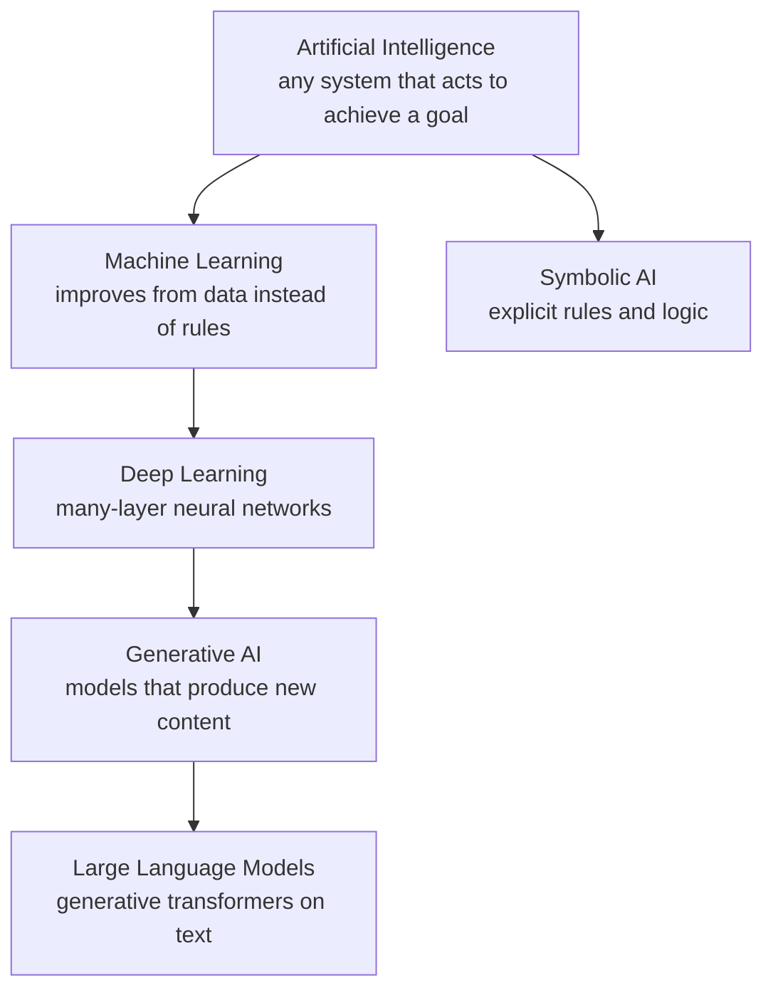

**Reading the diagram.** The containment runs AI ⊃ ML ⊃ DL ⊃ generative models ⊃ LLMs, but the
arrows are not a hierarchy of prestige. Symbolic AI is a sibling of machine learning, not a
predecessor: both are ways of building an AI system, and the course treats hybrid systems as
normal rather than as a compromise. "Generative" describes what a model outputs, "deep" describes
how it is built, and "large" describes its scale — three different axes that marketing often
flattens into one.

**Where to read more.** [L01-01](../modules/M01-introduction-and-foundations/lessons/L01-01-what-is-artificial-intelligence.md),
[L01-03](../modules/M01-introduction-and-foundations/lessons/L01-03-symbolic-statistical-generative.md),
[L11-01](../modules/M11-generative-ai-and-large-language-models/lessons/L11-01-the-generative-modelling-landscape.md)

## 2. Symbolic and connectionist AI

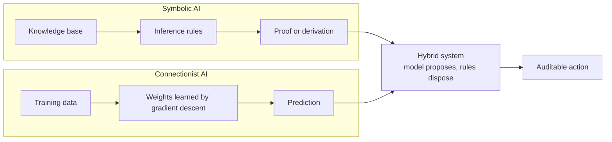

**Reading the diagram.** The two paradigms differ in where the knowledge lives: in sentences that
can be read and edited, or in weights that cannot. Symbolic systems explain by derivation and
break when the world escapes their rules; connectionist systems generalise from examples and
cannot justify a single decision. The hybrid branch is the practical answer in regulated settings:
the model supplies judgement, and a deterministic layer supplies the constraint that must not be
negotiable.

**Where to read more.** [L01-03](../modules/M01-introduction-and-foundations/lessons/L01-03-symbolic-statistical-generative.md),
[L04-07](../modules/M04-knowledge-representation-and-logical-reasoning/lessons/L04-07-rule-based-and-expert-systems.md),
[L14-01](../modules/M14-advanced-ai-applications-and-capstone/lessons/L14-01-ai-in-practice-case-studies-and-hybrid-systems.md)

## 3. Search algorithms

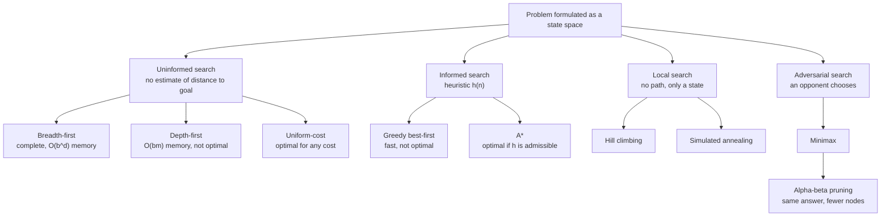

**Reading the diagram.** The first decision is not which algorithm but which *question*: a path to
a goal (uninformed or informed search), a good state without caring about the path (local search),
or a decision against an adversary (minimax). Within informed search, admissibility is what buys
optimality; within adversarial search, pruning changes the cost but not the answer. Memory is the
constraint that usually decides in practice — breadth-first is optimal and unusable on large
graphs for the same reason.

**Where to read more.** Module page only — [M03 Problem Solving and Search](../modules/README.md#m03).
The glossary entries are [A* search](../resources/glossary/classical-ai.md#a-search) and
[admissible heuristic](../resources/glossary/classical-ai.md#admissible-heuristic).

## 4. Machine learning algorithms

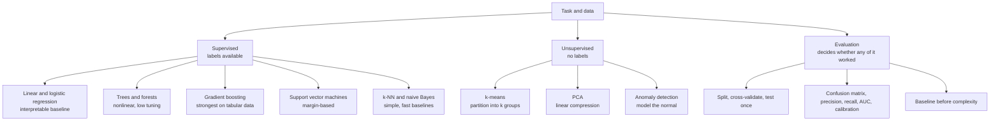

**Reading the diagram.** Algorithm choice follows from the data, not from fashion: labels decide
supervised versus unsupervised, and the shape of the boundary decides linear versus tree-based.
The evaluation branch is drawn as a peer of the algorithm branches because a model without a
baseline, a held-out test set and per-class metrics is not a result. The course's recurring
example — 96% accuracy that is really 40% above a majority-class rule — is the reason that branch
exists.

**Where to read more.** [L06-01](../modules/M06-machine-learning-fundamentals/lessons/L06-01-what-machine-learning-is.md),
[L06-05](../modules/M06-machine-learning-fundamentals/lessons/L06-05-model-evaluation-metrics-and-roc.md),
[L06-08](../modules/M06-machine-learning-fundamentals/lessons/L06-08-trees-forests-boosting-and-svm.md)

## 5. Neural network architectures

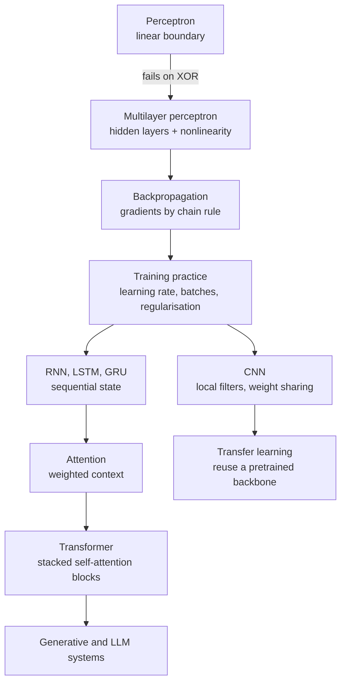

**Reading the diagram.** The chain from perceptron to transformer is driven by two failures: the
perceptron cannot separate XOR, which motivates hidden layers, and recurrence cannot carry long
context efficiently, which motivates attention. Everything after backpropagation is a choice about
*inductive bias* — locality for images, recurrence for sequences, attention for arbitrary
dependencies. Transfer learning sits off the CNN branch because it is a training strategy, not an
architecture.

**Where to read more.** [L07-01](../modules/M07-neural-networks-and-deep-learning/lessons/L07-01-from-perceptron-to-mlp.md),
[L07-02](../modules/M07-neural-networks-and-deep-learning/lessons/L07-02-backpropagation-the-mathematics-of-learning.md),
[L07-07](../modules/M07-neural-networks-and-deep-learning/lessons/L07-07-attention-and-transformers.md)

## 6. NLP and transformers

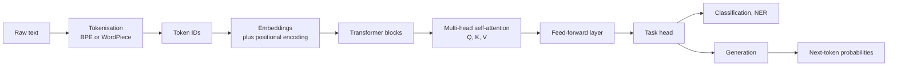

**Reading the diagram.** Text becomes numbers before anything intelligent happens: tokenisation
fixes the vocabulary, embeddings give each token a vector, and positional encodings restore the
order that attention ignores. Inside a block, attention decides *which other tokens matter* and
the feed-forward layer transforms each position. The same stack serves classification, extraction
and generation — only the head and the decoding differ.

**Where to read more.** [L07-07](../modules/M07-neural-networks-and-deep-learning/lessons/L07-07-attention-and-transformers.md),
[L11-02](../modules/M11-generative-ai-and-large-language-models/lessons/L11-02-inside-a-large-language-model.md).
Module page only for the NLP pipeline: [M08](../modules/M08-natural-language-processing/README.md).

## 7. Computer vision

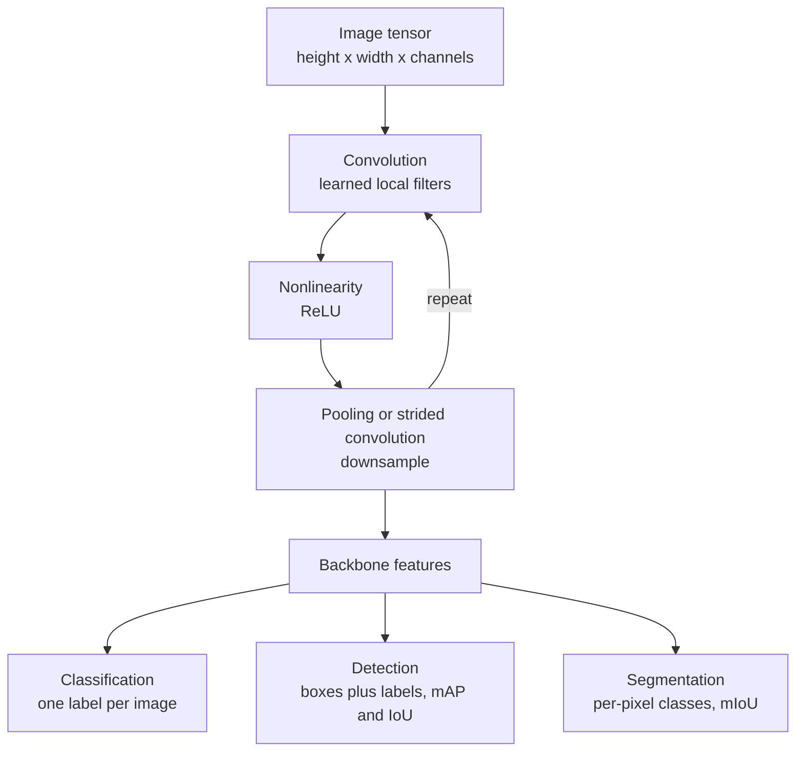

**Reading the diagram.** Vision stacks repeat one motif — convolve, activate, downsample — until
the spatial map is small and semantically rich. The three task heads differ in output granularity:
a label per image, a box per object, or a class per pixel. Evaluation follows the output: accuracy
and per-class recall for classification, IoU and mAP for detection, mIoU for segmentation.

**Where to read more.** [L07-05](../modules/M07-neural-networks-and-deep-learning/lessons/L07-05-convolutional-neural-networks.md).
Module page only for the vision module: [M09](../modules/README.md#m09).

## 8. Generative AI

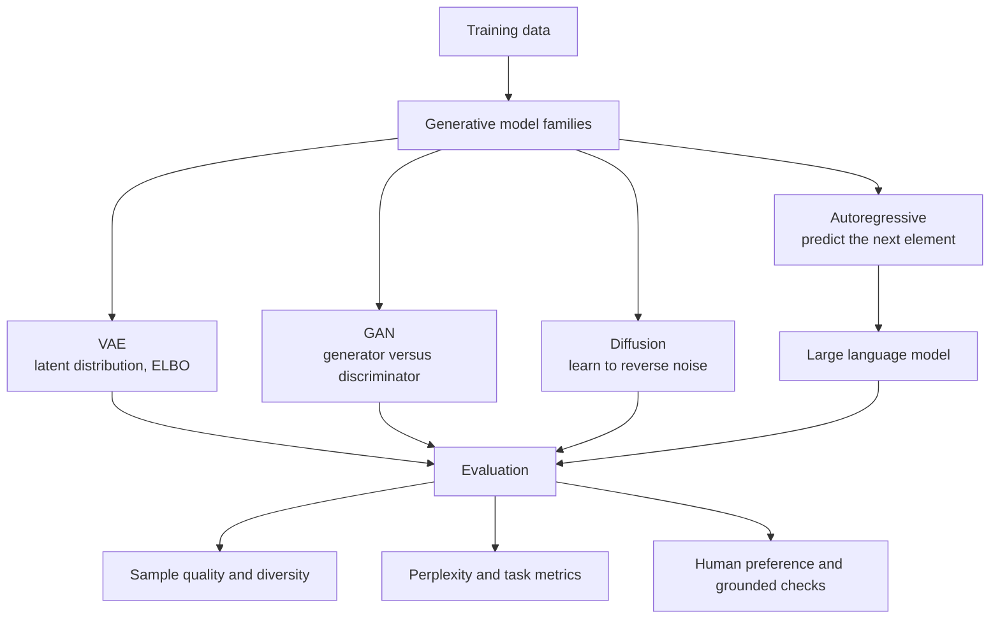

**Reading the diagram.** Four families, four different bets about how to represent a distribution:
a compressed latent space (VAE), an adversarial game (GAN), an iterated denoising process
(diffusion), or a chain of conditional probabilities (autoregressive). Evaluation is drawn once
because the same warning applies to all of them: a good-looking loss curve does not prove the
samples are good, and mode collapse is invisible in the numbers.

**Where to read more.** [L11-01](../modules/M11-generative-ai-and-large-language-models/lessons/L11-01-the-generative-modelling-landscape.md),
[L11-07](../modules/M11-generative-ai-and-large-language-models/lessons/L11-07-evaluating-llm-systems.md)

## 9. LLMs and RAG

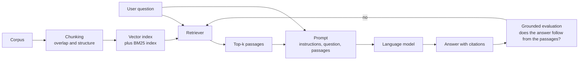

**Reading the diagram.** Retrieval-augmented generation is two systems, not one: a retrieval
pipeline (chunk, embed, index, search) and a generation step that consumes what retrieval returns.
The feedback edge is the important one — when the answer is not supported by the retrieved
passages, the failure is usually retrieval, and no amount of prompting fixes it. That is why the
course evaluates retrieval and answers separately.

**Where to read more.** [L11-05](../modules/M11-generative-ai-and-large-language-models/lessons/L11-05-retrieval-augmented-generation.md),
[L11-07](../modules/M11-generative-ai-and-large-language-models/lessons/L11-07-evaluating-llm-systems.md)

## 10. AI agents and multi-agent systems

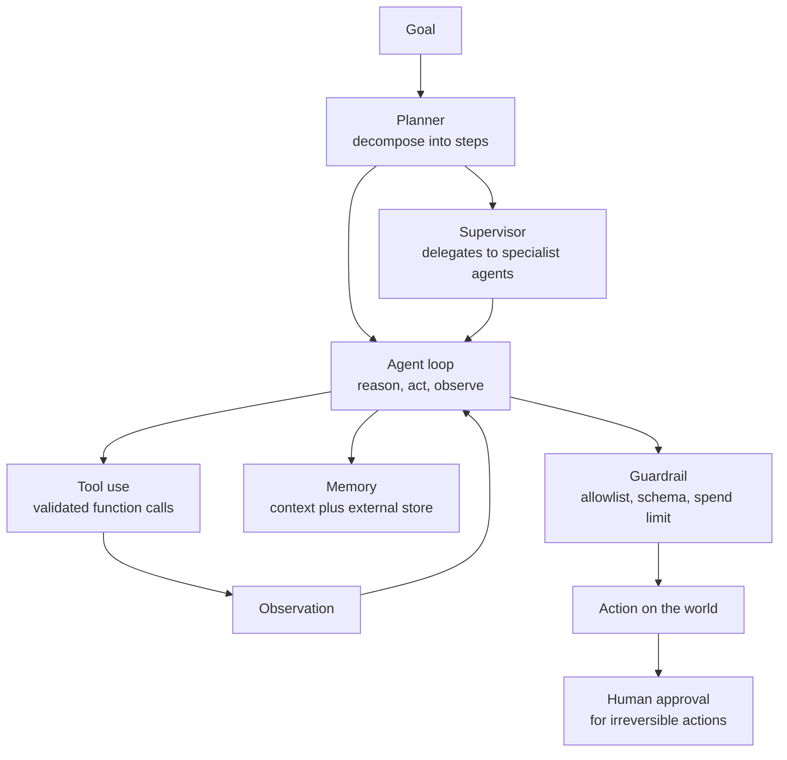

**Reading the diagram.** An agent is a loop with a budget, not a single model call. The planner
decides the shape of the work, the loop executes it, tools and memory extend what the model can
reach, and the guardrail sits between the loop and the world. The multi-agent branch adds
coordination cost: every hand-off is a new failure mode, so specialisation must earn its keep.
Human approval is drawn on the action path, where the risk actually is.

**Where to read more.** Module page only — [M12 AI Agents](../modules/M12-ai-agents-and-agentic-systems/README.md).
Glossary: [agent loop](../resources/glossary/agents.md#agent-loop), [guardrail](../resources/glossary/agents.md#guardrail).

## 11. Responsible and secure AI

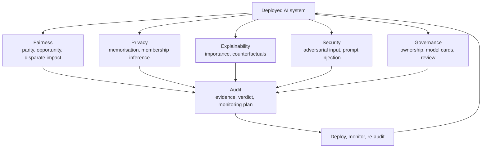

**Reading the diagram.** The five concerns are not a checklist to complete once; they are
properties of a deployed system that decay as the data and the world change. Fairness, privacy,
explanation and security each produce evidence, and governance decides who is accountable for it.
The loop from deployment back to the system is the point: an audit that is not repeated is a
snapshot, not a control.

**Where to read more.** [L13-01](../modules/M13-responsible-explainable-secure-ai/lessons/L13-01-responsible-ai-fairness-and-bias.md),
[L13-04](../modules/M13-responsible-explainable-secure-ai/lessons/L13-04-security-adversarial-examples-and-prompt-injection.md),
[L13-06](../modules/M13-responsible-explainable-secure-ai/lessons/L13-06-auditing-and-responsible-deployment.md)

---

[Course home](../README.md) · [Modules](../modules/README.md) · [Glossary](../resources/glossary.md) ·
[Detailed glossary](../resources/glossary/README.md) · [Resources](../resources/README.md)
