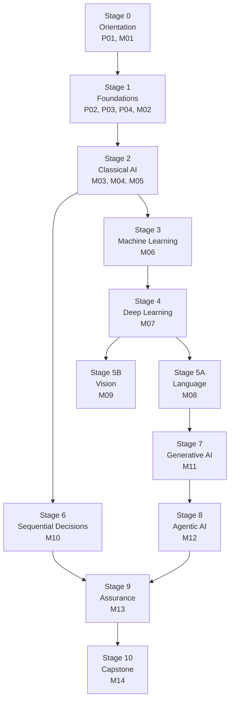

# Curriculum Map — Module Numbering, Lesson Inventory and Learning Progression

This document is the authoritative inventory of the course. It fixes what is taught, in what
order, with which artifacts, and how much study time each part assumes. Any future phase that
adds, splits or reorders content updates this file in the same pass.

Companion documents: [Architecture](ARCHITECTURE.md) (how content is structured),
[Roadmap](IMPLEMENTATION-ROADMAP.md) (when it is built).

---

## 1. Course learning outcomes

| ID | Outcome — on completion the student can |
| :--- | :--- |
| **CLO1** | Explain what artificial intelligence is, how the field evolved, and how agents perceive, decide and act in an environment |
| **CLO2** | Formulate a real problem as a state-space or constraint problem, and select and justify a search strategy with its complexity trade-offs |
| **CLO3** | Represent knowledge in propositional and first-order logic, and derive conclusions by sound inference |
| **CLO4** | Quantify uncertainty with probability, build and query Bayesian networks, and design a fuzzy inference system |
| **CLO5** | Run a complete, leakage-free machine-learning workflow and evaluate models with the right metrics |
| **CLO6** | Build, train, debug and evaluate neural networks for tabular, text and image data |
| **CLO7** | Implement reinforcement-learning and generative systems, and assemble a tool-using AI agent |
| **CLO8** | Audit an AI system for fairness, explainability, privacy and security, and deliver a documented capstone project |

Outcome coverage is the acceptance test for the whole course: every CLO must be taught in at
least one lesson, practised in at least one lab or assignment, and assessed in at least one quiz
or project.

## 2. Structure at a glance

| Track | Sections | Lessons | Hours |
| :--- | :--- | ---: | ---: |
| Prerequisites P01–P04 | 4 | 21 | ≈ 56 |
| Modules M01–M14 | 14 | 93 | 350.7 |
| **Total** | **18** | **114** | **406.7** |

Artifact counts across the full course:

| Artifact | Count |
| :--- | ---: |
| Lessons | 114 |
| Laboratory scenarios | 37 |
| Jupyter notebooks | 35 |
| Programming assignments | 13 |
| Module quizzes (MCQ sets) | 14 |
| Mini-projects | 13 |
| Capstone project briefs | 12 |

## 3. Module summary table

`Level` is the depth of assumed background: 100 = no AI background, 200 = programming plus basic
mathematics, 300 = probability and linear algebra fluency, 400 = the preceding module chain.
`AIMA` refers to *Artificial Intelligence: A Modern Approach*, 4th edition (Russell & Norvig).
Hours are total student effort — guided study, practical work, assessment and project work — not
contact hours. They are estimates for planning, not deadlines. The calculation method is in §3.1.

| ID | Module | Level | Lessons | Labs | NB | Asg | Quiz | MP | Hours | AIMA ch. |
| :--- | :--- | :--- | ---: | ---: | ---: | ---: | :-: | :-: | ---: | :--- |
| M01 | Introduction and Foundations of AI | 100 | 5 | 1 | 1 | — | ✓ | ✓ | 12.8 | 1 |
| M02 | Intelligent Agents and Environments | 200 | 5 | 2 | 2 | 1 | ✓ | ✓ | 17.9 | 2 |
| M03 | Problem Solving and Search Algorithms | 200 | 8 | 3 | 3 | 1 | ✓ | ✓ | 19.9 | 3–6 |
| M04 | Knowledge Representation and Logical Reasoning | 200 | 7 | 2 | 2 | 1 | ✓ | ✓ | 31.6 | 7–10 |
| M05 | Uncertainty, Bayesian Reasoning and Fuzzy Logic | 300 | 7 | 3 | 3 | 1 | ✓ | ✓ | 20.6 | 12–16 |
| M06 | Machine Learning Fundamentals and Algorithms | 300 | 10 | 4 | 4 | 1 | ✓ | ✓ | 31.4 | 19–20 |
| M07 | Artificial Neural Networks and Deep Learning | 300 | 8 | 3 | 3 | 1 | ✓ | ✓ | 24.9 | 21 |
| M08 | Natural Language Processing | 300 | 6 | 2 | 2 | 1 | ✓ | ✓ | 24.3 | 23–24 |
| M09 | Computer Vision | 300 | 6 | 2 | 2 | 1 | ✓ | ✓ | 26.8 | 25 |
| M10 | Reinforcement Learning | 400 | 7 | 3 | 3 | 1 | ✓ | ✓ | 34.1 | 22 |
| M11 | Generative AI and Large Language Models | 400 | 7 | 3 | 2 | 1 | ✓ | ✓ | 23.3 | 24 + current literature |
| M12 | AI Agents and Agentic AI Systems | 400 | 6 | 2 | 1 | 1 | ✓ | ✓ | 27.8 | — (current literature) |
| M13 | Responsible, Explainable and Secure AI | 300 | 6 | 2 | 1 | 1 | ✓ | ✓ | 22.4 | 27 |
| M14 | Advanced AI Applications and Capstone Projects | 400 | 5 | — | — | 1 | ✓ | — | 32.9 | 26–28 |
| | **Totals** | | **93** | **32** | **29** | **13** | **14** | **13** | **350.7** | |

### 3.1 How the hour totals are calculated

One method, used by every table in this repository:

1. **Unit.** One hour is one hour of total student effort at the stated level, not a
   fifty-minute contact hour. Contact hours are not tracked, because the course is self-study
   and no timetable exists.
2. **Four components.** Each module page publishes its own breakdown: **guided** (lesson
   reading plus the worked examples), **practical** (labs, coding exercises and hands-on
   notebook work), **assessment** (quizzes, assignments and self-assessment) and **project**
   (mini-project or capstone work). A module total is the sum of those four numbers.
3. **Module total.** Sum of the published components on that module's page. Totals below are
   the exact published values, which is why they carry one decimal.
4. **Programme total.** Prerequisite sections (P01 14 + P02 24 + P03 10 + P04 8 = 56 h) plus
   all fourteen module totals (350.7 h) = **406.7 h**.
5. **Study paths.** A path total is the sum of the full module totals it includes, plus an
   explicit share of the prerequisite sections. The core path takes P01 in full (14 h) and
   50% of P02–P04 (21 h) as a planning assumption for "the essentials"; that assumption is
   stated because the repository does not record per-lesson prerequisite hours. Reusing a
   different share changes the core-path total, not the module totals.
6. **Rounding.** Module and component figures are exact to one decimal. Path and programme
   totals are rounded to the nearest hour for display; the unrounded total is quoted in §7.

No hours are double-counted: a lab's time sits in `practical`, its report mark in `assessment`,
and project time only in `project`. The earlier design budgets (318 h for modules, 374 h total)
were estimates made before the labs and projects were written; they are superseded by the
measured figures above and are no longer used anywhere in the course.

## 4. Prerequisite track (P01–P04)

Prerequisites are **remediation, not gatekeeping**. Each section states what a student must be able
to *do* before a module assumes it, and each later module links to the exact lesson that supplies it.
Lessons marked *(essential)* are the minimum for the core study path. Each section also ships a
notebook students run and a lab they build; they are listed after the lessons.

### P01 — Python Programming for AI · 14 h · 6 lessons

| ID | Lesson |
| :--- | :--- |
| LP01-01 | Setting Up Python and Jupyter *(essential)* |
| LP01-02 | Variables, Types, Operators and Expressions *(essential)* |
| LP01-03 | Conditionals, Loops, Comprehensions and Lambda *(essential)* |
| LP01-04 | Functions and Collections *(essential)* |
| LP01-05 | Objects, Modules, Exceptions and Files *(essential)* |
| LP01-06 | NumPy, pandas and Plotting *(essential)* |

Notebooks: `NB-P01-01` Python fundamentals, `NB-P01-02` NumPy, pandas and plotting.
Lab: `LAB-P01-01` Student Results Analysis.

### P02 — Mathematics for AI · 24 h · 5 lessons

| ID | Lesson |
| :--- | :--- |
| LP02-01 | Scalars, Vectors, Matrices, Tensors and Dot Products *(essential)* |
| LP02-02 | Matrix Operations and Matrix Multiplication *(essential)* |
| LP02-03 | Transpose, Inverse and Eigenvalues *(essential)* |
| LP02-04 | Derivatives, Partial Derivatives and Gradients *(essential)* |
| LP02-05 | Optimisation Fundamentals *(essential)* |

Notebooks: `NB-P02-01` linear algebra, `NB-P02-02` calculus and optimisation.
Labs: `LAB-P02-01` An Image Is a Matrix, `LAB-P02-02` Gradient Descent by Hand.

### P03 — Probability and Statistics · 10 h · 6 lessons

| ID | Lesson |
| :--- | :--- |
| LP03-01 | Descriptive Statistics *(essential)* |
| LP03-02 | Probability Rules and Conditional Probability *(essential)* |
| LP03-03 | Bayes' Theorem *(essential)* |
| LP03-04 | Random Variables and Distributions |
| LP03-05 | Sampling, Covariance and Correlation |
| LP03-06 | Hypothesis Testing Fundamentals |

Notebook: `NB-P03-01` probability and statistics. Lab: `LAB-P03-01` Exam Score Report.

### P04 — Data Preparation and Visualisation · 8 h · 4 lessons

| ID | Lesson |
| :--- | :--- |
| LP04-01 | Dataset Structures, CSV and JSON *(essential)* |
| LP04-02 | Missing Values and Duplicates *(essential)* |
| LP04-03 | Outliers, Normalisation and Standardisation *(essential)* |
| LP04-04 | Visualisation and Exploratory Data Analysis *(essential)* |

Notebook: `NB-P04-01` data preparation. Lab: `LAB-P04-01` Messy Survey Cleanup.

Diagnostic: `prerequisites/diagnostic.md`, a 40-question self-assessment covering all four sections.

## 5. Module inventory

Each module lists its lesson inventory and the artifacts that accompany it. Labs, notebooks,
assignments and mini-projects carry the IDs defined in
[Architecture §4](ARCHITECTURE.md#4-naming-and-numbering-scheme).

### M01 — Introduction and Foundations of AI · 10 h · Level 100

*Outcomes: CLO1. Prerequisites: none.*

| ID | Lesson |
| :--- | :--- |
| L01-01 | What Is Artificial Intelligence? Definitions, Goals and Myths |
| L01-02 | A Brief History of AI and the AI Winters |
| L01-03 | The Many Faces of AI: Symbolic, Statistical and Generative |
| L01-04 | What AI Can and Cannot Do Today |
| L01-05 | How This Course Works: Tools, Workflow and Study Habits |

Artifacts: `LAB-01-01` AI myth-busting investigation · `NB-01-01` first notebook and environment
check · `QUIZ-01` · `MP-01` AI-in-your-field use-case audit.

### M02 — Intelligent Agents and Environments · 18 h · Level 200

*Outcomes: CLO1. Prerequisites: P01 (essential).*

| ID | Lesson |
| :--- | :--- |
| L02-01 | Agents, Percepts, Actions and the Agent–Environment Boundary |
| L02-02 | Rationality and the PEAS Description |
| L02-03 | Properties of Task Environments |
| L02-04 | Agent Architectures: Reflex, Model-Based, Goal-Based, Utility-Based |
| L02-05 | Learning Agents and the Agent Design Space |

Artifacts: `LAB-02-01` design a PEAS specification for a real deployment · `LAB-02-02` build a
reflex agent in a gridworld · `NB-02-01` agent loop, `NB-02-02` environment comparison ·
`ASG-02` rational agent in a stochastic world · `QUIZ-02` · `MP-02` vacuum-world tournament.

### M03 — Problem Solving and Search Algorithms · 26 h · Level 200

*Outcomes: CLO2. Prerequisites: P01 (essential), M02 (recommended), P02 (essential for complexity notation).*

| ID | Lesson |
| :--- | :--- |
| L03-01 | Formulating a Problem as a Search Problem |
| L03-02 | Uninformed Search: BFS, DFS and Iterative Deepening |
| L03-03 | Uniform-Cost Search and the Price of Optimality |
| L03-04 | Heuristics and Greedy Best-First Search |
| L03-05 | A\* Search: Admissibility, Consistency and Optimality |
| L03-06 | Local Search: Hill Climbing, Simulated Annealing, Beam Search |
| L03-07 | Adversarial Search: Minimax and Alpha–Beta Pruning |
| L03-08 | Constraint Satisfaction Problems and Backtracking Search |

Artifacts: `LAB-03-01` campus route planning under real constraints · `LAB-03-02` puzzle solver
benchmark · `LAB-03-03` game-playing agent · `NB-03-01`–`03` search visualisation and benchmarks ·
`ASG-03` A\* with a designed heuristic · `QUIZ-03` · `MP-03` maze-solving competition.

### M04 — Knowledge Representation and Logical Reasoning · 21 h · Level 200

*Outcomes: CLO3. Prerequisites: P02 (essential), M03 (recommended).*

| ID | Lesson |
| :--- | :--- |
| L04-01 | Why Symbolic Knowledge Representation Still Matters |
| L04-02 | Propositional Logic: Syntax and Semantics |
| L04-03 | Propositional Inference: Truth Tables, Chaining and Resolution |
| L04-04 | First-Order Logic: Objects, Relations and Quantifiers |
| L04-05 | Inference in First-Order Logic: Unification and Resolution |
| L04-06 | Knowledge Graphs, Ontologies and Semantic Resources |
| L04-07 | Rule-Based and Expert Systems — and Their Limits |

Artifacts: `LAB-04-01` course-eligibility rule engine · `LAB-04-02` knowledge graph for a domain ·
`NB-04-01` truth-table and resolution engine, `NB-04-02` forward-chaining engine ·
`ASG-04` mini inference engine · `QUIZ-04` · `MP-04` small expert system.

### M05 — Uncertainty, Bayesian Reasoning and Fuzzy Logic · 24 h · Level 300

*Outcomes: CLO4. Prerequisites: P04 (essential), P03 (recommended), M04 (recommended).*

| ID | Lesson |
| :--- | :--- |
| L05-01 | Why Certainty Is Unavailable: Quantifying Uncertainty |
| L05-02 | Conditional Probability, Independence and Bayes' Rule |
| L05-03 | Bayesian Networks: Representation and Semantics |
| L05-04 | Exact Inference in Bayesian Networks |
| L05-05 | Reasoning over Time: Markov Chains and Hidden Markov Models |
| L05-06 | Fuzzy Sets, Membership Functions and Fuzzy Inference |
| L05-07 | Decision Theory: Utility and Expected Utility |

Artifacts: `LAB-05-01` diagnosis under uncertainty · `LAB-05-02` fuzzy controller · `LAB-05-03`
Bayesian network for a real risk assessment · `NB-05-01`–`03` · `ASG-05` build a small Bayesian
network and inference routine · `QUIZ-05` · `MP-05` fuzzy irrigation controller.

### M06 — Machine Learning Fundamentals and Algorithms · 31 h · Level 300

*Outcomes: CLO5. Prerequisites: P02, P03, P04 (essential), M05 (recommended).*

| ID | Lesson |
| :--- | :--- |
| L06-01 | What Machine Learning Is — and What It Is Not |
| L06-02 | Data Preparation, Splitting and Leakage |
| L06-03 | Linear Regression from First Principles |
| L06-04 | Classification with Logistic Regression |
| L06-05 | Model Evaluation: Metrics, Confusion Matrices and ROC |
| L06-06 | Bias–Variance, Regularisation and Generalisation |
| L06-07 | k-Nearest Neighbours and Naïve Bayes |
| L06-08 | Decision Trees, Random Forests, Boosting and Support Vector Machines |
| L06-09 | Unsupervised Learning: k-Means, PCA and Dimensionality Reduction |
| L06-10 | Building a Reproducible Machine-Learning Pipeline |

Artifacts: `LAB-06-01` tabular prediction end-to-end · `LAB-06-02` model comparison study ·
`LAB-06-03` customer segmentation · `LAB-06-04` leakage hunt · `NB-06-01`–`04` ·
`ASG-06` complete ML pipeline with report · `QUIZ-06` · `MP-06` prediction challenge.

### M07 — Artificial Neural Networks and Deep Learning · 27 h · Level 300

*Outcomes: CLO6. Prerequisites: P02 (essential), M06 (essential).*

| ID | Lesson |
| :--- | :--- |
| L07-01 | From the Perceptron to the Multilayer Perceptron |
| L07-02 | Backpropagation: The Mathematics of Learning |
| L07-03 | Training in Practice: Initialisation, Optimisers, Learning Rates |
| L07-04 | Regularisation, Dropout and Diagnosing a Deep Network |
| L07-05 | Convolutional Neural Networks |
| L07-06 | Sequence Models: RNN, LSTM and GRU |
| L07-07 | Attention and the Transformer Architecture |
| L07-08 | Transfer Learning with Pretrained Models |

Artifacts: `LAB-07-01` implement a neural network from scratch · `LAB-07-02` train and debug a
classifier · `LAB-07-03` fine-tune a pretrained model · `NB-07-01`–`03` · `ASG-07` deep model
with an ablation study · `QUIZ-07` · `MP-07` image classifier sprint.

### M08 — Natural Language Processing · 22 h · Level 300

*Outcomes: CLO6, CLO7. Prerequisites: M07 (essential), P04 (recommended).*

| ID | Lesson |
| :--- | :--- |
| L08-01 | Text as Data: Normalisation, Tokenisation and Subwords |
| L08-02 | Classical NLP: Bag of Words, TF-IDF and n-Gram Models |
| L08-03 | Word Embeddings: From word2vec to Contextual Vectors |
| L08-04 | Sequence Labelling and Text Classification |
| L08-05 | Transformer-Based NLP: Encoders and Fine-Tuning |
| L08-06 | Evaluating, Auditing and Operating NLP Pipelines |

Artifacts: `LAB-08-01` sentiment analysis comparison · `LAB-08-02` named-entity extraction ·
`NB-08-01`–`02` · `ASG-08` text classifier with error analysis · `QUIZ-08` ·
`MP-08` Urdu/English text classifier.

### M09 — Computer Vision · 22 h · Level 300

*Outcomes: CLO6. Prerequisites: M07 (essential), P03 (recommended).*

| ID | Lesson |
| :--- | :--- |
| L09-01 | Digital Images, Colour and Convolution |
| L09-02 | Classical Computer Vision: Edges, Features and Descriptors |
| L09-03 | CNN Architectures for Vision |
| L09-04 | Object Detection and Semantic Segmentation |
| L09-05 | Data Augmentation and Transfer Learning for Vision |
| L09-06 | Robustness, Bias and Responsible Vision Systems |

Artifacts: `LAB-09-01` image classifier end-to-end · `LAB-09-02` detection on a small dataset ·
`NB-09-01`–`02` · `ASG-09` vision pipeline with robustness testing · `QUIZ-09` ·
`MP-09` visual inspection prototype.

### M10 — Reinforcement Learning · 25 h · Level 400

*Outcomes: CLO7. Prerequisites: M05 (essential, MDP section), M06 (essential), P02, P03 (essential).*

| ID | Lesson |
| :--- | :--- |
| L10-01 | Reinforcement Learning: The Interaction Loop |
| L10-02 | Markov Decision Processes, Returns and Discounting |
| L10-03 | Dynamic Programming: Policy and Value Iteration |
| L10-04 | Model-Free Learning: Monte Carlo, TD, SARSA and Q-Learning |
| L10-05 | Deep Reinforcement Learning: DQN and Function Approximation |
| L10-06 | Policy Gradients and Actor–Critic Methods |
| L10-07 | Reward Design, Evaluation and the Pitfalls of RL |

Artifacts: `LAB-10-01` gridworld with Q-learning · `LAB-10-02` environment design and reward
shaping · `LAB-10-03` DQN on a small control task · `NB-10-01`–`03` · `ASG-10` agent with a
learning-curve study · `QUIZ-10` · `MP-10` inventory-control agent.

### M11 — Generative AI and Large Language Models · 24 h · Level 400

*Outcomes: CLO7. Prerequisites: M07 (essential, attention), M08 (essential), P04 (recommended).*

| ID | Lesson |
| :--- | :--- |
| L11-01 | The Generative Modelling Landscape: Autoregressive, VAE, GAN, Diffusion |
| L11-02 | Inside a Large Language Model: Tokens, Attention, Next-Token Prediction |
| L11-03 | Pretraining, Instruction Tuning and Preference Alignment |
| L11-04 | Prompt Engineering and In-Context Learning |
| L11-05 | Retrieval-Augmented Generation |
| L11-06 | Fine-Tuning and Parameter-Efficient Adaptation |
| L11-07 | Evaluating LLM Systems: Quality, Hallucination, Cost and Safety |

Artifacts: `LAB-11-01` prompt engineering laboratory · `LAB-11-02` build a retrieval-augmented
assistant · `LAB-11-03` evaluation harness · `NB-11-01`–`02` · `ASG-11` RAG system with an
evaluation report · `QUIZ-11` · `MP-11` domain question-answering assistant.
All hosted-API work has an offline alternative (see Architecture §13).

### M12 — AI Agents and Agentic AI Systems · 19 h · Level 400

*Outcomes: CLO7. Prerequisites: M11 (essential), M02 (essential).*

| ID | Lesson |
| :--- | :--- |
| L12-01 | From Language Model to Agent: The Perception–Reason–Act Loop |
| L12-02 | Tool Use, Function Calling and Structured Outputs |
| L12-03 | Planning, Memory and Task Decomposition |
| L12-04 | Multi-Agent Systems and Orchestration Patterns |
| L12-05 | Guardrails, Permissions, Sandboxing and Observability |
| L12-06 | Evaluating and Hardening Agentic Systems |

Artifacts: `LAB-12-01` tool-using agent with a fixed tool set · `LAB-12-02` red-team an agent ·
`NB-12-01` agent loop · `ASG-12` agent with logging and evaluation · `QUIZ-12` ·
`MP-12` research assistant agent.

### M13 — Responsible, Explainable and Secure AI · 19 h · Level 300

*Outcomes: CLO8. Prerequisites: M06 (essential), M07 or M11 (recommended).*

| ID | Lesson |
| :--- | :--- |
| L13-01 | Fairness and Bias: Measurement and Mitigation |
| L13-02 | Explainability and Interpretability |
| L13-03 | Privacy, Memorisation and Data Protection |
| L13-04 | Security: Adversarial Inputs, Poisoning and Prompt Injection |
| L13-05 | Governance, Regulation and Professional Responsibility |
| L13-06 | Auditing an AI System: A Practical Checklist |

Artifacts: `LAB-13-01` fairness audit of a classifier · `LAB-13-02` adversarial and prompt-injection
testing · `NB-13-01` explainability toolkit · `ASG-13` model card and audit report · `QUIZ-13` ·
`MP-13` ethics review board simulation.

### M14 — Advanced AI Applications and Capstone Projects · 30 h · Level 400

*Outcomes: CLO8. Prerequisites: the modules named by the chosen capstone brief.*

| ID | Lesson |
| :--- | :--- |
| L14-01 | AI in Practice: Case Studies in Health, Education, Finance and Agriculture |
| L14-02 | From Model to Product: MLOps and the Serving Lifecycle |
| L14-03 | Monitoring, Drift and Continuous Evaluation |
| L14-04 | Reading and Reproducing AI Research |
| L14-05 | Capstone Studio: Scoping, Milestones, Rubric and Presentation |

Artifacts: `ASG-14` capstone proposal · `capstone/` studio (12 project briefs, milestone guides,
rubric, report template) · `QUIZ-14`.

## 6. Learning progression

Content is released in stages. A **gate** is the evidence a student should produce before moving
on; it is self-checked, not enforced by the repository.

*Text description of the diagram:* orientation leads to foundations; foundations lead to the
classical-AI trio (search, logic, uncertainty); from classical AI the path continues to machine
learning and then deep learning; deep learning branches into language and vision; classical AI
also feeds reinforcement learning, which converges with language/vision work into generative AI
and then agentic AI; assurance (M13) draws on agentic AI and reinforcement learning; the capstone
is last.

| Stage | Units | Gate — the student can |
| :--- | :--- | :--- |
| 0 Orientation | P01, M01 | Write and run a Python script and a notebook; define an agent in their own words |
| 1 Foundations | P02, P03, P04, M02 | Manipulate vectors and matrices in NumPy; compute a posterior; clean a table; describe an environment with PEAS |
| 2 Classical AI | M03, M04, M05 | Solve a new problem with a justified search strategy; derive a conclusion in first-order logic; compute a posterior with Bayes' rule |
| 3 Machine Learning | M06 | Run a leakage-free pipeline and defend its metric choice |
| 4 Deep Learning | M07 | Implement one epoch of backpropagation by hand, then train a model that beats a baseline |
| 5A/5B Perception | M08, M09 | Fine-tune a text model and an image model and explain their errors |
| 6 Sequential decisions | M10 | Explain the difference between value iteration and Q-learning with a working example |
| 7 Generative AI | M11 | Build a retrieval-augmented system and measure its faithfulness |
| 8 Agentic AI | M12 | Build a tool-using agent with logging and a working guardrail |
| 9 Assurance | M13 | Produce a model card and a fairness/security audit of their own model |
| 10 Capstone | M14 | Deliver a documented, reproducible AI project and defend its limitations |

## 7. Study paths

| Path | Composition | Effort |
| :--- | :--- | ---: |
| **Core (one semester, 3 credits)** | P01 + essentials of P02–P04 → M01–M06 | ≈ 169 h |
| **Core plus deep learning** | Core → M07 | ≈ 194 h |
| **Full programme (two semesters)** | All prerequisites and all 14 modules | ≈ 407 h |
| **Specialisation: NLP & Generative AI** | Core + M07 → M08 → M11 → M12 | ≈ 270 h |
| **Specialisation: Vision** | Core + M07 → M09 → full M13 | ≈ 243 h |
| **Specialisation: Decision systems** | Core + M07 → M10 → M12 | ≈ 256 h |
| **Responsible AI emphasis** | Core + M07 → full M13 → M12 → M11 | ≈ 268 h |

**How each path total is obtained** (same method as §3.1):

- Core = P01 14 + 50% of P02–P04 21 + M01–M06 (12.8 + 17.9 + 19.9 + 31.6 + 20.6 + 31.4
  = 134.2) = **169.2 h**.
- Core plus deep learning = 169.2 + M07 24.9 = **194.1 h**.
- Full programme = prerequisites 56 + modules 350.7 = **406.7 h**.
- NLP & Generative AI = 194.1 + M08 24.3 + M11 23.3 + M12 27.8 = **269.5 h**.
- Vision = 194.1 + M09 26.8 + M13 22.4 = **243.3 h**.
- Decision systems = 194.1 + M10 34.1 + M12 27.8 = **256.0 h**.
- Responsible AI = 194.1 + M13 22.4 + M12 27.8 + M11 23.3 = **267.6 h**.

Every module total in this table is the published figure on that module's page. Nothing here is
a design estimate, and no figure depends on the retired 318/374 budgets.

The core path is defined by the *(essential)* markers in §4 and by the modules listed above.
Students following the core path should be told plainly which lessons they are skipping and what
that omission costs them.

## 8. Assessment model

| Component | Weight | Artifacts |
| :--- | ---: | :--- |
| Module quizzes | 10% | 14 MCQ sets, self-marked |
| Laboratories | 25% | 37 scenario labs (5 prerequisite, 32 module) |
| Programming assignments | 25% | 13 assignments |
| Mini-projects | 15% | 13 mini-projects |
| Capstone | 25% | 1 project, staged milestones |

Every graded artifact is assessed on the same six dimensions, so a student can predict the
feedback they will receive:

| Dimension | What earns marks |
| :--- | :--- |
| Correctness | The system does what the brief asks, on the specified inputs |
| Understanding | The report explains *why* it works, including the mathematics |
| Code quality | Readable, modular, typed where it matters, PEP 8, no dead code |
| Evaluation | Appropriate metrics, a baseline, and honest error analysis |
| Communication | Clear structure, labelled figures, reproducible instructions |
| Responsibility | Limitations, bias, privacy and security considered and stated |

## 9. Module dependencies

`H` = hard dependency (the module cannot be studied without it). `S` = soft dependency
(strongly recommended; the module is readable but harder without it).

| Module | Hard prerequisites | Soft prerequisites | Depends on it |
| :--- | :--- | :--- | :--- |
| P01 | — | — | M01–M14 (all coding), M02 H |
| P02 | — | — | M03 H, M04 H, M06 H, M07 H, M10 H |
| P03 | P02 S | — | M05 H, M06 H, M10 H, M11 S |
| P04 | P01 S | — | M06 H, M08 S, M09 S, M14 S |
| M01 | — | — | M02 S |
| M02 | P01 H | M01 S | M03 S, M12 H |
| M03 | P01 H, P02 H | M02 S | M04 S, M10 S, M14 S |
| M04 | P02 H | M03 S | M05 S, M14 S |
| M05 | P03 H | M04 S, P02 S | M06 S, M10 H |
| M06 | P02 H, P03 H, P04 H | M05 S | M07 H, M13 H, M14 S |
| M07 | M06 H, P02 H | — | M08 H, M09 H, M11 H, M13 S |
| M08 | M07 H | P04 S | M11 H, M14 S |
| M09 | M07 H | P02 S, P04 S | M14 S |
| M10 | M06 H, M05 H, P02 H, P03 H | M03 S | M12 S, M13 S |
| M11 | M07 H, M08 H | P04 S | M12 H, M13 S, M14 S |
| M12 | M11 H, M02 H | M10 S | M14 S |
| M13 | M06 H | M07 S, M11 S, M10 S | M14 H |
| M14 | M13 H + the modules its brief names | M08, M09, M10, M12 S | — |

**Critical path:** `P01 → M06 → M07 → M08 → M11 → M12 → M14`. Any delay in the machine-learning
and deep-learning modules (M06, M07) delays every applied module after them, which is why the
roadmap schedules them early relative to their position in the reading order.

## 10. Design commitments that follow from this map

1. **No prerequisite is assumed without a named source.** Every "prerequisites" block links to
   the specific lesson that supplies the knowledge.
2. **Every CLO is assessed.** Mapping is tracked in §1 and checked at the end of the build.
3. **Numbers are honest.** The counts in §2 and §3 are the plan; a phase that cannot meet them
   reports the shortfall rather than silently shrinking scope.
4. **Nothing is published as complete until it exists.** No module directory appears before its
   lessons are written (see [Architecture §10](ARCHITECTURE.md#10-content-quality-and-validation-standards)).
