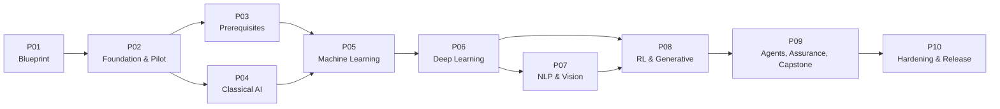

# Implementation Roadmap

This document sequences the build. Phase 01 produced the blueprint; Phases 02–10 produce the
course. Each phase is a reviewable increment that ends with a gate the instructor can accept or
send back.

**Rules that apply to every phase**

- No commit, push, pull or merge. No GitHub Actions workflow. No GitHub Pages configuration.
- No placeholder or stub content: a directory is created only when its content exists.
- Every phase ends with `tools/validate.py` passing and a short written summary.
- Work stays inside the repository; existing content is inspected before being changed.
- The instructor approves each phase summary before the next phase starts.

---

## Phase overview

| Phase | Title | Units produced | Modules / units delivered | Gate (exit criteria) |
| :--- | :--- | ---: | :--- | :--- |
| **01** | Audit and Architecture | — | Governance documents, templates | ✅ Accepted when the instructor approves this blueprint |
| **02** | Foundation and Pilot | ≈ 40 | Infrastructure, P01, M01, M02, course pages | Pilot module proves the templates end-to-end; a student can start the course |
| **03** | Prerequisites Complete | ≈ 44 | P01, P02, P03, P04 | Prerequisite track is self-sufficient; the diagnostic routes a student to the right section |
| **04** | Classical AI Core | ≈ 49 | M03, M04, M05 | CLO2–CLO4 assessable; the largest technical module (M03) is complete |
| **05** | Machine Learning | ≈ 25 | M06 + its datasets | CLO5 assessable on real tabular data |
| **06** | Deep Learning | ≈ 18 | M07 | CLO6 partially assessable; CPU-trainable models demonstrated |
| **07** | Language and Vision | ≈ 27 | M08, M09 | CLO6 complete; two applied perception modules shipped |
| **08** | Interaction and Generation | ≈ 32 | M10, M11 | CLO7 complete; offline alternatives verified for all hosted-API lessons |
| **09** | Agents, Assurance, Capstone | ≈ 44 | M12, M13, M14, capstone studio | CLO8 complete; every CLO taught, practised and assessed |
| **10** | Hardening and Release | ≈ 19 | Glossary, resources, FAQ, cross-cutting sweeps | Full-repository validation, accessibility and usability pass |

Units are a relative effort measure (lesson = 1, notebook = 1, lab = 1.5, assignment = 2,
quiz = 0.5, module page = 0.5). The course totals roughly **290 units**, which is why it is
phased rather than attempted in one pass. Calendar dates are the instructor's decision; the
sequence is not.

## Phase 02 — Foundation and Pilot

**Purpose:** prove the whole system on a small, complete slice before committing to 90 lessons.

**Scope**

1. **Tooling and governance** — `tools/validate.py` (V01–V14), `tools/check_links.py`,
   `tools/new_lesson.py`, `tools/strip_notebooks.py`; `docs/STYLE-GUIDE.md`,
   `docs/VALIDATION.md`, `docs/DECISIONS.md` (recording D1–D6 from the audit).
2. **Course pages** — student homepage (`README.md` rewritten as the real entry page),
   `modules/README.md` (progression map), `instructor/README.md` (About the Instructor),
   `instructor/course-info.md` (About the Course: outcomes, schedule, assessment, policy),
   `prerequisites/README.md` (which unit do I need?), `datasets/README.md` (index),
   `glossary/README.md` + seed entries for M01–M02 and P01.
3. **P01 Python** — 6 lessons, 2 notebooks, 1 lab.
4. **M01** — 5 lessons, 1 notebook, 1 lab, 1 quiz, 1 mini-project.
5. **M02** — 5 lessons, 2 notebooks, 2 labs, 1 assignment, 1 quiz, 1 mini-project.
6. **Git initialisation** — only with explicit authorisation (D6).

**Exit criteria**

- A student with no AI background can read M01, run every notebook, complete LAB-02-02 and score
  the M02 quiz using nothing but the repository.
- `validate.py` reports zero errors across the repository.
- Templates are confirmed or amended: any template change discovered during the pilot is made
  now, before 90 lessons inherit it.
- Both reviewer passes completed for P01, M01 and M02.

**Risk:** template churn after the pilot. Mitigation: the pilot is deliberately the phase where
friction is expected and templates may change.

## Phase 03 — Prerequisites Complete

**Scope:** P01 (6 lessons), P02 (5), P03 (6), P04 (4); 6 notebooks; 5 labs;
`prerequisites/diagnostic.md`, a 40-question self-assessment across all four sections.

**Exit criteria**

- Every prerequisite claim made in M01–M14 has a real target.
- The diagnostic routes a student to the right section, with a scoring guide.
- Mathematical notation across P02 and P03 is consistent (one symbol table convention, one notation).
- Every notebook executes top to bottom with no output committed, and every link resolves.

**Dependency:** needs Phase 02's tooling only.

## Phase 04 — Classical AI Core

**Scope:** M03 (8 lessons, 3 notebooks, 3 labs, 1 assignment, 1 quiz, 1 mini-project), M04 (7, 2, 2,
1, 1, 1), M05 (7, 3, 3, 1, 1, 1). Plus datasets: graph/route data, puzzle instances, a small
diagnosis network.

**Exit criteria**

- CLO2, CLO3 and CLO4 each have a lesson, a lab and a quiz question set.
- Search complexity claims are verified by benchmark notebooks, not asserted.
- Every Bayesian example is reproducible by hand: the worked example's numbers match the code.

**Risk:** M03 is where students quit. Mitigation: the search visualisation notebook and the
three labs are prioritised over optional depth in L03-06/L03-08.

## Phase 05 — Machine Learning

**Scope:** M06 (10 lessons, 4 notebooks, 4 labs, 1 assignment, 1 quiz, 1 mini-project) and the
tabular datasets it uses, each with a data dictionary.

**Exit criteria**

- CLO5 assessable end-to-end on at least two real datasets.
- Leakage lab (LAB-06-04) demonstrably catches a planted leak.
- Every metric taught has a worked numeric example a student can recompute.

## Phase 06 — Deep Learning

**Scope:** M07 (8 lessons, 3 notebooks, 3 labs, 1 assignment, 1 quiz, 1 mini-project). Framework
scope confirmed by decision D3.

**Exit criteria**

- The from-scratch network in LAB-07-01 trains in under 60 s on CPU and matches a NumPy reference.
- Backpropagation is derived by hand in L07-02 and verified numerically (gradient check).
- Pretrained-model lessons state download size and an offline fallback.

## Phase 07 — Language and Vision

**Scope:** M08 (6, 2, 2, 1, 1, 1) and M09 (6, 2, 2, 1, 1, 1).

**Exit criteria**

- Both modules' evaluation lessons include an error-analysis workflow, not just a score.
- Model downloads are optional: each notebook runs with a small local model or cached fixture.
- CLO6 fully covered.

## Phase 08 — Interaction and Generation

**Scope:** M10 (7, 3, 3, 1, 1, 1) and M11 (7, 2, 3, 1, 1, 1).

**Exit criteria**

- Every RL notebook trains a working agent in under 60 s.
- Every M11 hosted-API lesson has a verified offline alternative (§13 of the architecture).
- Cost, safety and hallucination measurement are taught as engineering, not as warnings.
- CLO7 fully covered.

## Phase 09 — Agents, Assurance and Capstone

**Scope:** M12 (6, 1, 2, 1, 1, 1), M13 (6, 1, 2, 1, 1, 1), M14 (5 lessons, 1 assignment, 1 quiz),
and the `capstone/` studio: 12 briefs, 4 milestone guides, rubric, report template.

**Exit criteria**

- CLO8 complete; every CLO is taught, practised and assessed (traceability table verified).
- The 12 capstone briefs map to distinct modules, so each student's project has a named
  prerequisite chain.
- M13's audit checklist is usable against the student's own M06–M11 artefact.

## Phase 10 — Hardening and Release

**Scope:** glossary completion (~200 terms), `resources/` (4 curated pages), `faq/`,
cross-module link sweep, accessibility pass, consistency pass (terminology, symbols, code style),
narrative pass (does the course tell one coherent story?), and a final full validation run.

**Exit criteria**

- Zero validation errors and zero broken links repository-wide.
- Every lesson's metadata time adds up to the module's stated hours.
- A usability test: one student who has not seen the course finds a lab, a notebook and a quiz
  for a named module in under 30 seconds each.
- Release notes list what is complete and, honestly, what is not.

## Dependency graph between phases

*Text description of the diagram:* the blueprint enables the pilot; the pilot enables both the
prerequisite track and the classical-AI track; those converge into machine learning, then deep
learning; deep learning enables both applied tracks (language/vision and RL/generative);
those converge into agents and assurance; hardening is last. Phase 04 can run in parallel with
Phase 03 because they touch different modules and share only the tooling from Phase 02.

## Sequencing rationale

1. **Tooling before content.** Validation is cheapest to build first and most expensive to retrofit
   after 90 lessons exist.
2. **A pilot before scale.** M01–M02 are the least technical modules, so template problems surface
   without being confused with content problems.
3. **Prerequisites before the maths-heavy modules.** M05–M07 assume P02–P04; shipping a module
   whose prerequisites do not exist would break the "no forward references" rule.
4. **Classical AI before ML.** It is the reading order, and it gives CLO2–CLO4 a complete, isolated
   increment.
5. **Deep learning before its dependants.** M08, M09 and M11 all hard-depend on M07.
6. **Capstone last among content.** Briefs can only name real prerequisites once M05–M13 exist.
7. **Hardening as its own phase.** Consistency across 114 lessons cannot be achieved inside any one
   module's phase.

## Phase 02 start-up checklist

Immediately executable once approved:

- [ ] Record decisions D1–D6 in `docs/DECISIONS.md` (licence, Python baseline, framework, LLM policy,
      answer-key format, Git initialisation).
- [ ] Write `docs/STYLE-GUIDE.md` and `docs/VALIDATION.md`.
- [ ] Implement `tools/validate.py` and `tools/check_links.py`; run them against Phase 01 documents
      as the first real test (they must flag nothing structural and catch at least one deliberate
      breakage during development).
- [ ] Create `modules/README.md`, `prerequisites/README.md`, `instructor/`, `glossary/`,
      `datasets/README.md`.
- [ ] Write P01 (7 lessons, 3 notebooks, practice sets) — the first real test of the lesson template.
- [ ] Write M01 and M02 completely.
- [ ] Run the pilot usability check and revise templates before Phase 03.

## Change control

- Template changes after Phase 02 require a note in `docs/DECISIONS.md` and a plan to retrofit
  affected modules.
- ID renumbering after release is not permitted (Architecture §4).
- Scope additions are recorded in the curriculum map first, then built; the map is never updated
  afterwards to match what happened to be produced.
