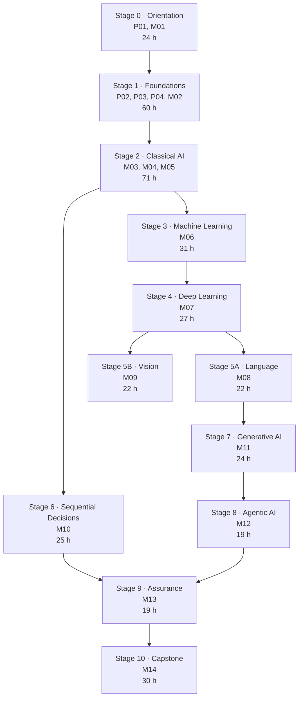

# Course Roadmap

The complete sequence of the course: eleven stages, four prerequisite sections and fourteen modules,
with the reason each one comes where it does. Use this page to see the whole journey; use
[learning paths](learning-path.md) to choose your route through it.

**Course home:** [README](../README.md) · **Module index:** [modules/README.md](../modules/README.md) ·
**Prerequisites:** [prerequisites/README.md](../prerequisites/README.md)

## 1. How the course is organised

The course has two tracks that run alongside each other:

- The **prerequisite track** (P01–P04) prepares the programming, mathematics, probability and data
  handling that the modules assume. It is not remedial in a pejorative sense: linear algebra, probability and calculus are
  the working language of modern AI, and most students meet them here for the first time in a form
  they can use.
- The **module track** (M01–M14) is the course itself: classical AI, machine learning, deep
  learning, applied AI, responsibility, and a capstone.

Every module states its prerequisites explicitly and links to the lesson that supplies them, so you
are never told to "know the maths" without being shown where to get it.

## 2. The journey at a glance

*Text description of the diagram:* the course opens with orientation and moves into mathematical
foundations; foundations lead into the three classical modules (search, logic, uncertainty);
classical AI leads to machine learning and then deep learning; deep learning branches into a
language route and a vision route; the language route continues into generative AI and then
agentic AI; classical AI also feeds reinforcement learning, which converges with agentic AI in the
assurance stage; the capstone comes last. Hours shown are total study effort for the stage.

## 3. Stage-by-stage description

### Stage 0 — Orientation (26.8 hours)

**P01 Python programming, M01 Introduction.**

You learn to write and run Python, to read the notation the course uses, and to describe an AI
system precisely. This stage is deliberately gentle: its purpose is to make the rest of the course
possible, and to give you an early, honest signal about your study habits before the material gets
demanding.

**You are ready to move on when** you can write a function with a loop inside it without help, and
explain in your own words what an agent is.

### Stage 1 — Foundations (59.9 hours)

**P02 Mathematics for AI, P03 Probability and statistics, P04 Data preparation and visualisation,
M02 Intelligent agents.**

The mathematics arrives before it is needed, in the smallest useful dose. M02 sits here because its
vocabulary — percept, environment, rational action — is used in every later module, including the
agentic systems at the end of the course.

**You are ready to move on when** you can multiply matrices in NumPy, compute a conditional
probability by hand, differentiate a simple function, load and plot a CSV, and write a PEAS
description for a system you know.

### Stage 2 — Classical AI (72.1 hours)

**M03 Search, M04 Logic, M05 Uncertainty.**

The intellectual core of the field. Search teaches you to think in states and costs; logic teaches
you what follows from what; probability teaches you what to believe when information is incomplete.
These three ideas are the reason AI is a discipline rather than a collection of models, and they
remain the right answer for many real problems — scheduling, routing, configuration, compliance.

**You are ready to move on when** you can formulate a new problem as a search problem, justify your
algorithm choice, derive a conclusion in first-order logic, and compute a posterior probability
with Bayes' rule.

### Stage 3 — Machine Learning (31.4 hours)

**M06 Machine learning fundamentals.**

The pivot of the course. You learn the classical algorithms, but the emphasis is on the workflow
that surrounds them: splitting, leakage, baselines, metric choice, regularisation and error
analysis. Students who rush this stage struggle in every module after it.

**You are ready to move on when** you can take an unfamiliar dataset to a model you can defend, and
explain why your evaluation is trustworthy.

### Stage 4 — Deep Learning (24.9 hours)

**M07 Neural networks and deep learning.**

Backpropagation derived once by hand, then the engineering that makes it work: initialisation,
optimisers, regularisation, and diagnosis. The module ends with attention, which is the single
mechanism behind modern language, vision and generative systems.

**You are ready to move on when** you can implement a network from scratch, verify its gradients,
and debug a training run from its loss curves rather than by guessing.

### Stages 5A and 5B — Language and Vision (24.3 and 26.8 hours)

**M08 Natural language processing, M09 Computer vision.**

Two applications of the same deep-learning machinery to different data. They can be taken in
either order, or both in parallel if your weeks allow. Each ends with evaluation and audit work,
because both domains fail in ways that average accuracy conceals.

**You are ready to move on when** you can fine-tune a model on your own small dataset and explain
the pattern of its errors.

### Stage 6 — Sequential Decisions (34.1 hours)

**M10 Reinforcement learning.**

Learn from consequences rather than labels. Markov decision processes, dynamic programming,
model-free methods, and the engineering of reward design — including how easily an agent learns the
wrong thing.

**You are ready to move on when** you can implement Q-learning, explain its convergence conditions,
and diagnose reward hacking from a learning curve.

### Stage 7 — Generative AI (23.3 hours)

**M11 Generative AI and large language models.**

How autoregressive models generate text, why they hallucinate, and how to build something reliable
around one: prompting as measurement, retrieval with citations, parameter-efficient fine-tuning,
and an evaluation harness that reports quality, cost and failure together.

### Stage 8 — Agentic AI (27.8 hours)

**M12 AI agents and agentic systems.**

From answering to acting: tools, memory, planning, multi-agent coordination — and the guardrails
that make such a system safe enough to run. This stage converts a model into a system.

### Stage 9 — Assurance (22.4 hours)

**M13 Responsible, explainable and secure AI.**

Fairness measurement, explanation, privacy, and attack. Deliberately scheduled *after* you have
built systems, so that the audit you perform is on your own work rather than a hypothetical.

### Stage 10 — Capstone (32.9 hours)

**M14 Applications and capstone.**

Case studies, the serving and monitoring lifecycle, research literacy, and the capstone itself:
scoped, milestone-driven, evaluated and defended.

## 4. Module sequence and dependencies

| Module | Hours | Hard prerequisites | Opens the door to |
| :--- | ---: | :--- | :--- |
| P01 | 14 | — | all coding in the course |
| P02 | 24 | — | M03, M04, M06, M07, M10 |
| P03 | 10 | P02 (recommended) | M05, M06, M10 |
| P04 | 8 | P01 (recommended) | M06, M08, M09 |
| M01 | 12.8 | — | M02 |
| M02 | 17.9 | P01 | M03, M12 |
| M03 | 19.9 | P01, P02 | M04, M10 |
| M04 | 31.6 | P02 | M05 |
| M05 | 20.6 | P03 | M06, M10 |
| M06 | 31.4 | P02, P03, P04 | M07, M13 |
| M07 | 24.9 | M06, P02 | M08, M09, M11 |
| M08 | 24.3 | M07 | M11 |
| M09 | 26.8 | M07 | capstone |
| M10 | 34.1 | M06, M05, P03, P02 | M12 |
| M11 | 23.3 | M07, M08 | M12 |
| M12 | 27.8 | M11, M02 | capstone |
| M13 | 22.4 | M06 | capstone |
| M14 | 32.9 | M13 + your brief | — |

**The critical path is P01 → M06 → M07 → M08 → M11 → M12 → M14.** A delay in machine learning or
deep learning delays every applied module after it. That is why those two modules should not be
compressed or rushed, and why the order in this table is not negotiable in the early stages.

**What is negotiable.** M09 can move earlier or later, because it depends only on M07. M10 can run
in parallel with M08/M09 once M06 is complete. M13 needs only M06, so a student focusing on
governance can take it sooner — though it is more valuable after building something.

## 5. Two-semester plan for the full programme

| Semester | Content | Hours | Weekly load at 16 weeks |
| :--- | :--- | ---: | ---: |
| 1 | P01–P04, M01–M05 | 158.8 | ≈ 10 h |
| 2 | M06–M14 | 247.9 | ≈ 15.5 h |
| **Total** | **All eighteen sections and modules** | **406.7** | |

The second semester is heavier because the modules are denser. If 14 hours a week is unrealistic,
split it into three semesters of about 8 hours a week: prerequisites and M01–M03, then M04–M07,
then M08–M14. Spreading is always better than dropping modules, because the later modules assume
the earlier ones.

## 6. What "finished" means at each stage

Knowledge that feels familiar is not knowledge that is available when needed. Before advancing,
each stage has a small piece of evidence attached to it:

| Stage | Evidence you are ready |
| :--- | :--- |
| 0 | You can run a notebook end to end and explain every cell's purpose |
| 1 | You can do the five-item readiness check in the prerequisites page |
| 2 | You can solve an unfamiliar search problem and justify the algorithm in writing |
| 3 | You can present a model with a baseline, the right metric and an error analysis |
| 4 | You can train a network that beats a trivial baseline, and explain why it does |
| 5 | You can fine-tune a text and an image model and describe their failure patterns |
| 6 | You can explain value iteration versus Q-learning with your own working example |
| 7 | You can build a retrieval-augmented system and measure its faithfulness |
| 8 | You can build a tool-using agent with logging and a working guardrail |
| 9 | You can produce a model card and an audit of your own system |
| 10 | Someone else can run your capstone from your documentation |

## 7. Why this order, and not another

**Because dependency beats curiosity in the early stages.** It is possible to start with M11, build
something impressive with a hosted model, and learn a great deal. It is also possible to do that
without ever understanding why the model fails, what the evaluation actually measures, or how to
fix it — which is the difference between using AI and engineering it. The order here delays the
satisfying part slightly and makes it durable.

**Because the classical modules are not obsolete.** Search, constraint satisfaction and logic run
scheduling systems, planners, configuration engines and compliance tools in daily production.
Students who skip them recognise AI only in its most recent costume.

**Because assurance must come after construction.** Ethics taught in week two is abstract; ethics
taught after you have built a classifier with a biased dataset is engineering. M13 is placed where
it will land.

**Because a capstone needs something to cap.** The final project draws on the whole course, and it
is only honest to run it once the modules it depends on exist.

**Navigation:** [Course home](../README.md) · [Learning paths](learning-path.md) ·
[Modules](../modules/README.md) · [Prerequisites](../prerequisites/README.md) ·
[Curriculum map](CURRICULUM-MAP.md) · [Documentation index](index.md)
