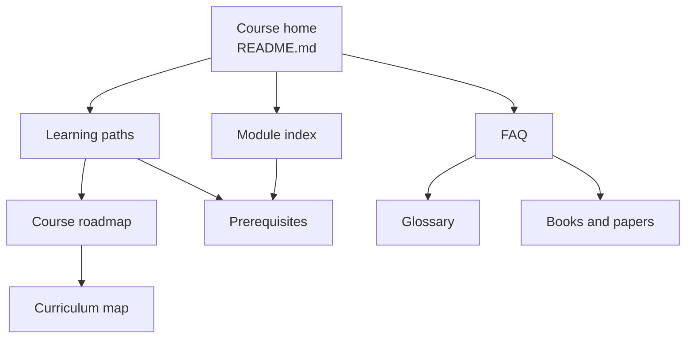

# Documentation Index

Every page in this repository, in one place. If you are a student, start with the first group and
ignore the rest until you need them.

**Course home:** [README](../README.md)

## Start here

| Page | What it gives you |
| :--- | :--- |
| [Learning paths](learning-path.md) | Which unit to start at, how long each route takes, and week-by-week plans |
| [Course roadmap](course-roadmap.md) | The full sequence of stages and modules, with dependencies and outcomes |
| [Prerequisites](../prerequisites/README.md) | A readiness self-check and the four preparation sections |
| [All modules](../modules/README.md) | Module index: what each module covers and what it assumes |

## Help while studying

| Page | What it gives you |
| :--- | :--- |
| [FAQ](faq.md) | Answers to the questions students ask most: tools, pace, maths, assessment, careers |
| [Glossary](../resources/glossary.md) | One-sentence definitions of the course's key terms |
| [Detailed glossary](../resources/glossary/README.md) | Expanded entries by module: definition, mathematics, example, related terms |
| [Concept maps](CONCEPT-MAPS.md) | Eleven diagrams showing how the course's ideas relate |
| [Books](../resources/books.md) | Annotated reading list, including free online texts |
| [Documentation](../resources/documentation.md) | Official references for Python and the libraries used |
| [Research papers](../resources/research-papers.md) | The primary sources behind the course, with reading guidance |
| [Learning resource library](../resources/README.md) | Curated books, courses, documentation and papers, organised by module |
| [About the course](about.md) | What this course is, how it was designed, and who wrote it |

## Licensing and reuse

| Page | What it covers |
| :--- | :--- |
| [README §9 — Licensing and attribution](../README.md#9-licensing-and-attribution) | The four-layer summary: MIT code, CC BY 4.0 content, CC0 data and third-party terms |
| [LICENSE](../LICENSE) | MIT licence for original source code |
| [CONTENT-LICENSE.md](../CONTENT-LICENSE.md) | CC BY 4.0 scope and attribution requirements for lessons, labs and documentation |
| [DATASET-LICENSE.md](../DATASET-LICENSE.md) | CC0 1.0 dedication and the synthetic dataset catalogue |
| [THIRD-PARTY-ATTRIBUTIONS.md](../THIRD-PARTY-ATTRIBUTIONS.md) | Dependencies, external datasets, models and references that are **not** covered by the course licences |
| [LICENSING-INVENTORY.md](../LICENSING-INVENTORY.md) | Per-category ownership and licence audit |
| [Ownership review checklist](../OWNERSHIP-REVIEW-CHECKLIST.md) | Chain-of-title, contribution and sign-off checklist for the owner |
| [CITATION.cff](../CITATION.cff) | How to cite the course |

## Course design documents

These describe how the course is built. They are written for instructors, reviewers and future
contributors; a student does not need them to study, though the curriculum map is a useful overview
of everything the course contains.

| Page | What it contains |
| :--- | :--- |
| [Curriculum map](CURRICULUM-MAP.md) | Every lesson, lab, assignment and project, with outcomes and hours |
| [Architecture](ARCHITECTURE.md) | Directory structure, naming, templates, quality and accessibility standards |
| [Implementation roadmap](IMPLEMENTATION-ROADMAP.md) | The phase plan for writing and reviewing the course |
| [Repository audit](AUDIT.md) | The starting state of the repository and the constraints it imposed |

## Authoring material

| Page | Purpose |
| :--- | :--- |
| [Templates](../templates/README.md) | The six templates every lesson, lab, assignment, quiz and module page is written from |

## How these pages fit together

*Text description of the diagram:* the course homepage leads to three student routes — learning
paths, the module index and the FAQ; learning paths lead to the roadmap and prerequisites; the
module index also points at prerequisites; the FAQ leads to the glossary and to the reading lists;
the roadmap leads to the detailed curriculum map.

**Navigation:** [Course home](../README.md) · [Modules](../modules/README.md) ·
[Prerequisites](../prerequisites/README.md) · [Resources](../resources/glossary.md)
