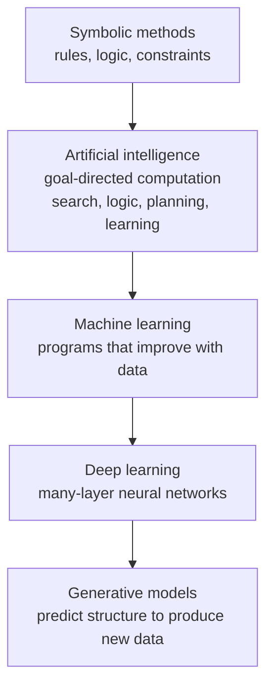

# L01-03 — The Many Faces of AI: Symbolic, Statistical and Generative

| Module | M01 · Introduction and Foundations of Artificial Intelligence |
| :--- | :--- |
| Level | 100 |
| Study time | 60 minutes |
| Prerequisites | [L01-01 What Is Artificial Intelligence?](L01-01-what-is-artificial-intelligence.md) · [L01-02 A Brief History](L01-02-history-and-ai-winters.md) |
| Notebook | [NB-01-01 Capability Test Bench](../notebooks/nb-01-01-capability-test-bench.ipynb) |
| Lab | [LAB-01-01 Claim Audit](../labs/lab-01-01-claim-audit.md) |

[← Previous: L01-02 A Brief History of AI and the AI Winters](L01-02-history-and-ai-winters.md) · [Module home](../README.md) · [Next: L01-04 What AI Can and Cannot Do Today →](L01-04-ai-capabilities-and-limitations.md)

## On this page

- [1. Learning Objectives](#1-learning-objectives)
- [2. Prerequisite Knowledge](#2-prerequisite-knowledge)
- [3. Conceptual Explanation](#3-conceptual-explanation)
- [4. The Two Classifiers, as Pseudocode](#4-the-two-classifiers-as-pseudocode)
- [5. Worked Examples](#5-worked-examples)
- [6. Mathematical Formulation](#6-mathematical-formulation)
- [7. Python Implementation](#7-python-implementation)
- [8. Practical Applications](#8-practical-applications)
- [9. Common Mistakes](#9-common-mistakes)
- [10. Practical Exercises](#10-practical-exercises)
- [11. Self-Assessment](#11-self-assessment)
- [12. Key Terms](#12-key-terms)
- [13. Further Reading](#13-further-reading)
- [What to Do Next](#what-to-do-next)

## 1. Learning Objectives

By the end of this lesson you will be able to:

- **Distinguish** symbolic (rule-based) from connectionist (learned) approaches, and say which problems each suits.
- **Place** artificial intelligence, machine learning and deep learning correctly in a containment diagram, and explain the difference between a field, a method family and an architecture family.
- **Compare** a rule-based and a learned classifier on the same task, and interpret the result as evidence about inductive bias rather than about which method "wins".
- **Recognise** hybrid systems where rules and learning cooperate, and explain why most production systems are hybrids.

## 2. Prerequisite Knowledge

You should already be able to:

- Apply the four-flag capability test — [L01-01](L01-01-what-is-artificial-intelligence.md).
- Explain why the AI winters happened — [L01-02](L01-02-history-and-ai-winters.md).
- Write a Python function and call it in a loop — [LP01-04](../../../prerequisites/P01-python-programming/lessons/LP01-04-functions-and-collections.md).

## 3. Conceptual Explanation

### 3.1 The intuition

Two ways to teach someone to spot spam email.

**Way one: write the rules.** "If the subject contains three or more capitalised words, and the body has a link to an unknown domain, mark as spam." You can read the policy, argue with it, and fix it when it is wrong. But every new trick the spammers invent needs a new rule, and after two hundred rules nobody can say why the system made a particular decision.

**Way two: show examples.** Give the system ten thousand emails already labelled spam or not, and let it find the pattern. It will catch tricks you never thought of. But you cannot read its policy, and when it starts blocking a legitimate newsletter you have no rule to point at — only a training set to inspect.

These are the two great traditions. **Symbolic AI** (also called classical, rule-based, or GOFAI — "good old-fashioned AI") represents knowledge explicitly and reasons over it. **Connectionist AI** represents knowledge as numbers in a network of simple units, adjusted by learning. Neither is a historical relic or a universal winner; they fail differently, and the failure modes decide which to use.

### 3.2 The formal idea: three nested terms people confuse



*Text description:* the diagram is a containment hierarchy with a side branch. AI is the outer set; machine learning is a subset of it (some AI is not learning — a search algorithm is AI but not ML); deep learning is a subset of ML; generative models are a subset of deep learning today, though generative ideas also exist outside it. Symbolic methods sit inside AI but outside ML, which is why "AI versus ML" is a category error: ML is one way of doing AI.

Stated as sets:

- $AI \supset ML \supset DL$
- $Symbolic \subset AI$ and $Symbolic \cap ML = \varnothing$ in the classical case (a rule engine does not learn from data)
- $Generative \subset DL$ currently, but generative modelling as an idea predates deep learning

The confusion is almost always between a **field** (AI), a **method family** (ML), and an **architecture family** (deep learning). A product can be AI without ML (a route planner), ML without deep learning (logistic regression), and deep learning without being generative (an image classifier).

### 3.3 Connectionism in one paragraph

A connectionist model is a parameterised function $f_\theta$ — often a network — whose parameters $\theta$ are fitted by minimising a loss on examples. What it "knows" is distributed across thousands or millions of numbers. Its inductive bias is smoothness and compositionality: it assumes that similar inputs should produce similar outputs, and that complex functions are built from simple ones. That bias is why it generalises well on perception and language, and why it needs a lot of data to learn anything a rule could state in one line.

### 3.4 Why it matters

Choosing a paradigm is the first architectural decision in any AI project, and it is usually made by habit. The habit in industry is "use a model"; the habit in safety-critical systems is "use a rule". Both defaults are wrong some of the time. The question to ask is: *what will this system get wrong, and can I inspect the failure?* A rule engine fails in ways you can read. A learned model fails in ways you must measure. Pick the failure mode you can afford.

### 3.5 The generative turn

A generative model learns $p(x)$ — or $p(x \mid \text{context})$ — well enough to produce new samples. This is a different objective from classification, and it changes the evaluation problem: there is no single right answer to compare against, so quality is judged by distributional similarity, downstream usefulness and human preference. That is why generative systems are so much harder to evaluate than classifiers, and why the rest of this course treats evaluation as a discipline rather than a metric.

## 4. The Two Classifiers, as Pseudocode

```text
FUNCTION rule(email):                       # symbolic
    caps, links <- email
    RETURN "spam" IF links >= 2 AND caps > 0.3 ELSE "ham"

FUNCTION knn(email, k=3):                   # connectionist in spirit
    neighbours <- k training emails closest to `email`
    RETURN the majority label among neighbours

FUNCTION compare(train, test):
    FOR each method IN [rule, knn]:
        accuracy[method] <- fraction of test emails labelled correctly
    RETURN accuracy table plus the emails each method got wrong
```

The second function is not a neural network, but it shares the essential move of connectionism: the decision comes from *examples* and a similarity measure, not from a written condition. A k-nearest-neighbour classifier is the smallest honest example of learning from data — no gradients, no epochs, and you can trace every decision.

## 5. Worked Examples

### Example 1 — A rule and a nearest-neighbour classifier, head to head

Eight training emails, described by two features: the ratio of capitalised words, and the number of links. Six test emails, including two deliberately awkward cases.

| Email (caps, links) | True label | Rule says | 3-NN says |
| :--- | :--- | :--- | :--- |
| (0.06, 1) | ham | ham | ham |
| (0.70, 3) | spam | spam | spam |
| (0.35, 2) | spam | spam | spam |
| (0.90, 0) | ham | ham | ham |
| (0.90, 1) | spam | **ham** | spam |
| (0.30, 3) | ham | ham | **spam** |

Both score **5/6**, and they fail on *different* emails. This is the result that matters, and it is not a tie in any interesting sense.

- The rule fails on (0.90, 1): almost every word capitalised, one link. The rule demands two links, so it misses obvious spam. Its bias is *conjunctive and strict*.
- k-NN fails on (0.30, 3): three links but normal capitalisation, which the training set never showed. Its nearest neighbours are spam because links dominate the distance, even though the email reads like a newsletter.

Neither method is better; each encodes a different assumption about which feature matters. In practice you would combine them, or add features until both agree — which is exactly what a hybrid system does.

### Example 2 — The same task, one paradigm shift later

Suppose the spam problem doubles: 200,000 emails a day, in four languages, with spammers changing tactics weekly.

- The rule approach now needs a team maintaining thousands of conditions across languages, and every update risks breaking an old case. The failure mode is *maintenance*.
- A learned approach needs labelled data in each language, a retraining pipeline, and an evaluation set that keeps up with the changing distribution. The failure mode is *drift*.

The decision is not "which is more intelligent". It is "which failure mode does the organisation have the capacity to manage". That is a management question with a technical component, and pretending otherwise is how projects fail politely.

## 6. Mathematical Formulation

A classifier is a function $f: \mathcal{X} \to \mathcal{Y}$ chosen from a hypothesis class $\mathcal{H}$.

| Symbol | Meaning |
| :--- | :--- |
| $\mathcal{X}$ | input space (here, pairs of real numbers) |
| $\mathcal{Y}$ | label set, e.g. $\{\text{spam}, \text{ham}\}$ |
| $\mathcal{H}$ | the set of functions the method can represent |
| $D$ | training data, $n$ labelled examples |
| $\hat{R}(f)$ | empirical error on the training set |

The **inductive bias** of a method is the restriction that defines $\mathcal{H}$. The rule method's hypothesis class is tiny:

$$
\mathcal{H}_{\text{rule}} = \{\, f_{a,b} : f(x) = \text{spam} \iff x_{\text{links}} \ge a \ \land\ x_{\text{caps}} > b \,\}
$$

k-NN's class is much larger — any labelling that is locally constant — but it is only defined relative to the training set, which is a different kind of restriction.

Empirical error and true error are different quantities:

$$
\hat{R}(f) = \frac{1}{n}\sum_{i=1}^{n} \mathbb{1}[f(x_i) \ne y_i],
\qquad R(f) = \mathbb{E}_{(x,y)\sim \mathcal{D}}\big[\mathbb{1}[f(x) \ne y]\big]
$$

You can compute $\hat{R}$; you can only estimate $R$ with held-out data. A small hypothesis class has low variance but may be unable to fit the truth (bias); a large one can fit anything, including noise. That trade-off is the subject of M06 and the reason a 5/6 versus 5/6 result tells you almost nothing on six examples.

## 7. Python Implementation

```python
# (capitalised-word ratio, link count, label)
train = [
    (0.05, 0, "ham"), (0.08, 1, "ham"), (0.02, 0, "ham"), (0.10, 2, "ham"),
    (0.60, 3, "spam"), (0.75, 4, "spam"), (0.55, 2, "spam"), (0.80, 5, "spam"),
]
test = [
    ((0.06, 1), "ham"), ((0.70, 3), "spam"), ((0.35, 2), "spam"),
    ((0.90, 0), "ham"), ((0.90, 1), "spam"), ((0.30, 3), "ham"),
]


def rule(email: tuple[float, int]) -> str:
    """Symbolic classifier: a hand-written conjunction."""
    caps, links = email
    return "spam" if (links >= 2 and caps > 0.3) else "ham"


def knn(email: tuple[float, int], k: int = 3) -> str:
    """3-nearest-neighbour classifier over (caps, links), links scaled down."""
    def distance(other: tuple[float, int, str]) -> float:
        return ((email[0] - other[0]) ** 2 + 0.1 * (email[1] - other[1]) ** 2) ** 0.5

    neighbours = sorted(train, key=distance)[:k]
    votes = [label for _, _, label in neighbours]
    return "spam" if votes.count("spam") > votes.count("ham") else "ham"


print("email     true   rule   knn")
for (caps, links), label in test:
    print(f"({caps:.2f},{links})  {label:4s}  {rule((caps, links)):4s}  {knn((caps, links)):4s}")

rule_hits = sum(rule(email) == label for email, label in test)
knn_hits = sum(knn(email) == label for email, label in test)
print(f"rule accuracy: {rule_hits}/{len(test)}   k-NN accuracy: {knn_hits}/{len(test)}")
```

**Output**

```text
email     true   rule   knn
(0.06,1)  ham   ham   ham 
(0.70,3)  spam  spam  spam
(0.35,2)  spam  spam  spam
(0.90,0)  ham   ham   ham 
(0.90,1)  spam  ham   spam
(0.30,3)  ham   ham   spam
rule accuracy: 5/6   k-NN accuracy: 5/6
```

The printed table is the evidence for Example 1: equal accuracy, disjoint errors. Print the misclassified rows whenever you compare two methods — an accuracy figure alone would have hidden the only interesting fact.

## 8. Practical Applications

- **Credit and insurance decisions.** Rules encode regulatory constraints ("decline if under 18"), models estimate risk. The hybrid is mandatory: the rule is auditable, the model is accurate, and neither substitutes for the other.
- **Medical triage.** A learned model prioritises scans; a rule set enforces hard exclusions (allergies, pregnancy) that must never be overridden by a score. The rule exists because the cost of the model being wrong is unacceptable, not because it predicts better.
- **Warehouse and route planning.** Constraint solvers and search find feasible schedules; a learned demand forecast supplies the numbers they optimise. Symbolic optimisation on top of statistical prediction is the standard production pattern.
- **Language products.** A generative model drafts text; deterministic checks (citation existence, schema validation, banned-content filters) gate what reaches the user. Every deployed generative system of consequence is a hybrid, whether or not it is described that way.

## 9. Common Mistakes

| Mistake | What you will see | Why it happens | Fix |
| :--- | :--- | :--- | :--- |
| "AI versus ML" framing | Comparisons that treat them as rivals | Both are used loosely in marketing | ML is a subset of AI; ask whether the system learns |
| Assuming the learned method always wins | "Just train a model" on 40 examples | Learned methods dominate headlines | With little data, a rule or a simple model often wins |
| Judging two methods by one accuracy number | "5/6 beats 5/6, so it is a tie" | Accuracy collapses a distribution of errors to a scalar | Compare *which* cases fail, and at what cost |
| Treating symbolic AI as obsolete | Students skip logic and constraints | History is taught as replacement | Constraints still run scheduling, verification and guardrails |
| Calling a deep network "AI" and a rule engine "not AI" | Definition by fashion | Deep learning is the current default | Use the mechanism test from L01-01, not the era |

## 10. Practical Exercises

1. **Add a third feature.** Extend the email example with "contains the word *unsubscribe*". Add two training and two test rows where it changes the answer. Report both accuracies and both failure sets.
2. **Choose a paradigm.** For each system, state symbolic, learned or hybrid, and one sentence of justification: (a) a tax calculator, (b) a face-unlock phone, (c) a fraud detector that must explain every block, (d) a chess engine with a learned evaluation function.
3. **Break the rule deliberately.** Find a single email that the rule misclassifies and that no reasonable person would call spam. Then modify the rule minimally to fix it without breaking another case. What does the exercise show about maintenance cost?
4. **Draw the containment diagram** from memory, including one example in each region, including one example of symbolic AI and one of ML that is not deep learning.
5. **Write the deployment paragraph.** For a spam filter at a university, write four sentences choosing a paradigm and naming the failure mode you are accepting. Mention what you would monitor.

## 11. Self-Assessment

**1.** Where does machine learning sit relative to AI, and give one example of AI that is not machine learning.
<details><summary>Show answer</summary>

ML is a subset of AI: the part concerned with improving performance from data. A* search, a constraint solver or a rule-based expert system is AI but not ML, because nothing is learned from data — the behaviour is specified.

</details>

**2.** Explain inductive bias in one sentence, then state the bias of the rule classifier and of k-NN in §7.
<details><summary>Show answer</summary>

Inductive bias is the set of assumptions a method uses to generalise beyond its training data. The rule assumes spam requires both many links and heavy capitalisation, and nothing else matters. k-NN assumes labels are locally constant under a distance metric in which one link counts as 0.1 against a capitalisation-ratio difference of 1.0 — a weighting choice that decides the (0.30, 3) case.

</details>

**3.** Both classifiers score 5/6. Give two reasons this is not evidence that they are equally good.
<details><summary>Show answer</summary>

Six examples is far too few to estimate true error (the standard error on 6 trials is large), and the two methods fail on different cases with different costs — missing obvious spam is not the same harm as blocking a newsletter. A meaningful comparison needs more data, a cost model, and a report of the failure distribution.

</details>

**4.** A team proposes replacing a rule engine with a neural network because "rules do not scale". What two questions should you ask before agreeing?
<details><summary>Show answer</summary>

First, which failure mode is being traded: rules fail through maintenance and unreadable interactions, models fail through drift and opacity — can the team monitor drift and explain decisions? Second, is there labelled data at the required scale in every sub-population that matters? Without both, the replacement may improve the demo while making production worse.

</details>

**5.** Name one task where a generative model is the wrong tool, and explain why.
<details><summary>Show answer</summary>

Any task with a single verifiable answer and strict constraints — payroll calculation, tax computation, a database migration — where a deterministic program is exact, auditable and cheap. A generative model adds sampling variability and unverifiable output for no gain; correctness, not fluency, is the objective.

</details>

## 12. Key Terms

- **Symbolic AI** — intelligence implemented by explicit symbols, rules and logical inference.
- **Connectionist AI** — intelligence implemented by networks of simple units whose weights are learned.
- **Machine learning** — the subfield that improves performance by fitting models to data.
- **Deep learning** — machine learning with many-layer neural networks.
- **Generative model** — a model of the data distribution, able to produce new samples.
- **Inductive bias** — the assumptions that let a method generalise beyond its training examples.
- **Hybrid system** — a system combining symbolic and learned components.
- **GOFAI** — "good old-fashioned AI", the symbolic tradition.

The [glossary](../../../resources/glossary.md) carries the full definitions.

## 13. Further Reading

- Russell, S. & Norvig, P. (2021). *Artificial Intelligence: A Modern Approach*, 4th ed., §1.1 and §1.3. — The field's standard taxonomy, including the agent view used in M02.
- Domingos, P. (2015). *The Master Algorithm*. Basic Books, Chapters 1–2. — The connectionist argument made well, and a useful counterweight to symbolic intuition.
- Mitchell, T. (1997). *Machine Learning*, Chapter 1. — Still the clearest short account of inductive bias and why a learner needs assumptions.
- Goodfellow, I., Bengio, Y. & Courville, A. (2016). *Deep Learning*, Chapter 1. — Places deep learning in the wider history without hype.

## What to Do Next

Continue to [L01-04 — What AI Can and Cannot Do Today](L01-04-ai-capabilities-and-limitations.md), where the paradigms meet evidence: which claims survive contact with a real evaluation, and which do not.

---

**Navigation:** [← Previous: L01-02 A Brief History of AI and the AI Winters](L01-02-history-and-ai-winters.md) · [Module home](../README.md) · [Next: L01-04 What AI Can and Cannot Do Today →](L01-04-ai-capabilities-and-limitations.md)
