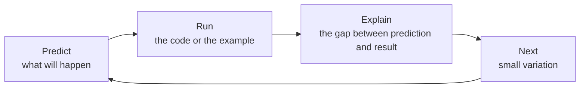

# L01-05 — How This Course Works: Tools, Workflow and Study Habits

| Module | M01 · Introduction and Foundations of Artificial Intelligence |
| :--- | :--- |
| Level | 100 |
| Study time | 40 minutes |
| Prerequisites | [L01-04 What AI Can and Cannot Do Today](L01-04-ai-capabilities-and-limitations.md) |
| Notebook | [NB-01-01 Capability Test Bench](../notebooks/nb-01-01-capability-test-bench.ipynb) |
| Lab | [LAB-01-02 Turing-Test-Style Conversation](../labs/lab-01-02-turing-test-conversation.md) |

[← Previous: L01-04 What AI Can and Cannot Do Today](L01-04-ai-capabilities-and-limitations.md) · [Module end](../README.md)

## On this page

- [1. Learning Objectives](#1-learning-objectives)
- [2. Prerequisite Knowledge](#2-prerequisite-knowledge)
- [3. Conceptual Explanation](#3-conceptual-explanation)
- [4. The Procedure: A Setup Check You Can Trust](#4-the-procedure-a-setup-check-you-can-trust)
- [5. Worked Examples](#5-worked-examples)
- [6. Mathematical Formulation](#6-mathematical-formulation)
- [7. Python Implementation](#7-python-implementation)
- [8. Practical Applications](#8-practical-applications)
- [9. Common Mistakes](#9-common-mistakes)
- [10. Practical Exercises](#10-practical-exercises)
- [11. Self-Assessment](#11-self-assessment)
- [12. Key Terms](#12-key-terms)
- [13. Further Reading](#13-further-reading)
- [What to Do Next](#what-to-do-next)

## 1. Learning Objectives

By the end of this lesson you will be able to:

- **Set up** a working Python and Jupyter environment and verify it with a script you wrote yourself.
- **Apply** the predict–run–explain loop to every code block you meet, so reading becomes active rather than passive.
- **Plan** a study week that fits the module's stated hours, using retrieval practice instead of rereading.
- **Diagnose** the three most common self-study failures — passive reading, environment drift, and skipping evaluation — and correct each.

## 2. Prerequisite Knowledge

You should already be able to:

- Read and modify a short Python script — [LP01-01](../../../prerequisites/P01-python-programming/lessons/LP01-01-setting-up-python-and-jupyter.md) and [LP01-02](../../../prerequisites/P01-python-programming/lessons/LP01-02-variables-types-and-operators.md).
- Explain what a notebook cell is — [LP01-01](../../../prerequisites/P01-python-programming/lessons/LP01-01-setting-up-python-and-jupyter.md).

If `python --version` does not work in your terminal, stop and fix that first: everything in this course assumes it.

## 3. Conceptual Explanation

### 3.1 The intuition

Self-study fails in a predictable way. A student reads a lesson, nods, runs the notebook, sees the output, and feels they understand. Two weeks later they cannot reproduce the argument. Nothing was wrong with their effort; the *activity* was wrong. Reading and watching produce a feeling of fluency that is not the same as the ability to retrieve and use an idea.

The course is built around a different loop, repeated at every scale:



*Text description:* a four-step cycle. You commit to a prediction before running anything, observe the real outcome, explain the difference in your own words, then change one thing and go round again. The loop only works if the prediction comes first — otherwise you are reading a result, not testing a model.

The same loop applies to non-code material. Before reading a subsection, predict what it will claim. After reading, close the page and write the claim from memory. That is retrieval practice, and it is the single most effective study technique in the research literature on learning.

### 3.2 What you need installed

| Tool | Version | Why this course uses it |
| :--- | :--- | :--- |
| Python | 3.10 or newer | The language for every implementation |
| Jupyter | JupyterLab or Notebook 7+ | Notebooks mix explanation, code and output |
| NumPy | 1.24+ | Arrays and the linear algebra in M02 and M03 |
| pandas | 2.0+ | Tabular data in M01 labs and M06 onwards |
| Matplotlib | 3.7+ | Every figure you produce |
| Seaborn | 0.12+ | Statistical plots with sensible defaults |

Nothing else is required for M01–M03. You do **not** need a GPU, a cloud account, or any paid service. Later modules add libraries; each one is introduced with an offline path.

### 3.3 The predict–run–explain loop, concretely

1. **Predict.** Read the code. Write down, in one line, what you expect it to print.
2. **Run.** Execute it unchanged.
3. **Explain.** If you were right, say *why* the mechanism produces that result. If you were wrong, find the exact line where your model of the code diverged.
4. **Vary.** Change one value — a threshold, a list length, a seed — and predict again.

Step 3 is where learning happens, and it is the step almost everyone skips. A correct prediction is not yet understanding; it is a hypothesis that survived one test.

### 3.4 Reading a lesson actively

Every lesson in this course has the same shape, and you can use the shape:

| Section | What to do with it |
| :--- | :--- |
| Learning objectives | Read first; they tell you what will be assessed |
| Conceptual explanation | Read once, then close the page and write the idea from memory |
| Worked example | Work it on paper before reading the solution |
| Pseudocode | Trace it by hand on the example's numbers |
| Python implementation | Predict the output, run it, compare |
| Complexity / comparison | Ask what would change if the input were ten times larger |
| Exercises | Do at least three; the odd-numbered ones have full answers in the lesson |
| Self-assessment | Answer without looking; reopen only to mark |

### 3.5 Why it matters

The material is not hard because the mathematics is exotic. It is hard because there is a lot of it, and because it is easy to mistake recognition for knowledge. A student who finishes this course with the loop as a habit can pick up any later module; a student who reads everything once and never predicts will need the whole course again when they build something.

### 3.6 Honest use of AI assistants

You will use AI tools while studying — that is the world you are entering. The line that matters is between *using a tool to learn* and *substituting a tool for learning*:

- **Fine:** ask an assistant to explain a concept, generate extra practice, or review your code for a bug you already located.
- **Fine:** ask it to critique your explanation of an algorithm.
- **Not fine:** paste a lab solution you did not write and cannot defend line by line.
- **Not fine:** accept generated code without running it. Every claim in this course is checked by execution; your work should meet the same standard.

A practical test: could you reimplement it from scratch tomorrow, on a whiteboard, while explaining each step? If not, you have not learned it yet, whatever produced the code.

## 4. The Procedure: A Setup Check You Can Trust

```text
FUNCTION setup_check():
    PRINT python version                       # must be 3.10+
    FOR name IN [json, csv, math, random, statistics, dataclasses, itertools, pathlib]:
        TRY import name
        PRINT name, "ok"
        EXCEPT ImportError: PRINT name, "MISSING"
    PRINT count(ok) / count(all)

    # then, separately:
    RUN python -c "import numpy, pandas, matplotlib; print('scientific stack ok')"
    OPEN a notebook and run one cell that prints 2 + 2
    RETURN nothing if all checks pass; otherwise fix the first failure before continuing
```

The last two steps are the ones beginners skip. Importing a package in a terminal and importing it inside a notebook can fail differently, because they may use different Python interpreters. The notebook is the environment that matters.

## 5. Worked Examples

### Example 1 — Running the check and reading the result

On a correctly installed machine the check prints:

```text
python: 3.14.7
platform: Windows 11
  json         ok
  csv          ok
  math         ok
  random       ok
  statistics   ok
  dataclasses  ok
  itertools    ok
  pathlib      ok
8/8 standard-library modules available
```

Read it as three separate facts. The version line tells you the interpreter is modern enough. The module list tells you the standard library is intact — a surprising number of "installation" problems are actually broken or shadowed imports. The final line is a summary you can compare after any change; if it ever drops below 8/8, something in the environment changed.

Note that this check does **not** test NumPy, pandas or Matplotlib. Those are third-party packages, and the check in §7 deliberately covers only the standard library so it works even before you install anything. Run the one-line import test from §4 as the second stage.

### Example 2 — Predict, run, explain: a one-line bug

Consider this snippet:

```python
values = [3, 1, 2]
print(values.sort())
```

**Predict:** most beginners expect `[1, 2, 3]`.

**Run:** it prints `None`.

**Explain:** `list.sort()` sorts *in place* and returns `None`. The sorted list is now in `values`, but the expression `values.sort()` evaluates to `None`, and `print` receives `None`. The fix is `print(sorted(values))` — `sorted` returns a new list — or `values.sort()` followed by `print(values)`.

**Vary:** what does `sorted("cba")` return? A list of characters, `['a', 'b', 'c']`. Why a list and not a string? Because `sorted` promises a list for any iterable.

This is a trivial example of a non-trivial habit. The bug is not the lesson; the *method* — predict, run, explain, vary — is.

### Example 3 — Planning a 10-hour module across a week

M01 is 10 hours of study effort. Spread over seven days that is about 1.4 hours a day, but the distribution matters more than the average:

| Day | Work | Time |
| :--- | :--- | ---: |
| 1 | L01-01, L01-02 | 2 h |
| 2 | L01-03, start NB-01-01 | 2 h |
| 3 | Finish NB-01-01, LAB-01-01 | 2 h |
| 4 | L01-04 | 1 h |
| 5 | LAB-01-02 | 1.5 h |
| 6 | L01-05, QUIZ-01 | 1 h |
| 7 | MP-01 | 1.5 h |

Two sessions of heavy reading are deliberately separated by a lab day: the lab forces retrieval from the lessons, which is what makes the reading stick. If you have only four days, keep the lab days and merge the reading — never drop the labs to save time, because the labs are where the material becomes usable.

## 6. Mathematical Formulation

Study time is a budget, and budgets are checkable:

$$
T_{\text{module}} = \sum_{i} t_i, \qquad \bar{t} = \frac{T_{\text{module}}}{d}
$$

| Symbol | Meaning |
| :--- | :--- |
| $t_i$ | study time of artifact $i$ (lesson, notebook, lab, quiz, project) |
| $T_{\text{module}}$ | total module study time, here 10 hours |
| $d$ | number of study days available |
| $\bar{t}$ | average daily effort |

Effort is necessary, not sufficient. The retention of a studied idea decays roughly exponentially without retrieval:

$$
R(t) = e^{-t/S}
$$

where $R$ is the probability of recall at time $t$ and $S$ is a stability constant that increases each time you successfully retrieve the idea. This is why three short retrieval sessions across a week beat one long rereading session: each successful retrieval raises $S$, so the curve flattens. The formula is a simplification of a large empirical literature, but the qualitative prediction is robust and it matches what you will observe in yourself.

## 7. Python Implementation

```python
import platform
import sys

print("python:", sys.version.split()[0])
print("platform:", platform.system(), platform.release())

report = []
for name in ("json", "csv", "math", "random", "statistics", "dataclasses", "itertools", "pathlib"):
    try:
        __import__(name)
        report.append((name, "ok"))
    except ImportError:
        report.append((name, "MISSING"))

for name, status in report:
    print(f"  {name:12s} {status}")
print(f"{sum(status == 'ok' for _, status in report)}/{len(report)} standard-library modules available")
```

**Output**

```text
python: 3.14.7
platform: Windows 11
  json         ok
  csv          ok
  math         ok
  random       ok
  statistics   ok
  dataclasses  ok
  itertools    ok
  pathlib      ok
8/8 standard-library modules available
```

Your version and platform lines will differ; the module lines should not. If you see `MISSING`, reinstall Python from the official distribution rather than debugging individual modules — the cause is almost always a broken installation, not eight simultaneous missing packages.

## 8. Practical Applications

- **Professional setup discipline.** Teams lose days to "works on my machine". A short environment check committed alongside the code turns that into a five-second diagnosis.
- **Reproducibility in research.** Papers with pinned versions and a runnable check script get reproduced; papers without them become citations. The habit starts small.
- **Teaching and tutoring.** Knowing where a student's prediction diverged from reality tells you exactly which misconception to address — far more useful than a graded score.
- **Working with AI tools.** Reviewing generated code requires the same predict-run-explain loop: you cannot review what you cannot predict.

## 9. Common Mistakes

| Mistake | What you will see | Why it happens | Fix |
| :--- | :--- | :--- | :--- |
| Passive reading | "I understood it when I read it" | Fluency feels like knowledge | Close the page and reconstruct the idea; run the code before believing it |
| Notebook and terminal using different Pythons | Imports work in one, fail in the other | Two interpreters installed | Check with `sys.executable` in both; use one environment |
| Skipping the labs to save time | Good quiz scores, cannot build anything | Labs are slower than reading | Keep the labs; merge reading sessions instead |
| Copying code without running it | Errors discovered days later | Generated code looks plausible | Run every block; paste real output, never expected output |
| Rereading instead of retrieving | Familiarity after the second read, blank page in an exam | Recognition is easier than recall | Self-test first, then reread only what you missed |
| Installing packages globally and hoping | Version conflicts appear in week six | No isolation | Use one virtual environment per course; record versions |

## 10. Practical Exercises

1. **Run the check.** Execute §7, then the third-party import line from §4. Record both outputs and the value of `sys.executable`. Save them in a text file you can compare later.
2. **Predict three outputs.** Without running anything, write what these print: `print(2 ** 3 ** 2)`, `print([1, 2] * 2)`, `print(0.1 + 0.2 == 0.3)`. Then run them and explain each surprise.
3. **Plan M01.** Build your own seven-day table for 10 hours using the artifacts listed in the [module map](../README.md#module-map). Justify one choice where you deviate from Example 3.
4. **Design a retrieval test.** Write five questions covering L01-01 to L01-03 that require explanation rather than recall. Answer them a day later without notes.
5. **Audit your own workflow.** For one week, record every study session as *read*, *ran*, or *retrieved*. Compute the proportions. Which activity is under-represented, and what will you change?

## 11. Self-Assessment

**1.** Why does the setup check in §7 avoid NumPy and pandas?
<details><summary>Show answer</summary>

Because they are third-party packages that may not be installed yet, and the check should distinguish "Python is healthy" from "the scientific stack is installed". Mixing the two produces a confusing failure where a broken install looks like a missing package. Run the standard-library check first, then the import test for third-party libraries.

</details>

**2.** State the four steps of the predict–run–explain loop and say which one is most often skipped.
<details><summary>Show answer</summary>

Predict, run, explain, vary. The explain step is most often skipped: students run code, see output and move on, so a wrong prediction is never reconciled with the mechanism. Without it, the loop is just watching code execute.

</details>

**3.** A student studies 10 hours in one day before an assessment instead of spreading it over a week. Use the retention model in §6 to explain why this is likely to underperform.
<details><summary>Show answer</summary>

Recall decays as $e^{-t/S}$, and each successful retrieval increases stability $S$. A single long session produces one retrieval opportunity, so stability stays low and recall falls quickly. Spaced sessions produce several retrievals, each raising $S$, flattening the decay. The total hours are equal; the number of retrievals is not.

</details>

**4.** Why is pasting generated code into a lab without running it a problem even if it is correct?
<details><summary>Show answer</summary>

Because you cannot defend code you have not executed: you do not know its assumptions, its failure modes, or whether it matches the specification. Correctness of the artifact is not the only learning objective — the ability to diagnose and modify the code is, and that only comes from running it and explaining the output.

</details>

**5.** Your notebook cannot import NumPy but your terminal can. Give two likely causes and the check that distinguishes them.
<details><summary>Show answer</summary>

Either the notebook kernel uses a different interpreter, or NumPy is installed only in one environment. Print `sys.executable` in a notebook cell and compare it with the terminal's `python -c "import sys; print(sys.executable)"`. If they differ, register the correct kernel or install into the environment the notebook uses.

</details>

## 12. Key Terms

- **Predict–run–explain loop** — the study cycle of committing to an expectation, running, explaining the difference, and varying one input.
- **Retrieval practice** — recalling an idea from memory rather than rereading it, which strengthens later recall.
- **Spaced practice** — distributing study across sessions so each one involves retrieval.
- **Kernel** — the process a notebook uses to execute code; it has its own interpreter and environment.
- **Virtual environment** — an isolated set of installed packages for one project.
- **Reproducibility** — the property that the same code and versions produce the same result.

Terms are defined in the [glossary](../../../resources/glossary.md).

## 13. Further Reading

- Dunlosky, J. et al. (2013). *Improving Students' Learning With Effective Learning Techniques*. Psychological Science in the Public Interest 14(1). — The evidence for retrieval and spacing over rereading and highlighting.
- Project Jupyter documentation. *JupyterLab User Guide*. — Kernels, environments and notebook execution, from the source.
- Python Software Foundation. *Python Setup and Usage*. — The official installation and virtual-environment guide.
- Pineau, J. et al. (2021). *Improving Reproducibility in Machine Learning Research*. JMLR 22. — Why the setup discipline matters at research scale.

## What to Do Next

Finish [LAB-01-01](../labs/lab-01-01-claim-audit.md) and [LAB-01-02](../labs/lab-01-02-turing-test-conversation.md), take [QUIZ-01](../quizzes/quiz-01.md), then move to [M02 — Intelligent Agents and Environments](../../M02-intelligent-agents-and-environments/README.md), where you will build the first systems that actually decide.

---

**Navigation:** [← Previous: L01-04 What AI Can and Cannot Do Today](L01-04-ai-capabilities-and-limitations.md) · [Module end](../README.md)
