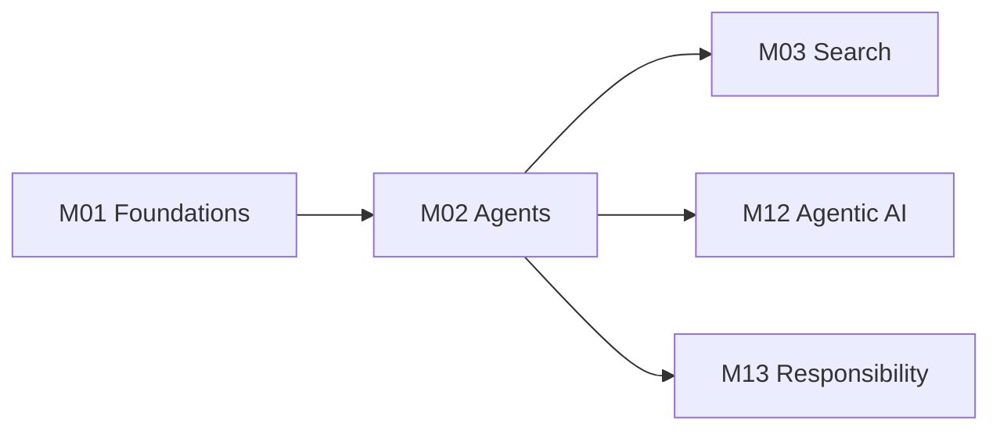

# M02 — Intelligent Agents and Environments

| Level | 200 |
| :--- | :--- |
| Study time | 17.9 hours — guided 7.1 · practical 6.0 · assessment 4.8 · project 0.0 |
| Lessons | 5 of 5 |
| Course outcome | CLO1 — explain how agents perceive, decide and act in an environment |
| Prerequisites | [P01 Python Programming](../../prerequisites/P01-python-programming/README.md) |

[← Previous module: M01](../M01-introduction-and-foundations/README.md) · [Course home](../../README.md) · [All modules](../README.md) · [Next module: M03](../M03-problem-solving-and-search-algorithms/README.md)

## Overview

"Agent" is the organising abstraction of the whole field: something that perceives an environment,
decides, and acts. This module gives you the vocabulary to describe any AI system precisely — percepts,
actions, rationality, PEAS descriptions, and the properties of environments — and then builds the five
classical architectures, each one adding exactly one capability to the previous.

Every architecture is implemented in the module's code and measured on the same world, so the
differences are numbers rather than claims: a reflex agent scores −49 and cleans one cell; a goal-based
agent scores 15 and cleans both.

## Learning outcomes

By the end of this module you will be able to:

1. **Write** a PEAS description with a measurable performance measure.
2. **Classify** an environment on seven dimensions and predict which architectures fit it.
3. **Distinguish** reflex, model-based, goal-based, utility-based and learning agents by what each adds.
4. **Explain** why partial observability forces internal state, and why stochasticity forces expected values.
5. **Diagnose** a badly specified objective from the behaviour it produces.

## Module map

| ID | Title | Type | Time | Link |
| :--- | :--- | :--- | ---: | :--- |
| L02-01 | Agents, Percepts, Actions and the Agent–Environment Boundary | Lesson | 90 m | [Read](lessons/L02-01-agents-percepts-actions.md) |
| L02-02 | Rational Agents and PEAS Descriptions | Lesson | 80 m | [Read](lessons/L02-02-rational-agents-and-peas.md) |
| L02-03 | Task Environments and Their Properties | Lesson | 80 m | [Read](lessons/L02-03-task-environments-and-properties.md) |
| L02-04 | Simple Reflex and Model-Based Agents | Lesson | 85 m | [Read](lessons/L02-04-simple-reflex-and-model-based-agents.md) |
| L02-05 | Goal-Based, Utility-Based and Learning Agents | Lesson | 90 m | [Read](lessons/L02-05-goal-utility-and-learning-agents.md) |
| NB-02-01 | The Agent Loop in a Gridworld | Notebook | 60 m | [Open](notebooks/nb-02-01-agent-loop-gridworld.ipynb) |
| LAB-02-01 | The Intelligent Vacuum Cleaner | Lab | 2.5 h | [Start](labs/lab-02-01-intelligent-vacuum-cleaner.md) |
| LAB-02-02 | Intelligent Campus Navigation Agent | Lab | 3 h | [Start](labs/lab-02-02-campus-navigation-agent.md) |
| QUIZ-02 | Module self-check | Quiz | 30 m | [Take](../../assessments/quizzes/quiz-m02.md) |

## Reference code

| File | What it contains |
| :--- | :--- |
| [`agents.py`](code/agents.py) | `RandomAgent`, `ReflexAgent`, `ModelBasedAgent`, `GoalBasedAgent`, `UtilityBasedAgent`, `LearningAgent`, `run_episode` |
| [`environments.py`](code/environments.py) | `GridWorld` (local or full percept, optional slip) and `BanditWorld` |

Measured on `GridWorld(4, 4, dirt={(1,1),(3,2)}, seed=1)`, 60-step limit. With a **local** percept
(the default in `agents.py`) planning has nothing to see, so the three knowledge-rich agents tie; with a
**full** percept the planner pulls ahead:

| Agent | Steps (local) | Score (local) | Steps (full) | Score (full) |
| :--- | ---: | ---: | ---: | ---: |
| Random | 60 | −34 | 60 | −34 |
| Reflex | 60 | −49 | 60 | −49 |
| Model-based | 15 | 7 | 15 | 7 |
| Goal-based | 15 | 7 | **7** | **15** |
| Utility-based | 15 | 7 | 7 | 15 |

Every agent cleans 2 cells except random and reflex, which clean 1. This table is the module's central
result: capability is a property of the percept and the architecture together, not of either alone.

## Where this module sits

*Text description of the diagram:* M02 follows M01, feeds the search module (an agent that plans),
returns near the end of the course when LLM agents are built, and supplies the vocabulary used when a
system's objectives and failure modes are audited.

## Suggested study plan

| Day | Work | Time |
| :--- | :--- | ---: |
| 1 | L02-01, L02-02; write a PEAS description of a system you use | 3 h |
| 2 | L02-03, L02-04; run `python code/agents.py` | 3 h |
| 3 | L02-05, NB-02-01 | 2.5 h |
| 4–5 | LAB-02-01 | 2.5 h |
| 6 | LAB-02-02 | 3 h |

## Assessment for this module

| Component | Weight |
| :--- | ---: |
| LAB-02-01 (controllers, comparison, manager note) | 35% |
| LAB-02-02 (navigation, robustness, help condition) | 35% |
| QUIZ-02 | 20% |
| Notebook exercises | 10% |

## Key terms introduced

**Agent**, **percept**, **actuator**, **rationality**, **PEAS**, **performance measure**, **task
environment**, **observability**, **determinism**, **episodic vs sequential**, **agent function**,
**belief state**, **model-based agent**, **utility function**, **learning agent**. Definitions:
[glossary](../../resources/glossary/classical-ai.md).

## Navigation

[← Previous module: M01](../M01-introduction-and-foundations/README.md) · [Course home](../../README.md) ·
[All modules](../README.md) · [Next module: M03](../M03-problem-solving-and-search-algorithms/README.md) ·
[Quiz for M02](../../assessments/quizzes/quiz-m02.md) · [Assignment PA-03 — An Agent for a Partly Observable Environment](../../assessments/programming/pa-03-intelligent-agents.md)
