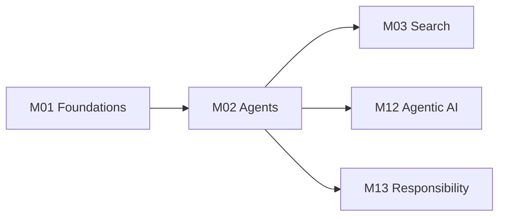

# M02 — Intelligent Agents and Environments

| Level | 200 |
| :--- | :--- |
| Study time | 18 hours (module total) |
| Lessons published | 1 of 5 |
| Course outcome | CLO1 — explain how agents perceive, decide and act in an environment |
| Prerequisites | [P01 Python Programming](../../prerequisites/P01-python-programming/README.md) |

[← Previous module: M01](../M01-introduction-and-foundations/README.md) · [Course home](../../README.md) ·
[Next module: M03](../README.md#m03)

> **Note** — this module is being published lesson by lesson. L02-01 and the reference code are
> ready; the remaining lessons, notebooks and labs are in preparation. Nothing below links to a page
> that does not exist yet.

**What to do when L02-01 ends.** The remaining four lessons are not published. Continue with
[M04 Knowledge Representation](../M04-knowledge-representation-and-logical-reasoning/README.md),
which needs only P02 and does not depend on the rest of M02, then
[M06 Machine Learning](../M06-machine-learning-fundamentals/README.md). Do not wait for M03 —
search is not published either.

## Overview

"Agent" is the organising abstraction of the whole field: something that perceives an environment,
decides, and acts. This module gives you the vocabulary to describe any AI system precisely —
percepts, actions, rationality, PEAS descriptions, and the properties of environments (observable or
not, deterministic or stochastic, static or dynamic). Every later module is, in effect, a different
way of choosing the agent function.

## Learning outcomes

By the end of this module you will be able to:

1. **Write** a PEAS description for a system you know, with a measurable performance standard.
2. **Classify** an environment on the standard dimensions and predict which algorithm families fit it.
3. **Distinguish** simple reflex, model-based, goal-based and utility-based agents, and say what each
   one adds.
4. **Explain** why partial observability forces an internal state estimate.
5. **Diagnose** a badly specified objective from the behaviour it produces.

## Before you start

You need to be able to write and run a small Python program, and to read a class definition.

- **Run Python and a notebook** — [LP01-01](../../prerequisites/P01-python-programming/lessons/LP01-01-setting-up-python-and-jupyter.md)
- **Write functions and collections** — [LP01-04](../../prerequisites/P01-python-programming/lessons/LP01-04-functions-and-collections.md)

**Readiness self-check.** If you cannot answer three of these, spend an hour in P01 first:

1. Can you write a class with two methods and instantiate it?
2. Can you explain what a loop over a dictionary does?
3. Can you read a traceback and find the failing line?

## Where this module sits

*Text description of the diagram:* M02 follows M01, feeds the search module (an agent that plans),
returns near the end of the course when LLM agents are built, and supplies the vocabulary used when
a system's objectives and failure modes are audited.

## Module map

| ID | Title | Type | Time | Link |
| :--- | :--- | :--- | ---: | :--- |
| L02-01 | Agents, Percepts, Actions and the Agent–Environment Boundary | Lesson | 90 m | [Read](lessons/L02-01-agents-percepts-actions.md) |
| CODE | `agents.py` — agent architectures used in the lesson | Reference code | 20 m | [Open](code/agents.py) |
| CODE | `environments.py` — grid and partial-observation environments | Reference code | 20 m | [Open](code/environments.py) |

**Published so far:** 90 minutes of lesson, plus reference code. The remaining four lessons and the
module's notebooks, labs and quiz are in preparation; this table will grow as they are published.

## How to study this module now

| Day | Work | Time |
| :--- | :--- | ---: |
| 1 | Read L02-01 §1–§6 with the code open; run `environments.py` | 90 min |
| 2 | Re-read §7–§10, answer the self-check, then modify one environment | 60 min |

Write the PEAS description of a system you actually use — a lift, a spam filter, a navigation app —
before moving on. The rest of the course assumes you can do this in a few minutes.

## Key terms introduced

**Agent**, **percept**, **actuator**, **rationality**, **PEAS**, **performance measure**, **task
environment**, **observability**, **determinism**, **episodic vs sequential**, **agent function**,
**model-based agent**, **utility**. All are defined in the [glossary](../../resources/glossary.md).

## Navigation

[← Previous module: M01](../M01-introduction-and-foundations/README.md) · [Course home](../../README.md) ·
[All modules](../README.md) · [Next module: M03](../README.md#m03) ·
[Quiz for M02](../../assessments/quizzes/quiz-m02.md)
