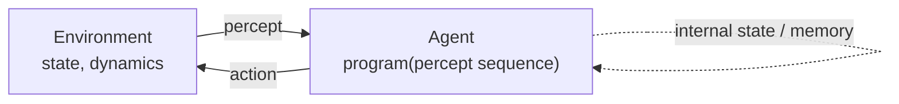

# L02-01 — Agents, Percepts, Actions and the Agent–Environment Boundary

| Module | M02 · Intelligent Agents and Environments |
| :--- | :--- |
| Level | 200 |
| Study time | 90 minutes |
| Prerequisites | [L01-01](../../M01-introduction-and-foundations/lessons/L01-01-what-is-artificial-intelligence.md) · [LP01-05](../../../prerequisites/P01-python-programming/lessons/LP01-05-objects-modules-exceptions-and-files.md) |
| Notebook | NB-02-01 The Agent Loop in a Gridworld |
| Lab | LAB-02-02 From Reflex to Utility |

[← Module start](../README.md) · [Module end](../README.md)

## On this page

- [1. Learning Objectives](#1-learning-objectives)
- [2. Prerequisite Knowledge](#2-prerequisite-knowledge)
- [3. Conceptual Explanation](#3-conceptual-explanation)
- [4. Pseudocode: the smallest possible agent](#4-pseudocode-the-smallest-possible-agent)
- [5. Worked Examples](#5-worked-examples)
- [6. Complexity: what the loop costs](#6-complexity-what-the-loop-costs)
- [7. Python Implementation](#7-python-implementation)
- [8. Visual Explanation](#8-visual-explanation)
- [9. Practical Applications](#9-practical-applications)
- [10. Common Mistakes](#10-common-mistakes)
- [11. Practical Exercises](#11-practical-exercises)
- [12. Self-Assessment](#12-self-assessment)
- [13. Key Terms](#13-key-terms)
- [14. Further Reading](#14-further-reading)
- [What to Do Next](#what-to-do-next)

[Module start](../README.md) · [Module home](../README.md) · [Module end](../README.md)

## 1. Learning Objectives

By the end of this lesson you will be able to:

- **Define** agent, percept, percept sequence, action, agent function and agent program, and use each term correctly in a sentence.
- **Draw** the agent–environment boundary for a described system and justify where you put the line.
- **Implement** the loop that turns percepts into actions, and explain why the loop, not the function, is what runs forever.
- **Quantify** why a table-driven agent is impossible in practice, using the size of the percept-sequence space.

## 2. Prerequisite Knowledge

You should already be able to:

- Explain what AI is and why the definition is about goal-directed action — [L01-01](../../M01-introduction-and-foundations/lessons/L01-01-what-is-artificial-intelligence.md).
- Write a Python class with methods and instantiate it — [LP01-05](../../../prerequisites/P01-python-programming/lessons/LP01-05-objects-modules-exceptions-and-files.md).
- Read a `for` loop and a function with a return value — [LP01-04](../../../prerequisites/P01-python-programming/lessons/LP01-04-functions-and-collections.md).

## 3. Conceptual Explanation

### 3.1 The intuition

A thermostat, a chess engine and a self-driving car do not look like the same kind of thing. But each can be described the same way: it **senses** something, **decides** something, and **acts**. That description is the organising abstraction of the whole field.

Here is the vocabulary, using a robot vacuum as the running example.

- A **percept** is what the agent senses at one moment: `dirty = True`, `bump = False`.
- A **percept sequence** is everything it has sensed so far, in order.
- An **action** is what it can do: move up, down, left, right, suck, or do nothing.
- The **agent function** maps a percept sequence to an action. It is a mathematical object: for every possible history, one action.
- The **agent program** is the code that computes that function. It runs on a real machine with finite memory, which is where all the engineering lives.

The distinction between function and program is the source of endless confusion in beginner discussions. The function is the *specification*; the program is the *implementation*. Two different programs can compute the same function; one program cannot compute a function it cannot represent.

### 3.2 The formal idea

An agent is anything that can be viewed as choosing actions in response to percepts. Formally, an agent function is

$$
f : \mathcal{P}^{*} \to \mathcal{A}
$$

where $\mathcal{P}^{*}$ is the set of all finite percept sequences and $\mathcal{A}$ is the set of actions. The environment supplies percepts and consumes actions; the agent supplies actions and consumes percepts.

That is the whole ontology, and it is deliberately thin. It says nothing about neurons, logic or learning. Any mechanism that chooses actions in response to percepts is an agent, which is why the abstraction survives every change of technique in the field.

### 3.3 Drawing the boundary

The **agent–environment boundary** is the line between what decides and what is decided upon. It sounds trivial and is not, because a system can be drawn several ways and each drawing changes what "the agent" is:

| System | Where beginners put the line | Where it often belongs |
| :--- | :--- | :--- |
| Robot vacuum | around the whole device | around the control software; sensors and motors are environment interface |
| Chess program | around the program | around the move chooser; the clock and the GUI are environment |
| Recommendation feed | around the model | around ranking + logging; the user's response is environment |
| Thermostat | around the box | around the switching rule; the room is environment |

Two rules keep this honest. First, **the agent does not get to change its own percepts directly** — it acts, and the environment decides what it senses next. Second, **anything the agent cannot control but must react to is environment**, including the consequences of its own actions.

Why it matters: if you draw the boundary around too much, you hide the feedback loop and your evaluation becomes circular (the system grades its own homework). If you draw it too small, you invent an environment that does not exist.

### 3.4 Why a table is not enough

The cleanest possible agent program is a lookup table: index the percept sequence, read off the action. It is perfectly rational by construction if you fill it correctly, and it is completely useless.

Count the size. Suppose the agent has 4 possible actions and 4 possible percepts, and it runs for $T$ steps. The number of distinct percept sequences is $4^{T}$ (each step has one of four percepts), and the table needs one action for each, so the table has

$$
|\mathcal{A}|^{|\mathcal{P}|^{T}} = 4^{4^{T}}
$$

entries. For $T = 1$ that is 256 entries — a small file. For $T = 2$ it is 4,294,967,296 entries. For $T = 3$ it is about $3.4 \times 10^{38}$ — more than the number of atoms in a large building. A robot vacuum running for a minute at ten percepts a second has $T = 600$.

This is the first appearance of a theme that runs through the whole course: **the naive representation of a policy is exponentially large**, and every algorithm you will learn is a way of compressing it using structure. Search compresses by exploring only reachable states; logic compresses by rules; learning compresses by fitting a small model to examples.

### 3.5 The loop

The agent function is a mathematical total function, but nothing ever evaluates it on all inputs. The program runs a loop:

```text
percepts = []
LOOP forever:
    p = sense()                  # environment -> agent
    percepts.append(p)
    a = program(percepts)        # decision
    act(a)                       # agent -> environment
```

Every architecture in this module is a different `program`. The loop is identical.

## 4. Pseudocode: the smallest possible agent

```text
FUNCTION reflex_vacuum(percept):
    IF percept.dirty: RETURN "suck"
    IF percept.bump:  RETURN turn_left()     # unstick
    RETURN "forward"

FUNCTION run(agent_program, environment, steps):
    history <- []
    REPEAT steps times:
        p <- environment.percept()
        history.append(p)
        a <- agent_program(p)
        environment.step(a)
    RETURN environment.performance
```

Note what is *not* here: no memory, no goal, no model. That is intentional. The simplest agent is the baseline against which every later architecture is measured, and in §7 you will see it score poorly — which is the point.

## 5. Worked Examples

### Example 1 — A percept sequence, written out

A 3×3 vacuum world with dirt at (1,1) and (2,2), starting at (0,0), fully observable. The environment prints:

```text
('full', (0, 0), frozenset({(1, 1), (2, 2)}), frozenset())
```

Read it as: *kind of percept*, *where I am*, *where the dirt is*, *where the obstacles are*. The first field tells the agent which kind of percept it is holding, which matters later when the same code must run with partial observability.

### Example 2 — Trace of six actions and their rewards

Using the convention "+10 for cleaning, −1 per move, −2 per bump":

| Step | Action | Reward | Total | Dirt left |
| ---: | :--- | ---: | ---: | ---: |
| 1 | right | −1 | −1 | 2 |
| 2 | down | −1 | −2 | 2 |
| 3 | suck | +10 | 8 | 1 |
| 4 | right | −1 | 7 | 1 |
| 5 | down | −1 | 6 | 1 |
| 6 | suck | +10 | 16 | 0 |

Final performance 16. Six actions, two cleans, four moves: $2 \times 10 - 4 = 16$. The arithmetic is trivial; the discipline of writing the trace is not, because it is the only way to see *why* an agent scored what it scored.

### Example 3 — Same loop, different boundary

Consider a delivery robot with a route planner. If you draw the boundary around the planner, its percept is "current position and job list", and the wheels, traffic and battery are environment. If you draw the boundary around the whole robot, the planner becomes an internal component and the *agent* perceives job requests and acts by arriving at addresses. Both are valid descriptions; they answer different questions.

The test: which entity's **failure** are you trying to explain? A late delivery caused by traffic is an environment failure under the second drawing and an unmodelled disturbance under the first. Draw the boundary so that the failure you care about has a place to live.

## 6. Complexity: what the loop costs

| Architecture | Time per step | Space |
| :--- | :--- | :--- |
| Table-driven (full history) | $O(1)$ lookup | $O(\lvert\mathcal{A}\rvert^{\lvert\mathcal{P}\rvert^{T}})$ — impossible |
| Reflex rules | $O(r)$ for $r$ rules | $O(r)$ |
| Model-based with map | $O(V + E)$ to search the believed map | $O(V)$ for the map |
| Goal-based planner | $O(V + E)$ per decision | $O(V)$ |

The trade is stark: the table has no runtime cost and no feasible size; the others have small runtime cost and small memory, at the price of being *approximations* of the rational function. Everything else in M03 is a refinement of that trade.

## 7. Python Implementation

```python
from dataclasses import dataclass


@dataclass
class VacuumPercept:
    dirty: bool
    bump: bool


def reflex_vacuum(percept: VacuumPercept, memory: dict) -> str:
    """Simplest reflex program: clean if dirty, turn if stuck, else forward."""
    if percept.dirty:
        return "suck"
    if percept.bump:
        memory["turns"] = memory.get("turns", 0) + 1
        return "turn_left"
    return "forward"


# A tiny world: the agent moves east until it hits the wall, cleaning as it goes.
world = [
    ["dirty", "clean", "dirty"],
    ["clean", "dirty", "clean"],
]
position, facing = 0, 0          # facing: 0 = east, 1 = south, 2 = west, 3 = north
memory: dict = {}
score = 0
bumped = False

for step in range(8):
    percept = VacuumPercept(dirty=world[position][facing] == "dirty", bump=bumped)
    action = reflex_vacuum(percept, memory)
    bumped = False
    if action == "suck":
        world[position][facing] = "clean"
        score += 10
    elif action == "forward":
        facing = min(facing + 1, 2)
        score -= 1
    else:
        position = min(position + 1, 1)
        bumped = position == 1 and facing == 2
        score -= 1
    print(f"step {step}: percept={percept} action={action:9s} score={score}")
print("final score:", score)
```

**Output**

```text
step 0: percept=VacuumPercept(dirty=True, bump=False) action=suck      score=10
step 1: percept=VacuumPercept(dirty=False, bump=False) action=forward   score=9
step 2: percept=VacuumPercept(dirty=True, bump=False) action=suck      score=19
step 3: percept=VacuumPercept(dirty=False, bump=False) action=forward   score=18
step 4: percept=VacuumPercept(dirty=False, bump=False) action=turn_left score=17
step 5: percept=VacuumPercept(dirty=True, bump=False) action=suck      score=27
step 6: percept=VacuumPercept(dirty=False, bump=False) action=forward   score=26
step 7: percept=VacuumPercept(dirty=False, bump=False) action=turn_left score=25
```

The agent cleans three cells and ends with 25. Now notice what it did **not** do: it never turned back to clean the first row's second cell, because a reflex program has no memory of where it has been. It is not rational — it is merely reactive. That distinction is the subject of L02-02.

## 8. Visual Explanation



*Text description:* a two-box loop. The environment emits a percept into the agent; the agent emits an action back. The dotted self-arrow is the only place architectures differ: a reflex agent has no such arrow, a model-based agent does, and a learning agent also writes to it from experience. Notice there is no arrow from the agent directly to its own next percept — that is the boundary rule.

## 9. Practical Applications

- **Robot vacuum cleaners.** The commercial product is exactly this loop with a map (model-based) and a dirt sensor; the difference between a cheap and an expensive model is mostly the internal state.
- **Industrial process control.** A controller senses temperature and pressure, acts on valves. The agent abstraction lets control engineers and software engineers share a vocabulary, and lets you swap a PID rule for a learned policy without redrawing the diagram.
- **API-based assistants.** A tool-using assistant perceives the conversation and tool results, and acts by calling tools. The boundary question ("is the tool part of the agent?") determines where you put retries, logging and permission checks — a design decision with security consequences in M12.

## 10. Common Mistakes

| Mistake | What you will see | Why it happens | Fix |
| :--- | :--- | :--- | :--- |
| Treating the agent function as the program | "The function runs forever" | Function is a specification; program is code | Say "the loop runs; the function is consulted each step" |
| Letting the agent read the world state directly | Test passes, deployment fails | Full state is convenient in code | Pass only the percept; hide the rest behind the interface |
| Drawing the boundary around the whole product | Evaluation grades the system on its own outputs | Comfortable and circular | Put the sensory and actuation interface on the boundary |
| Assuming a reflex agent is rational | "It cleans, so it is doing the right thing" | Any cleaning looks like progress | Check the performance measure; §7's agent leaves dirt behind |
| Forgetting that percepts are partial | Code reads `world.dirt` directly | Shortcut during development | Make the percept the only input; see the local-percept variant |

## 11. Practical Exercises

1. **Write the percept sequence.** For the trace in Example 2, write the full percept sequence as a list of tuples. How many distinct sequences are possible in a 4×4 world if you only distinguish dirty/clean and bump/no-bump? (Hint: $2^{2T}$ for $T$ steps.)
2. **Count the table.** For 3 actions and 8 percepts, compute the table size for $T = 1, 2, 3$. At which $T$ does it exceed $10^{12}$ entries?
3. **Move the boundary.** Take the recommendation feed from §3.3 and draw the boundary two ways. For each, name one failure that becomes visible and one that becomes invisible.
4. **Break the reflex agent.** Modify §7 so the agent cleans all four dirty cells. What is the minimum memory it needs? Is the result still a reflex agent by the definition in §3.1?
5. **Design a percept.** For a campus shuttle, list the percept fields you would expose to the agent, and one field you would deliberately withhold. Justify the omission in terms of what the agent could otherwise do.

## 12. Self-Assessment

**1.** Distinguish the agent function from the agent program, and say why the distinction matters in practice.
<details><summary>Show answer</summary>

The agent function is the mathematical mapping from every possible percept sequence to an action; the program is the finite code that computes it. The distinction matters because a program cannot represent an arbitrary function — the table is exponentially large — so every real program is an approximation, and its quality is judged against the rational function it approximates.

</details>

**2.** Why is a table-driven agent with a full percept history impossible rather than merely inefficient?
<details><summary>Show answer</summary>

Because the number of percept sequences grows as $|\mathcal{P}|^T$, so the table needs $|\mathcal{A}|^{|\mathcal{P}|^T}$ entries. For 4 percepts and 4 actions, three steps already need about $3.4\times10^{38}$ entries; a real agent runs for hundreds of steps. It is not a matter of faster hardware: the storage exceeds any physical limit.

</details>

**3.** In the §7 trace the agent scores 25 but leaves a dirty cell. Is it irrational? Justify your answer in terms of the performance measure.
<details><summary>Show answer</summary>

It is irrational relative to the stated measure (10 per clean, −1 per move): returning to the remaining cell would have added 10 for a few moves. It is *not* irrational relative to its own rules, which never consider unvisited cells — the program simply cannot represent the better policy. Rationality is a property of the choice given what the agent knows and can represent; this agent knows too little.

</details>

**4.** Give one reason to draw the agent–environment boundary tightly (around the decision software) and one reason to draw it widely.
<details><summary>Show answer</summary>

Tightly: failures of sensing and actuation stay visible as environment effects, so you do not blame the policy for a broken sensor, and evaluation does not become circular. Widely: when the question is about the product's behaviour — does the whole robot deliver on time? — a wide boundary matches the stakeholder's question, and internal interfaces become implementation detail. State the drawing explicitly either way.

</details>

**5.** A colleague says "the agent perceives the database, decides, and writes to it — so the database is part of the agent". What is wrong with the reasoning, and what test would settle it?
<details><summary>Show answer</summary>

Writing to the database is an action, and reading from it is a percept, so by the definition the database sits on the environment side of the boundary. The test: can the agent change what it perceives without acting? If yes, it is reading state it should not have (a boundary violation); if it must act to change the database, the database is environment.

</details>

## 13. Key Terms

- **Agent** — anything that perceives its environment and acts on it.
- **Percept** — the agent's sensory input at one moment.
- **Percept sequence** — the complete history of percepts.
- **Agent function** — the mapping from percept sequences to actions.
- **Agent program** — the code that computes the agent function.
- **Actuator** — the component through which the agent acts.
- **Sensor** — the component through which the agent perceives.
- **Agent–environment boundary** — the line between what decides and what is decided upon.
- **Table-driven agent** — an agent whose policy is stored explicitly for every percept sequence.

Definitions are collected in the [glossary](../../../resources/glossary.md).

## 14. Further Reading

- Russell, S. & Norvig, P. (2021). *Artificial Intelligence: A Modern Approach*, 4th ed., Chapter 2.1–2.2. — The source of this vocabulary; the table-size argument is theirs.
- Wooldridge, M. (2009). *An Introduction to MultiAgent Systems*, 2nd ed., Chapter 2. — The same abstraction extended to several agents sharing an environment.
- Sutton, R. & Barto, A. (2018). *Reinforcement Learning: An Introduction*, 2nd ed., §3.1. — The agent–environment interface formalised for learning; useful to see how the same diagram supports a different field.

## What to Do Next

Run NB-02-01 to trace an agent loop yourself, then read L02-02 — Rationality and the PEAS Description, which supplies the missing ingredient: a definition of *good* behaviour.

---

**Navigation:** [← Module start](../README.md) · [Module end](../README.md)
