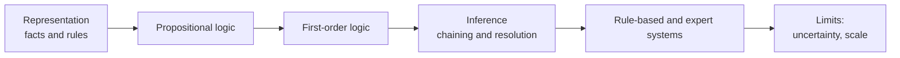

# M04 — Knowledge Representation and Logical Reasoning

| Level | 200 |
| :--- | :--- |
| Study time | 21 hours (module total) |
| Lessons published | 7 of 7 |
| Course outcome | CLO3 — represent knowledge in logic and derive conclusions by sound inference |
| Prerequisites | [P02 Mathematics for AI](../../prerequisites/P02-mathematics-for-ai/README.md) |

[← Previous module: M03](../README.md#m03) · [Course home](../../README.md) ·
[Next module: M05](../README.md#m05)

> **Note** — all seven lessons and both notebooks are published. The labs and mini-project are
> still being written. The quiz, the programming assignment and the self-assessment sheet are
> available now: [QUIZ-M04](../../assessments/quizzes/quiz-m04.md),
> [PA-04](../../assessments/programming/pa-04-knowledge-based-systems.md),
> [SA-M04](../../assessments/self-assessment/sa-m04.md).

## Overview

Machine learning is not the only way to make a system know something. This module covers the symbolic
tradition: representing facts and rules in propositional and first-order logic, and deriving new facts
by sound inference. These ideas still run scheduling engines, eligibility systems, database
constraints and knowledge graphs — and they teach a discipline that statistical methods lack: the
ability to say exactly what follows from what.

## Learning outcomes

By the end of this module you will be able to:

1. **Translate** a described domain into propositions, predicates and rules.
2. **Evaluate** entailment with truth tables, forward chaining, backward chaining and resolution.
3. **Use** quantifiers and unification correctly, including the occurs-check and substitution.
4. **Choose** between a rule base and a learned model for a stated problem, and justify the choice.
5. **Explain** why a rule base becomes inconsistent or incomplete, and detect both.

## Before you start

You need basic set notation and the habit of reading a formal definition slowly.

- **Sets, relations and functions** — [P02 Mathematics for AI](../../prerequisites/P02-mathematics-for-ai/README.md)
- **Read and modify a Python program** — [LP01-04](../../prerequisites/P01-python-programming/lessons/LP01-04-functions-and-collections.md)

**Readiness self-check.** If you cannot answer three of these, revisit P02 §1–§2 first:

1. Can you say what a relation is, and give one over a small domain?
2. Can you evaluate a Boolean expression for every assignment of its variables?
3. Can you write a recursive function over a nested list?

## Where this module sits

*Text description of the diagram:* the module moves from choosing a representation, through
propositional then first-order logic, into the inference procedures that derive new facts, and ends
with the systems built on them and the limits that push the next module towards probability.

## Module map

| ID | Title | Type | Time | Link |
| :--- | :--- | :--- | ---: | :--- |
| L04-01 | Knowledge Representation and Knowledge-Based Systems | Lesson | 75 m | [Read](lessons/L04-01-knowledge-representation-fundamentals.md) |
| L04-02 | Propositional Logic: Syntax, Operators and Truth Tables | Lesson | 75 m | [Read](lessons/L04-02-propositional-logic.md) |
| L04-03 | Inference Rules and Logical Equivalence | Lesson | 75 m | [Read](lessons/L04-03-inference-rules-and-equivalence.md) |
| L04-04 | First-Order Logic: Predicates, Terms and Quantifiers | Lesson | 75 m | [Read](lessons/L04-04-first-order-logic-and-quantifiers.md) |
| L04-05 | Unification, Forward Chaining and Backward Chaining | Lesson | 75 m | [Read](lessons/L04-05-unification-and-chaining.md) |
| L04-06 | Resolution and Automated Reasoning | Lesson | 75 m | [Read](lessons/L04-06-resolution-and-automated-reasoning.md) |
| L04-07 | Semantic Networks, Frames, Ontologies and Expert Systems | Lesson | 75 m | [Read](lessons/L04-07-rule-based-and-expert-systems.md) |
| NB-04-01 | Propositional logic workbench | Notebook | 45 m | [Open](notebooks/nb-04-01-propositional-logic-workbench.ipynb) |
| NB-04-02 | First-order inference and unification | Notebook | 45 m | [Open](notebooks/nb-04-02-first-order-inference-and-unification.ipynb) |
| CODE | `prop_logic.py`, `fol_core.py`, `knowledge_bases.py` | Reference code | 30 m | [Open](code/) |

**Total published:** about 8.8 hours of lessons, 1.5 hours of notebooks and 0.5 hours of code
reading. The syllabus allots 21 hours; the balance is labs, assignment, quiz and mini-project, which
are in preparation.

## Suggested study plan

| Day | Work | Time |
| :--- | :--- | ---: |
| 1 | L04-01, L04-02, start NB-04-01 | 2 h |
| 2 | L04-03, finish NB-04-01 | 2 h |
| 3 | L04-04, L04-05 | 2.5 h |
| 4 | NB-04-02 | 1 h |
| 5 | L04-06, L04-07 | 2.5 h |
| 6 | Re-derive two proofs by hand; answer every self-check | 2 h |

Do not read L04-05 before you can build a truth table without help. Chaining is easy once
substitution is clear and impossible before.

## Key terms introduced

**Knowledge base**, **entailment**, **model**, **validity**, **satisfiability**, **inference rule**,
**modus ponens**, **resolution**, **clause**, **unification**, **substitution**, **quantifier**,
**ontology**, **expert system**, **knowledge acquisition bottleneck**. All are defined in the
[glossary](../../resources/glossary.md).

## Navigation

[← Previous module: M03](../README.md#m03) · [Course home](../../README.md) · [All modules](../README.md) ·
[Next module: M05](../README.md#m05) · [Quiz for M04](../../assessments/quizzes/quiz-m04.md)
