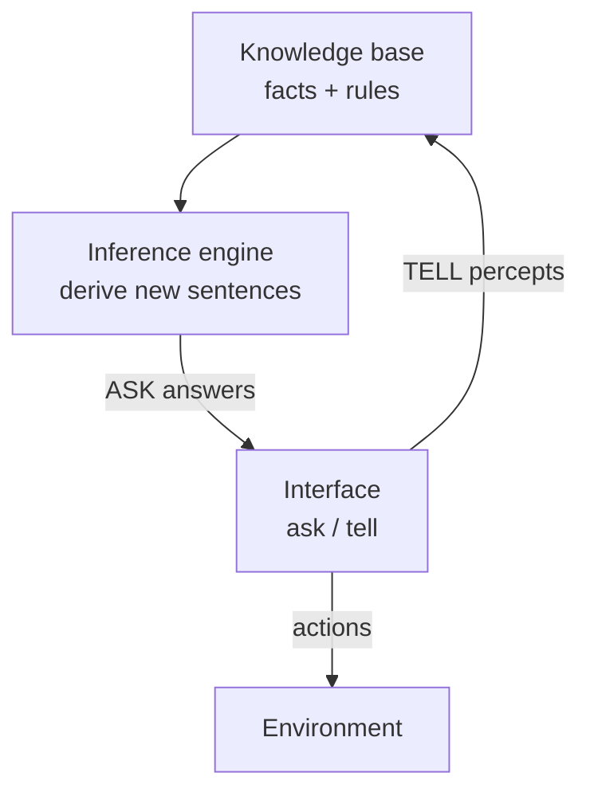

# L04-01 — Knowledge Representation and Knowledge-Based Systems

| Module | M04 · Knowledge Representation and Logical Reasoning |
| :--- | :--- |
| Level | 200 |
| Study time | 75 minutes |
| Prerequisites | [L02-01](../../M02-intelligent-agents-and-environments/lessons/L02-01-agents-percepts-actions.md) · L03-01 |
| Notebook | [NB-04-01 Propositional Logic Workbench](../notebooks/nb-04-01-propositional-logic-workbench.ipynb) |
| Lab | LAB-04-02 Advising and Family Knowledge Bases |

[← Module start](../README.md) · [Next: L04-02 Propositional Logic: Syntax, Operators and Truth Tables →](L04-02-propositional-logic.md)

## On this page

- [1. Learning Objectives](#1-learning-objectives)
- [2. Prerequisite Knowledge](#2-prerequisite-knowledge)
- [3. Conceptual Explanation](#3-conceptual-explanation)
- [4. Procedure: how a knowledge-based agent answers a question](#4-procedure-how-a-knowledge-based-agent-answers-a-question)
- [5. Worked Example — the same question, three representations](#5-worked-example--the-same-question-three-representations)
- [6. Complexity: what each representation costs](#6-complexity-what-each-representation-costs)
- [7. Python Implementation](#7-python-implementation)
- [8. Visual Explanation — the representational spectrum](#8-visual-explanation--the-representational-spectrum)
- [9. Real-World Application](#9-real-world-application)
- [10. Common Misconceptions](#10-common-misconceptions)
- [11. Exercises](#11-exercises)
- [12. Self-Assessment](#12-self-assessment)
- [13. Key Terms](#13-key-terms)
- [14. Further Reading](#14-further-reading)
- [What to Do Next](#what-to-do-next)

[Module start](../README.md) · [Module home](../README.md) · [Next: L04-02 Propositional Logic: Syntax, Operators and Truth Tables →](L04-02-propositional-logic.md)

## 1. Learning Objectives

By the end of this lesson you will be able to:

- **Explain** what a knowledge representation is, and why the choice of representation changes what an agent can conclude.
- **Distinguish** the three ingredients of a knowledge-based agent: knowledge base, inference engine and interface.
- **State** the knowledge acquisition bottleneck and give a concrete example of it.
- **Decide** whether a problem should be solved by search (M03) or by explicit knowledge (M04), and justify the choice.

## 2. Prerequisite Knowledge

You should already be able to:

- Describe an agent as a function from percept sequences to actions — [L02-01](../../M02-intelligent-agents-and-environments/lessons/L02-01-agents-percepts-actions.md).
- Define a state space, a goal test and a path cost — L03-01.
- Write and call a Python function that returns a value — [LP01-04](../../../prerequisites/P01-python-programming/lessons/LP01-04-functions-and-collections.md).

## 3. Conceptual Explanation

### 3.1 The problem representation solves

In M03 you solved problems by searching: enumerate states, test goals, expand the cheapest node. That works when the problem is *given* as a state space. But many everyday questions are not like that:

- "Is this patient's fever explained by the medication they started last week?"
- "Which courses may this student enrol in next term?"
- "Why will this printer not print?"

There is no state to search. What you have is a body of **statements that are taken to be true** and a question you want answered from them. That is the setting for knowledge representation.

A **knowledge representation (KR)** is a formal language plus a meaning for its expressions, chosen so that:

1. facts can be written down unambiguously,
2. consequences can be computed mechanically, and
3. the computation can be explained to a person.

All three matter. A representation that only satisfies (2) is a database; one that only satisfies (1) is prose.

### 3.2 The knowledge-based agent



*Text description:* percepts enter through an interface and are **told** to the knowledge base. The inference engine derives sentences the KB entails. The interface **asks** questions and turns answers into actions. The KB is data; the engine is code; the interface is the boundary from [L02-01](../../M02-intelligent-agents-and-environments/lessons/L02-01-agents-percepts-actions.md).

The loop is the same as the agent loop from M02. What changed is the *program*: instead of hard-coded rules it is `ask(KB, query)`.

### 3.3 Syntax, semantics and entailment

Every logic has three layers, and confusing them is the most common source of error in this module.

| Layer | Question it answers | Example |
| :--- | :--- | :--- |
| **Syntax** | Is this a well-formed sentence? | `fever ∧ rash` is; `∧ fever` is not |
| **Semantics** | In which worlds is it true? | true when both fever and rash hold |
| **Proof theory** | How do we derive it? | forward chaining, resolution |

**Entailment** connects semantics to what we want:

$$
KB \models \alpha \quad\text{iff}\quad \text{every world in which } KB \text{ is true is a world in which } \alpha \text{ is true.}
$$

An inference procedure is **sound** if it only derives entailed sentences, and **complete** if it derives every entailed sentence. Soundness protects you from wrong answers; completeness protects you from missed ones. Most practical engines give up completeness to gain speed — that is a trade you will make explicitly in §6.

### 3.4 What makes a representation good

Four properties, in the order they usually bite:

1. **Expressiveness** — can it say what the domain needs? Propositional logic cannot say "all students"; first-order logic can.
2. **Computational tractability** — can a conclusion be reached in reasonable time? Full first-order entailment is only semi-decidable; restricted rule languages are fast.
3. **Naturalness** — can a domain expert read and correct it? Frames and rules pass; raw clauses fail.
4. **Modularity** — can a fact be changed without rewriting everything? This decides maintenance cost, which dominates real deployments.

No representation wins on all four. The rest of this module walks the trade-off: propositional logic (cheap, inexpressive), first-order logic (expressive, expensive), semantic networks and frames (natural, semantically loose), ontologies (shared, heavy), rules (tractable, brittle).

### 3.5 The knowledge acquisition bottleneck

The rules are easy to write and hard to *obtain*. A domain expert knows thousands of exceptions and caveats, thresholds, caveats — and states them only when a case forces the issue. Historically this is why expert systems stalled: the engine was ready decades before the knowledge was captured, and capture does not scale by hiring more programmers, because the bottleneck is the expert's time.

Two consequences you will meet in the lab:

- **Coverage is uneven.** Rules exist for the cases someone thought of. The KB is confident exactly where it is not competent.
- **Rules drift.** The world changes and the KB does not; unlike a learned model, a rule base has no mechanism that notices.

## 4. Procedure: how a knowledge-based agent answers a question

```text
FUNCTION ask(kb, query):
    TELL(kb, percepts)                    # facts arrive from the interface
    IF query is already in kb: RETURN "yes"
    candidates <- INFER(kb, query)        # engine-specific: chaining, resolution
    IF candidates contains query: RETURN "yes"
    IF candidates contains NOT query: RETURN "no"
    RETURN "unknown"                      # never guess

FUNCTION infer(kb, query):
    REPEAT
        new <- APPLY_RULES(kb)            # sound steps only
        IF new is empty: RETURN kb
        kb <- kb UNION new
    UNTIL fixpoint or budget exhausted
```

The `"unknown"` branch is not a failure; it is the honest answer, and an agent that never says it is not reasoning, it is bluffing. This matters in [L04-07](L04-07-rule-based-and-expert-systems.md) where expert systems must expose uncertainty rather than invent certainty.

## 5. Worked Example — the same question, three representations

Question: *is Ali allowed to take CS201?*

**Representation A — a table (a database).**

| student | course | allowed |
| :--- | :--- | :--- |
| ali | cs201 | yes |

Works until a rule changes, then every row is wrong.

**Representation B — a rule over facts.**

```text
passed(ali, cs101).
passed(ali, ma101).
eligible(S, C) :- passed(S, P1), passed(S, P2), prereq(C, P1), prereq(C, P2).
```

Now adding a student or a course is a data change, not a code change.

**Representation C — first-order logic with a quantifier.**

$$
\forall s\,\forall c\;\big(\text{eligible}(s,c) \leftrightarrow \forall p\,(\text{prereq}(c,p) \to \text{passed}(s,p))\big)
$$

This says it once, for every student, course and prerequisite. It is also the hardest to compute with, because the inner universal quantifier ranges over an open set. When you run the code in §7 you will see the practical compromise: the KB is *generated* from the course catalogue, rule by rule.

The lesson is not that C is better. It is that **expressiveness is bought with computation**, and B is usually the right purchase.

## 6. Complexity: what each representation costs

| Task | Cost | Consequence |
| :--- | :--- | :--- |
| Truth-table check of one formula with $n$ symbols | $2^n$ rows | $n{=}20$: 1,048,576 rows; $n{=}30$: 1,073,741,824 |
| Propositional entailment by model checking | $O(2^n)$ | fine for tens of symbols, not thousands |
| Propositional resolution | exponential worst case, often fast | the practical default |
| Definite clauses, forward chaining | $O(\lvert KB\rvert \cdot \text{iterations})$ | iterations bounded by atoms |
| Full first-order entailment | semi-decidable | may not terminate on non-entailments |

The last row is the important one: in first-order logic, *disproving* something may never finish. Any real system therefore restricts the language — Horn clauses, description logics, Datalog — until entailment becomes decidable. M04's labs use definite clauses for exactly this reason.

## 7. Python Implementation

```python
from dataclasses import dataclass, field


@dataclass
class KnowledgeBase:
    """Facts and rules, plus a trivial tell/ask interface."""

    facts: set[str] = field(default_factory=set)
    rules: list[tuple[frozenset[str], str]] = field(default_factory=list)

    def tell(self, fact: str) -> None:
        self.facts.add(fact)

    def infer(self) -> set[str]:
        derived = set(self.facts)
        changed = True
        while changed:
            changed = False
            for conditions, conclusion in self.rules:
                if conditions <= derived and conclusion not in derived:
                    derived.add(conclusion)
                    changed = True
        return derived

    def ask(self, query: str) -> str:
        derived = self.infer()
        if query in derived:
            return "yes"
        if f"not {query}" in derived:
            return "no"
        return "unknown"


kb = KnowledgeBase()
kb.tell("passed(ali, cs101)")
kb.tell("passed(ali, ma101)")
kb.rules += [
    (frozenset({"passed(ali, cs101)", "passed(ali, ma101)"}), "eligible(ali, cs201)"),
    (frozenset({"eligible(ali, cs201)"}), "may_enrol(ali, cs201)"),
]

for query in ["eligible(ali, cs201)", "may_enrol(ali, cs201)", "eligible(ali, cs301)"]:
    print(f"{query:28s} -> {kb.ask(query)}")
print("derived:", len(kb.infer()), "sentences")
```

**Output**

```text
eligible(ali, cs201)         -> yes
may_enrol(ali, cs201)        -> yes
eligible(ali, cs301)         -> unknown
derived: 4 sentences
```

Three details are worth noticing. The rule for `eligible` names a specific student, so it does not generalise — that is representational poverty, not a coding bug. The `unknown` answer is correct behaviour. And `derived` counts 4 because the closure contains two facts plus two derived sentences.

The full engine, with variables and unification, is [`code/fol_core.py`](../code/fol_core.py); the four worked knowledge bases are in [`code/knowledge_bases.py`](../code/knowledge_bases.py).

## 8. Visual Explanation — the representational spectrum

```text
least expressive                                            most expressive
|                                                                          |
propositional  -->  Horn clauses  -->  first-order logic  -->  higher-order
  2^n models        linear-time           semi-decidable        undecidable
  easy to check     easy to explain       needs strategies      rarely used
|                                                                          |
tables/frames  <-- natural for people -->  ontologies (description logic)
```

*Text description:* expressiveness increases to the right and computational difficulty increases with it. The practical sweet spot for business systems is Horn clauses in the middle-left: fast, explainable, and expressive enough for eligibility, configuration and diagnosis rules.

## 9. Real-World Application

**Clinical decision support, honestly described.** A hospital rule base encodes interactions such as "if the patient is on drug A and has renal impairment, flag drug B". Such systems are deployed and useful — and they are deliberately *narrow*: they check a specific safety property, they do not diagnose. Their failure mode is well documented: alert fatigue, because a rule that fires too often is ignored, which silently disables the ones that matter.

**Course enrolment at a university.** Prerequisite checking is a rule problem, not a search problem: the catalogue is small, changes yearly, and must be explainable to a student who appeals a decision. This is LAB-04-02.

**Why not a neural network?** Because the answer must be auditable and the rule must be correctable in one edit. When those two requirements dominate, explicit knowledge wins regardless of accuracy.

## 10. Common Misconceptions

| Misconception | Correction |
| :--- | :--- |
| "A knowledge base is a database." | A database stores facts and answers lookups; a KB also stores rules and answers *entailed* questions it was never explicitly told. |
| "More rules always means more capable." | Beyond a point, rules interact; the limit is consistency and maintenance, not count. |
| "Logic cannot handle uncertainty, so it is useless." | Classical logic handles *unknown* by staying silent; graded belief is the subject of M05. Conflating the two leads to badly calibrated rule systems. |
| "If the engine says no, the fact is false." | Only under the closed-world assumption. Without it, `no` should be `unknown`. Our `ask` above distinguishes the two. |
| "The hard part is the inference engine." | The engine is a solved, short program. The hard part is obtaining and maintaining the knowledge. |

## 11. Exercises

1. **Represent it twice.** Write the statement "every student who has passed CS101 may take CS201" as (a) a propositional sentence set for three named students, and (b) a first-order sentence. Count the sentences in each.
2. **Find the missing case.** Extend the `KnowledgeBase` in §7 so that `eligible(ali, cs301)` becomes `unknown` rather than a crash, then make `cs301` require `cs201` and observe the answer change.
3. **Cost it.** Your KB has 24 propositional symbols. How many rows does a truth table need? At one million rows per second, how long does a check take?
4. **Break the closed world.** Give a query where `ask` returning `"no"` would be a lie, and explain what the KB would need in order to know.
5. **Choose a representation.** For each of these, say whether M03 search or M04 knowledge is the better fit, and why: route planning, tax calculation, chess endgame, appointment scheduling with constraints, drug-interaction checking.

## 12. Self-Assessment

**1.** Why does a knowledge-based agent need an inference engine at all, if the facts are already stored?
<details><summary>Show answer</summary>

Because most useful answers were never stored. The KB holds a finite set of sentences; the questions concern their consequences. The engine computes entailment, so a small KB answers many questions. Without it you would need to store every answer in advance — the table-driven agent of L02-01, with its exponential size.

</details>

**2.** Distinguish soundness from completeness, and say which one a safety-critical rule engine should never sacrifice.
<details><summary>Show answer</summary>

Soundness: every derived sentence is entailed (no false positives). Completeness: every entailed sentence is eventually derived (no false negatives). A safety system must stay sound — a wrongly flagged safe drug combination is dangerous. It may sacrifice completeness, provided the interface reports "unknown" rather than "safe".

</details>

**3.** What exactly is the knowledge acquisition bottleneck, and why does hiring more engineers not fix it?
<details><summary>Show answer</summary>

It is the cost of extracting, formalising and maintaining expert knowledge. The scarce resource is expert attention and the tacit exceptions they only recall when confronted with cases, not programming hours. More engineers generate more interviews and more rules to reconcile, without increasing the supply of validated knowledge.

</details>

**4.** Give one question that propositional logic cannot express and first-order logic can, and explain the representational difference.
<details><summary>Show answer</summary>

"Every student who passes CS101 may take CS201." Propositional logic has only fixed symbols (`ali_passed_cs101`), so it needs one sentence per student. First-order logic quantifies over individuals — $\forall s(\text{passed}(s, cs101) \to \text{may\_take}(s, cs201))$ — and thus states the rule once for an open-ended domain.

</details>

**5.** Your rule base answers "eligible" for 80% of cases and "unknown" for 20%. A colleague calls the unknowns bugs. Argue the opposite position.
<details><summary>Show answer</summary>

The unknowns mark the boundary of the KB's competence. Forcing them to "no" would be unsound: the student may be eligible under an exception the KB does not encode. Reporting unknown routes the case to a human, which is the correct handling of incomplete knowledge; a rule base that never says unknown is either trivial or wrong.

</details>

## 13. Key Terms

- **Knowledge representation** — a formal language plus semantics for writing facts and rules.
- **Knowledge base (KB)** — the set of sentences an agent treats as true.
- **Inference engine** — the procedure that derives entailed sentences.
- **Entailment** — $KB \models \alpha$: $\alpha$ is true in every model of $KB$.
- **Soundness / completeness** — only entailed conclusions / all entailed conclusions.
- **Knowledge acquisition bottleneck** — the cost of extracting expert knowledge.
- **Closed-world assumption** — treating unprovable positive facts as false.

Definitions are collected in the [glossary](../../../resources/glossary.md).

## 14. Further Reading

- Russell, S. & Norvig, P. (2021). *AIMA*, 4th ed., Chapter 7 (Logical Agents) and §8.1. — The knowledge-based agent and the entailment framing used here.
- Davis, R. & Lenat, D. (1982). *Knowledge-Based Systems in Artificial Intelligence*. — Historical account of why knowledge, not inference, was the limiting factor.
- Baader, F. et al. (2017). *The Description Logic Handbook*, 2nd ed., Chapter 1. — What happens when you restrict first-order logic until it is decidable.

## What to Do Next

Open [NB-04-01](../notebooks/nb-04-01-propositional-logic-workbench.ipynb) to build truth tables and run your first entailment checks, then read [L04-02 — Propositional Logic](L04-02-propositional-logic.md), where the syntax and semantics in §3.3 become concrete.

---

**Navigation:** [← Module start](../README.md) · [Next: L04-02 Propositional Logic: Syntax, Operators and Truth Tables →](L04-02-propositional-logic.md)
