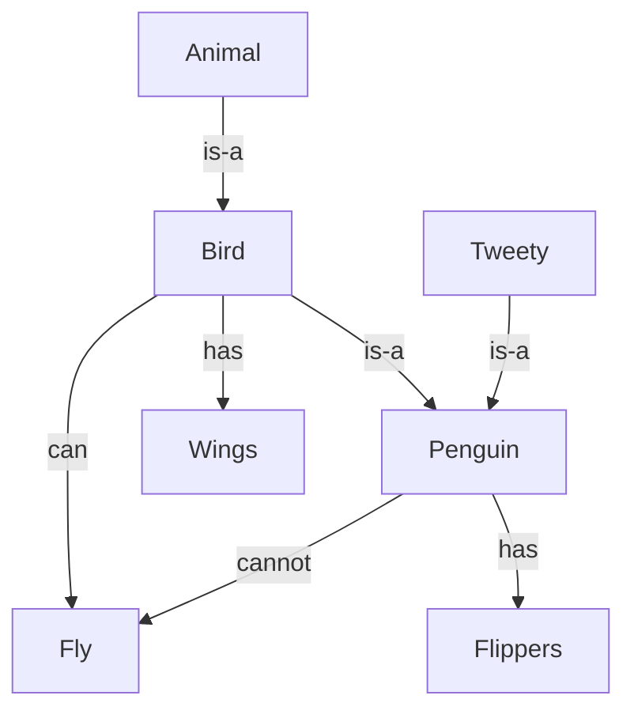
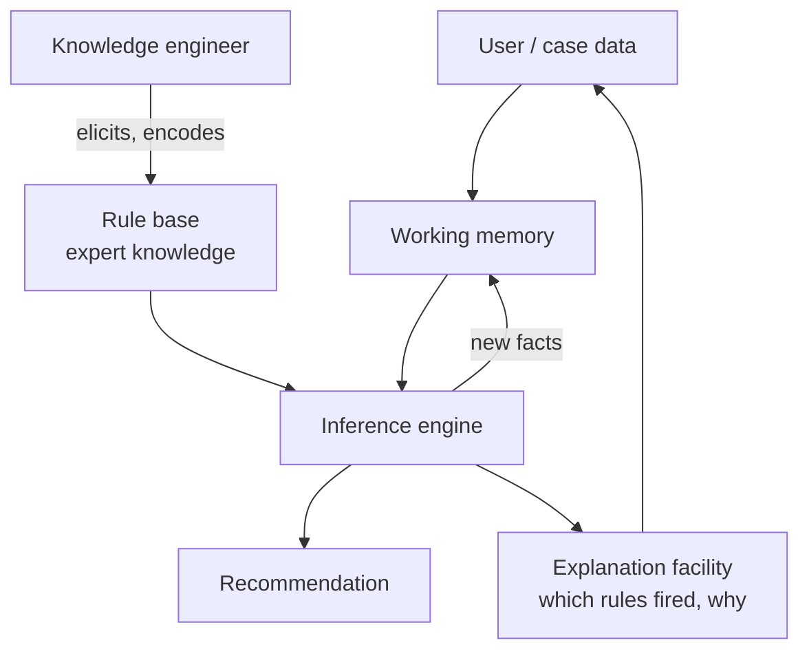

# L04-07 — Semantic Networks, Frames, Ontologies and Expert Systems

| Module | M04 · Knowledge Representation and Logical Reasoning |
| :--- | :--- |
| Level | 200 |
| Study time | 75 minutes |
| Prerequisites | [L04-06](L04-06-resolution-and-automated-reasoning.md) |
| Notebook | [NB-04-02 First-Order Inference and Unification](../notebooks/nb-04-02-first-order-inference-and-unification.ipynb) |
| Lab | LAB-04-01 Diagnostic Rule Engine |

[← Previous: L04-06 Resolution and Automated Reasoning](L04-06-resolution-and-automated-reasoning.md) · [Module end](../README.md)

## On this page

- [1. Learning Objectives](#1-learning-objectives)
- [2. Prerequisite Knowledge](#2-prerequisite-knowledge)
- [3. Conceptual Explanation](#3-conceptual-explanation)
- [4. Procedure: building a small expert system](#4-procedure-building-a-small-expert-system)
- [5. Worked Examples](#5-worked-examples)
- [6. Complexity](#6-complexity)
- [7. Python Implementation — an expert system with an explanation facility](#7-python-implementation--an-expert-system-with-an-explanation-facility)
- [8. Visual Explanation — inheritance with an exception](#8-visual-explanation--inheritance-with-an-exception)
- [9. Real-World Application](#9-real-world-application)
- [10. Common Misconceptions](#10-common-misconceptions)
- [11. Exercises](#11-exercises)
- [12. Self-Assessment](#12-self-assessment)
- [13. Key Terms](#13-key-terms)
- [14. Further Reading](#14-further-reading)
- [What to Do Next](#what-to-do-next)

## 1. Learning Objectives

By the end of this lesson you will be able to:

- **Draw** a semantic network for a small domain and read inheritance off it.
- **Represent** the same knowledge as frames, and say what a frame adds over a network.
- **Distinguish** a taxonomy from an ontology, and say what a reasoner contributes to each.
- **Describe** the architecture of a rule-based expert system, including the conflict-resolution step.
- **Explain** how an explanation facility works, and why it is a design requirement rather than a feature.

## 2. Prerequisite Knowledge

Forward chaining and rule form from [L04-05](L04-05-unification-and-chaining.md); the notion of entailment from [L04-01](L04-01-knowledge-representation-fundamentals.md). You do not need resolution for this lesson.

## 3. Conceptual Explanation

### 3.1 Four representations, one purpose

Logic is precise and awkward to read. The four representations in this lesson trade precision for usability:

| Representation | Unit | Strength | Cost |
| :--- | :--- | :--- | :--- |
| Semantic network | node + labelled edge | visually obvious, inheritance for free | no formal semantics; ambiguous links |
| Frame | object with slots | matches how experts talk about entities | defaults need a non-monotonic story |
| Ontology | class + property + axiom | shared, machine-checkable vocabulary | heavy to build, reasoning is restricted |
| Rule base (+ engine) | if–then rule | explainable, locally editable | brittle, no learning, coverage gaps |

All four are used in production. The choice is about who maintains the knowledge and what must be provable, not about which is more modern.

### 3.2 Semantic networks

A semantic network is a directed graph: nodes are concepts or individuals, edges are relations.



*Text description:* `Tweety is-a Penguin is-a Bird is-a Animal`. Properties flow down `is-a` edges: Tweety inherits wings from Bird. The `cannot Fly` edge on Penguin **overrides** the inherited `can Fly` — an exception, and the point where the representation stops being logic: nothing in the graph says which edge wins, or whether two edges conflict. You must add a convention (most specific wins) and hope no cycle defeats it.

Two edge types are routinely confused:

- **is-a** (subsumption): `Penguin is-a Bird` — every penguin is a bird. Transitive.
- **has-a / part-of** (composition): `Bird has Wings` — a bird is not a wing. Not transitive in the same way.

A network that mixes them produces nonsense conclusions ("Tweety is a wing"). Always label edges, and never let a drawing tool choose the label for you.

### 3.3 Frames

A frame is a record for a concept or individual, with **slots** and, per slot, **facets** such as value, default, type and documentation.

```text
Frame: Penguin
  is-a:        Bird
  habitat:     Antarctic            (default)
  can-fly:     no                   (value, overrides Bird's yes)
  lays-eggs:   yes                  (inherited from Bird)

Frame: Tweety
  is-a:        Penguin
  name:        "Tweety"
  owner:       Ann
```

Frames add three things a network lacks:

1. **Slots with structure** — type constraints, cardinality, defaults.
2. **Procedural attachment** — a slot can carry a function (`age: compute_age(birthdate)`), which is how frame systems stay fast.
3. **Defaults** — "birds fly unless stated otherwise", which is genuinely useful and genuinely non-monotonic: adding a fact can retract a conclusion. Classical logic cannot do this, and pretending otherwise is the classic frame-system bug.

### 3.4 Ontologies

An ontology is a formal, shared specification of a vocabulary: classes, properties, individuals and axioms, with a defined semantics so a **reasoner** can check consistency and infer subsumption.

| Element | Example (OWL) | Meaning |
| :--- | :--- | :--- |
| Class | `Student ⊑ Person` | every student is a person |
| Object property | `enrolledIn` with domain Student, range Course | typing constraints |
| Individual | `ali : Student` | a member of a class |
| Restriction | `Student ⊑ ∃enrolledIn.Course` | every student is enrolled in some course |
| Cardinality | `Course ⊑ ≤1 coordinator` | at most one coordinator |

Two payoffs justify the cost. **Consistency checking**: if the axioms entail that a class is unsatisfiable, the model is wrong before any data arrives. **Subsumption**: the reasoner computes the class hierarchy you did not write, which is how large biomedical ontologies (SNOMED, Gene Ontology) stay coherent.

The cost is real: OWL DL reasoning is 2-EXPTIME in the worst case, and the tractable profiles (EL, RL, QL) exist precisely because users wanted answers in milliseconds.

### 3.5 Rule-based systems

A rule-based system has four parts:

- **Working memory** — the current facts.
- **Rule base** — if–then rules.
- **Inference engine** — matches rules against working memory, fires them, repeats.
- **Conflict resolution** — decides which of several matching rules fires first.

Conflict resolution is where behaviour is actually determined, and it is usually invisible in the rule text:

| Strategy | Rule chosen | Consequence |
| :--- | :--- | :--- |
| Priority / salience | highest explicit priority | author controls order; priorities multiply |
| Specificity | most conditions | specific rules beat general ones |
| Recency | matched by newest facts | suits monitoring |
| Order of authoring | first written | simple, fragile, common in practice |

Two rules that both fire and disagree mean the KB is inconsistent — and no conflict-resolution strategy fixes that, it only hides it.

### 3.6 Expert systems

An expert system is a rule-based system built to reproduce a named expert's judgement in a narrow domain, with two additional requirements: an **explanation facility** and a **knowledge acquisition** process.



*Text description:* the engine matches rules to working memory, adds conclusions, and the explanation facility turns the firing trace into "why". The knowledge engineer is a permanent role, not a one-off: the KB decays without maintenance.

The explanation is a by-product of forward chaining, which is why rule systems can produce one and neural networks cannot without extra machinery. Real output from the troubleshooting KB in [`code/knowledge_bases.py`](../code/knowledge_bases.py):

```text
== actions for jam + no display ==
   action(check_power_cable)
   action(check_socket)
   action(open_rear_panel)
== derivation log ==
   seed facts: 3
   iter 1: action(check_power_cable) from rule 'no display means check the power cable'
   iter 1: action(check_socket) from rule 'no display means check the socket'
   iter 1: action(open_rear_panel) from rule 'jam while paper is loaded'
   fixpoint after 2 iteration(s)
```

Every recommendation has a rule name attached. A technician can dispute a rule; they cannot dispute a weight matrix.

### 3.7 Why expert systems declined, and why they did not disappear

The historical failure was not the engine:

- **Coverage** — the KB handles the cases someone encoded. Outside them it is silent or wrong, and users cannot tell which.
- **Maintenance** — every rule change can interact with existing rules; there is no compiler to catch it.
- **Knowledge acquisition** — expert time is the scarce input, and experts disagree with each other.
- **Scale** — XCON's rule base grew to thousands of interacting rules and became unmaintainable.

They survive where the domain is narrow, regulated and explainability is mandatory: insurance underwriting, clinical alerts, tax calculation, network configuration, anti-money-laundering triage. The lesson for M12 is that "agentic" systems rebuild the same architecture — tools, rules, an explanation trail — and inherit the same bottleneck.

### 3.8 Certainty in rule systems

Classical rules are all-or-nothing. MYCIN attached **certainty factors** to rules (`if A then B with cf 0.7`) and combined them with an ad hoc calculus. It worked well enough to be respected and badly enough to be superseded by probability. M05 treats both properly: L05-07 covers certainty factors, and L05-02 covers what they approximate.

## 4. Procedure: building a small expert system

```text
1. Fix the decision. One question the system answers, with a named expert.
2. List the inputs an expert actually uses. Not all available data: the used data.
3. Elicit rules in the expert's words, one decision path at a time.
4. Formalise: predicates for inputs, atoms for conclusions, one conclusion per rule.
5. Order rules only where order matters; prefer specificity to salience.
6. Test on cases with known answers, including cases the KB should decline.
7. Record for every recommendation which rules fired (explanation).
8. Schedule review: rules expire when guidelines, prices or policies change.
```

Step 6 is the one skipped under deadline pressure, and the one that decides whether the system is usable. A KB that answers confidently outside its competence is worse than no system, because the confidence is not visible to the user.

## 5. Worked Examples

### Example 1 — the same knowledge in three representations

Fact: "penguins are birds; birds fly; penguins do not fly; Tweety is a penguin."

| Representation | Encoding |
| :--- | :--- |
| Network | nodes `Tweety → Penguin → Bird`; edge `Bird --can--> Fly`; edge `Penguin --cannot--> Fly` |
| Frames | `Bird.can-fly: yes`; `Penguin.is-a: Bird`, `Penguin.can-fly: no`; `Tweety.is-a: Penguin` |
| Rules | `bird(x) ∧ ¬penguin(x) → flies(x)`; `penguin(x) → ¬flies(x)` — note the explicit exception in the first rule |

Only the rule version is unambiguous, and it needed an extra literal to encode the exception. That is the price of precision, and it is why networks are used for communication and rules for execution.

### Example 2 — a derivation as an explanation

From the medical KB (synthetic data, teaching only):

```text
== medical explanation ==
   seed facts: 3
   iter 1: hypothesis(combined_picture) from rule 'two symptoms form a picture'
   iter 1: hypothesis(needs_assessment) from rule 'any symptom needs assessment'
   iter 1: hypothesis(viral_syndrome) from rule 'fever + cough + fatigue'
   fixpoint after 2 iteration(s)
```

The third line is the interesting one: it names the rule that fired, so a clinician can ask "which three symptoms?" and check them. The first two lines show the KB's redundancy — two weaker rules also fire, and a production system would need a priority scheme to stop the report reading as three equal findings.

### Example 3 — where the ontology earns its keep

A university ontology declares `Student ⊑ Person`, `enrolledIn` domain Student, and `Course ⊑ ∃taughtBy.Lecturer`. A new individual `ali : Student` is added with no course. A reasoner reports the model inconsistent? No — `Student` does not require enrolment unless the axiom says so. Add `Student ⊑ ∃enrolledIn.Course` and Ali becomes inconsistent until an enrolment is supplied. The ontology caught a data error at load time, before any report was generated. That is the value proposition, and it only works if the axioms are strong enough to constrain — weak ontologies are taxonomies with extra steps.

## 6. Complexity

| Operation | Cost |
| :--- | :--- |
| Match $m$ rules against $n$ facts, naive | $O(m \cdot n^{k})$ for $k$-condition rules |
| Rete network, incremental | roughly $O(\text{changes})$ per update after build |
| OWL 2 EL classification | polynomial |
| OWL 2 DL classification | 2-EXPTIME worst case |
| Consistency of a rule base | undecidable in general; decidable for Datalog |

The second row is why Rete (and its descendants) dominated commercial engines: with thousands of rules and a stream of facts, re-matching everything on every change is hopeless.

## 7. Python Implementation — an expert system with an explanation facility

```python
from dataclasses import dataclass


@dataclass(frozen=True)
class DiagnosisRule:
    conditions: frozenset[str]
    conclusion: str
    advice: str


RULES = [
    DiagnosisRule(frozenset({"no_display"}), "power_problem", "check the power cable and socket"),
    DiagnosisRule(frozenset({"paper_jam", "paper_loaded"}), "feed_problem", "open the rear panel and clear the jam"),
    DiagnosisRule(frozenset({"power_problem", "feed_problem"}), "service_call", "book a service visit"),
]


def diagnose(symptoms: set[str]) -> tuple[set[str], list[str]]:
    facts = set(symptoms)
    trail: list[str] = []
    changed = True
    while changed:
        changed = False
        for rule in RULES:
            if rule.conditions <= facts and rule.conclusion not in facts:
                facts.add(rule.conclusion)
                trail.append(f"{rule.conclusion} because {', '.join(sorted(rule.conditions))}")
                changed = True
    return facts, trail


facts, trail = diagnose({"no_display", "paper_jam", "paper_loaded"})
print("findings:", sorted(f for f in facts if f in {"power_problem", "feed_problem", "service_call"}))
for step in trail:
    print("  ", step)
print("advice:", [r.advice for r in RULES if r.conclusion in facts and r.conclusion == "service_call"])
```

**Output**

```text
findings: ['feed_problem', 'power_problem', 'service_call']
    power_problem because no_display
    feed_problem because paper_jam, paper_loaded
    service_call because feed_problem, power_problem
advice: ['book a service visit']
```

The trail is the explanation facility in miniature: each conclusion records the conditions that produced it, so the user sees a chain rather than a verdict. The `service_call` rule shows chaining — it fires only because two earlier conclusions were derived.

## 8. Visual Explanation — inheritance with an exception

```text
Animal
  |
 Bird  --can--> Fly
  |
Penguin --cannot--> Fly        <- exception: overrides the inherited value
  |
Tweety                          inherits: wings, lays-eggs, cannot-fly
```

*Text description:* values flow down the `is-a` chain, and the most specific frame wins. The exception edge is the interesting part: without a rule saying "most specific overrides", the diagram is ambiguous, and ambiguity in a knowledge base becomes a wrong recommendation in production. Draw the override explicitly, as here, or encode it as a rule.

## 9. Real-World Application

**XCON (DEC, 1980s)** configured VAX orders — a genuine commercial success, reportedly saving tens of millions of dollars a year, and a genuine maintenance failure as the rule base grew into the thousands. Both halves of that sentence are the lesson.

**Clinical decision support.** Alerts for drug interactions and dose limits are rule bases with explanation trails, deployed in every large hospital. Their dominant failure is alert fatigue: too many low-value alerts, ignored until a real one is missed. The fix is curation, not inference.

**Ontologies in biomedicine.** SNOMED CT and the Gene Ontology are large description-logic ontologies used for semantic interoperability between hospital systems. They work because the vocabulary is shared and the reasoner is restricted to a tractable profile.

**Cloud configuration and policy.** IAM policy analysers and infrastructure-as-code linters are rule engines over a graph of resources — the modern descendant of the configuration expert system, without the "expert" framing.

## 10. Common Misconceptions

| Misconception | Correction |
| :--- | :--- |
| "A semantic network is just a diagram." | It is a representation with inheritance semantics; the diagram is the notation, and the semantics must be supplied explicitly. |
| "Frames are object-oriented classes." | They resemble classes, but defaults make them non-monotonic, which OO inheritance is not. |
| "An ontology is a taxonomy." | A taxonomy is a hierarchy of terms. An ontology adds properties, axioms and a semantics a reasoner can use. |
| "Expert systems are obsolete." | They are embedded in underwriting, clinical alerts and configuration; what died was the general-purpose expert-system industry. |
| "Adding certainty factors makes a rule base probabilistic." | CFs are an ad hoc calculus with no coherent probability semantics; M05 shows why they can be badly calibrated. |

## 11. Exercises

1. **Draw the network.** Model "a sedan is-a car; a car is-a vehicle; a car has 4 wheels; a truck has 6 wheels; a hybrid sedan has a battery" and mark which properties the hybrid sedan inherits.
2. **Convert to frames.** Rewrite exercise 1 as frames with defaults, and state one default that would be wrong for an electric sedan.
3. **Write the rules.** Encode the penguin example so that the KB derives `¬flies(tweety)` without contradiction, and explain why the naive pair `bird → flies` and `penguin → ¬flies` is inconsistent in classical logic.
4. **Conflict resolution.** Two rules fire: "if overdue and small amount, send reminder" (priority 10) and "if overdue and third reminder, escalate" (priority 20). Which fires first, and what happens if the priorities are swapped?
5. **Audit an explanation.** Take the `diagnose` output in §7 and write the sentence a technician would read. Then identify what the explanation does *not* say, and why that matters for trust.

## 12. Self-Assessment

**1.** Why can a semantic network conclude something false that a rule base would not?
<details><summary>Show answer</summary>

Because the network's inheritance convention is informal. "Most specific wins" has no truth-theoretic justification and can conflict with other edges; a network also cannot express negation or exceptions without extra conventions. A rule base states the exception explicitly and its conclusions are entailed, so it cannot derive both `flies(tweety)` and `¬flies(tweety)` without the KB being inconsistent — which is at least detectable.

</details>

**2.** What does a frame's default value commit you to, and why is that a problem for classical logic?
<details><summary>Show answer</summary>

A default says "assume this unless contradicted". Adding a contradicting fact must retract the default conclusion, so the set of conclusions is not monotonic: more premises can remove conclusions. Classical logic is monotonic by definition, so defaults need a non-monotonic logic or procedural handling, and mixing the two silently is a common source of bugs.

</details>

**3.** Give two questions an ontology reasoner can answer that a taxonomy cannot.
<details><summary>Show answer</summary>

(a) Is this class satisfiable given the axioms (consistency)? (b) Which classes subsume `Student` given the property restrictions (inferred subsumption)? A taxonomy only stores the hierarchy a human wrote; the reasoner derives consequences of the axioms, including unsatisfiability and unintended subsumption.

</details>

**4.** Why is conflict resolution a semantic decision rather than an implementation detail?
<details><summary>Show answer</summary>

Because it determines which conclusions the system reaches when rules disagree. Two systems with identical rule text but different strategies produce different recommendations, so the strategy is part of the specification and must be documented and tested. It can also mask an inconsistent KB, which is why it should not be used as a substitute for fixing conflicting rules.

</details>

**5.** An expert system answers 95% of cases correctly on the cases it was built for, and 60% on new cases, and users cannot tell which is which. What would you add before deployment?
<details><summary>Show answer</summary>

A competence boundary: a check that every input pattern matches at least one rule with adequate support, and an explicit "outside my competence, refer to a human" output when it does not. Also monitoring of rule-firing coverage in production, since the 60% figure is only discoverable from new-case audits. Without that, the system's confidence is unearned and users will over-trust it.

</details>

## 13. Key Terms

- **Semantic network** — graph of concepts and labelled relations, with inheritance.
- **is-a / has-a** — subsumption / composition.
- **Frame** — structured record with slots and facets, supporting defaults.
- **Default reasoning** — conclusions retractable by new facts; non-monotonic.
- **Ontology** — formal vocabulary with axioms and a semantics for reasoning.
- **Working memory** — the facts a rule engine currently holds.
- **Conflict resolution** — choosing which matching rule fires.
- **Explanation facility** — the firing trace rendered for a human.
- **Certainty factor** — an ad hoc numeric confidence attached to a rule.

## 14. Further Reading

- Russell & Norvig (2021), *AIMA* 4th ed., Chapter 10 (Knowledge Representation) and §12.5. — Frames, semantic networks and description logics.
- Buchanan, B. & Shortliffe, E. (1984). *Rule-Based Expert Systems: The MYCIN Experiments*. — The canonical account, including certainty factors and explanation.
- Hitzler, P. et al. (2012). *Foundations of Semantic Web Technologies*. — OWL, profiles and reasoning, at a readable pace.
- Baader, F., Horrocks, I., Lutz, C. & Sattler, U. (2017). *An Introduction to Description Logic*. — Why the fragments have the complexity they do.

## What to Do Next

Finish the module with LAB-04-02 if you have not already, take QUIZ-04, and read the module summary. Then move to M05 — Uncertainty, Bayesian Reasoning and Fuzzy Logic, where the certainties these systems cannot express become the subject.

---

**Navigation:** [← Previous: L04-06 Resolution and Automated Reasoning](L04-06-resolution-and-automated-reasoning.md) · [Module end](../README.md)
