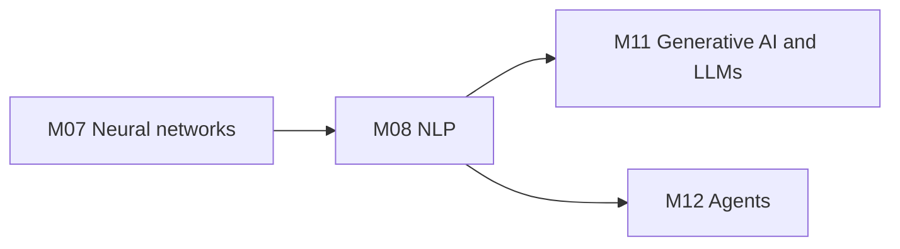

# M08 — Natural Language Processing

| Level | 300 |
| :--- | :--- |
| Study time | 22 hours (module total) |
| Lessons published | 0 of 6 |
| Course outcome | CLO6, CLO7 |
| Prerequisites | [M07 Neural Networks](../M07-neural-networks-and-deep-learning/README.md) |

[← Previous module: M07](../M07-neural-networks-and-deep-learning/README.md) · [Course home](../../README.md) ·
[Next module: M09](../README.md#m09)

> **Warning** — the lessons for this module are not written yet. This page exists so you can find the
> reference code and see what the module will cover. Nothing here is a substitute for the lessons.

## Overview

Language is the domain where modern AI is most visible and least understood. This module starts with
the unglamorous foundations — normalisation, tokenisation, subwords, TF-IDF — because they explain
what a model actually sees, then moves through embeddings to transformer-based fine-tuning. The
evaluation lesson is deliberately as long as the modelling one: text models fail in ways that
aggregate accuracy hides.

## Learning outcomes

By the end of this module you will be able to:

1. **Prepare** text without destroying information, and justify each normalisation choice.
2. **Explain** what a subword token is and why vocabulary size changes model behaviour.
3. **Train and compare** classical and neural text classifiers on the same split.
4. **Fine-tune** an encoder for classification or entity recognition.
5. **Analyse** errors by class, length and domain, and audit a text pipeline for bias.

## Reference code available today

The module's code is published and runs offline on CPU. Reading it is useful preparation, but it is
not a lesson: the explanations live in the lessons still to come.

| File | What it contains | Time |
| :--- | :--- | ---: |
| [`text_data.py`](code/text_data.py) | The module's synthetic corpus and label generation | 15 m |
| [`text_pipeline.py`](code/text_pipeline.py) | Normalisation, tokenisation and TF-IDF pipeline | 20 m |
| [`classify.py`](code/classify.py) | Classical and neural text classifiers | 20 m |
| [`embeddings.py`](code/embeddings.py) | Static and contextual embeddings | 20 m |
| [`seq_models.py`](code/seq_models.py) | Sequence models for tagging and classification | 20 m |

## Where this module sits

*Text description of the diagram:* M08 assumes the neural-network material from M07, and feeds both
the generative-AI module (where language models are the subject) and the agents module (where text is
the interface).

## What to do while you wait

1. Finish M07, especially attention and transfer learning.
2. Read the [glossary entries for M08](../../resources/glossary.md) — tokenisation, embedding, TF-IDF,
   attention.
3. Work the M08 quiz in the [assessment collection](../../assessments/quizzes/quiz-m08.md); it is
   written and marked, and tells you which parts of the module to prioritise when it lands.
4. Take the [self-assessment sheet](../../assessments/self-assessment/sa-m08.md).

## Key terms introduced

**Tokenisation**, **normalisation**, **subword**, **BPE**, **TF-IDF**, **bag of words**, **word
embedding**, **contextual embedding**, **named-entity recognition**, **macro-F1**, **perplexity**.
Definitions: [glossary](../../resources/glossary.md).

## Navigation

[← Previous module: M07](../M07-neural-networks-and-deep-learning/README.md) · [Course home](../../README.md) ·
[All modules](../README.md) · [Next module: M09](../README.md#m09)
