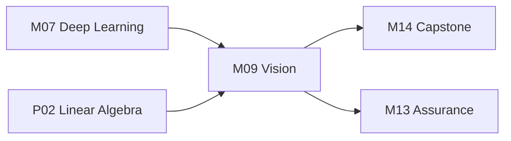

# M09 — Computer Vision

| Level | 300 |
| :--- | :--- |
| Study time | 26.8 hours — guided 7.5 · practical 13.5 · assessment 5.8 · project 0.0 |
| Lessons | 6 |
| Notebooks | 4 |
| Labs | 4 |
| Course outcome | CLO6 — build and evaluate a vision model, and know when it will fail |
| Prerequisites | [M07 Neural Networks](../M07-neural-networks-and-deep-learning/README.md) · [P02 Mathematics](../../prerequisites/P02-mathematics-for-ai/README.md) (recommended) |

[← Previous module: M08](../M08-natural-language-processing/README.md) · [Course home](../../README.md) ·
[All modules](../README.md) · [Next module: M10](../M10-reinforcement-learning/README.md)

## Overview

An image is an array, and most confusion in computer vision disappears once you accept that and follow the
consequences: shape order, coordinate order, dtype, and the fact that a model cannot recover what the
sensor never recorded. The module builds from pixels and convolution through classical features and CNNs
to detection, segmentation and transformers — and spends real time on evaluation, because a vision metric
is where most claims are inflated.

Everything runs offline on a laptop CPU. Images are generated in code (`code/vision_core.py`), so nothing
is downloaded, the data is dedicated to the public domain under CC0 1.0, and every number in the
lessons can be reproduced.

## Learning outcomes

By the end of this module you will be able to:

1. **Represent** an image as an array and convert between colour spaces without losing track of ranges.
2. **Implement** convolution, edge detection, thresholding, morphology and a HOG descriptor from scratch.
3. **Train and diagnose** a CNN classifier, including the baseline comparison that makes the result meaningful.
4. **Compute** IoU, run NMS and report AP for a detection task.
5. **Train** a U-Net segmenter and explain class collapse under unweighted loss.
6. **Decide** between transfer learning, fine-tuning and training from scratch, with licence awareness.

## Study time

| Category | Hours | What it covers |
| :--- | ---: | :--- |
| Guided study | 7.5 | lesson reading, examples and self-checks |
| Practical | 13.5 | 4 labs and 4 notebooks |
| Independent assessment | 5.8 | quiz, programming assignment and self-assessment |
| Project | 0.0 | mini-project or capstone work |
| **Total** | **26.8** | minimum guided path; extensions are extra |

*Convention:* guided is lesson time as stated in each lesson header; practical is lab and
notebook time; assessment is quiz + assignment + self-assessment; project is mini-project or
capstone time. Optional extension work is excluded and stated separately in the labs.

## Module map

| ID | Title | Type | Time | Link |
| :--- | :--- | :--- | ---: | :--- |
| L09-01 | Introduction to Computer Vision | Lesson | 60 m | [Read](lessons/L09-01-introduction-to-computer-vision.md) |
| L09-02 | Image Processing and Feature Extraction | Lesson | 75 m | [Read](lessons/L09-02-image-processing-and-feature-extraction.md) |
| L09-03 | Image Classification and CNNs | Lesson | 80 m | [Read](lessons/L09-03-image-classification-and-cnns.md) |
| L09-04 | Object Detection | Lesson | 80 m | [Read](lessons/L09-04-object-detection.md) |
| L09-05 | Image Segmentation | Lesson | 80 m | [Read](lessons/L09-05-image-segmentation.md) |
| L09-06 | Advanced Computer Vision | Lesson | 75 m | [Read](lessons/L09-06-advanced-computer-vision.md) |
| NB-09-01 | Image Processing Workbench | Notebook | 30 m | [Open](notebooks/nb-09-01-image-processing.ipynb) |
| NB-09-02 | CNN Classification Workbench | Notebook | 30 m | [Open](notebooks/nb-09-02-cnn-classification.ipynb) |
| NB-09-03 | Object Detection Concepts | Notebook | 25 m | [Open](notebooks/nb-09-03-object-detection.ipynb) |
| NB-09-04 | Segmentation with a Small U-Net | Notebook | 35 m | [Open](notebooks/nb-09-04-image-segmentation.ipynb) |
| LAB-09-01 | Image Processing and Feature Extraction | Lab | 2.5 h | [Start](labs/lab-09-01-image-processing-and-feature-extraction.md) |
| LAB-09-02 | Image Classification Using CNNs | Lab | 3 h | [Start](labs/lab-09-02-image-classification-with-cnns.md) |
| LAB-09-03 | Object Detection | Lab | 2.5 h | [Start](labs/lab-09-03-object-detection.md) |
| LAB-09-04 | Image Segmentation Using U-Net | Lab | 3.5 h | [Start](labs/lab-09-04-image-segmentation-with-unet.md) |
| QUIZ-09 | Module self-check | Quiz | 35 m | [Take](../../assessments/quizzes/quiz-m09.md) |
| PA-09 | Vision Pipeline with a Robustness Study | Assignment | 5 h | [Start](../../assessments/programming/pa-09-computer-vision.md) |

## Reference code

| File | What it contains |
| :--- | :--- |
| [`vision_core.py`](code/vision_core.py) | Synthetic datasets, convolution, edges, Otsu, morphology, HOG, IoU, NMS, AP, Dice, TinyCNN, U-Net |
| `python code/vision_core.py` | Prints the self-test result and a short training run |

## Suggested seven-day plan

| Day | Work | Hours |
| :--- | :--- | ---: |
| 1 | L09-01, L09-02, NB-09-01 | 2.5 |
| 2 | LAB-09-01 | 2.5 |
| 3 | L09-03, NB-09-02 | 2 |
| 4 | LAB-09-02 | 3 |
| 5 | L09-04, NB-09-03, LAB-09-03 | 3.5 |
| 6 | L09-05, L09-06, NB-09-04 | 2.5 |
| 7 | LAB-09-04, quiz | 4 |

## Datasets and licensing

All images are generated by `vision_core.py` and are course-authored synthetic data; no third-party dataset
is redistributed. Pretrained weights are **not** used anywhere in the module, so there is no model licence
to honour — and a student who substitutes a pretrained backbone (L09-06) must record that model's licence
in their report. Synthetic images are not a substitute for field data: no result here transfers to
clinical, agricultural or safety-critical use.

## Where this module sits

*Text description:* M09 assumes the convolution and training material from M07 and the matrix algebra from
P02, and feeds the capstone's applied projects and the assurance module's robustness discussion.

## Key terms introduced

**Pixel**, **luma**, **convolution**, **kernel**, **padding**, **stride**, **HOG**, **Otsu threshold**,
**morphology**, **IoU**, **non-maximum suppression**, **anchor**, **average precision**, **semantic
segmentation**, **U-Net**, **Dice coefficient**, **transfer learning**, **Vision Transformer**. Definitions:
[glossary](../../resources/glossary.md).

## Navigation

[← Previous module: M08](../M08-natural-language-processing/README.md) · [Course home](../../README.md) ·
[All modules](../README.md) · [Next module: M10](../M10-reinforcement-learning/README.md)
