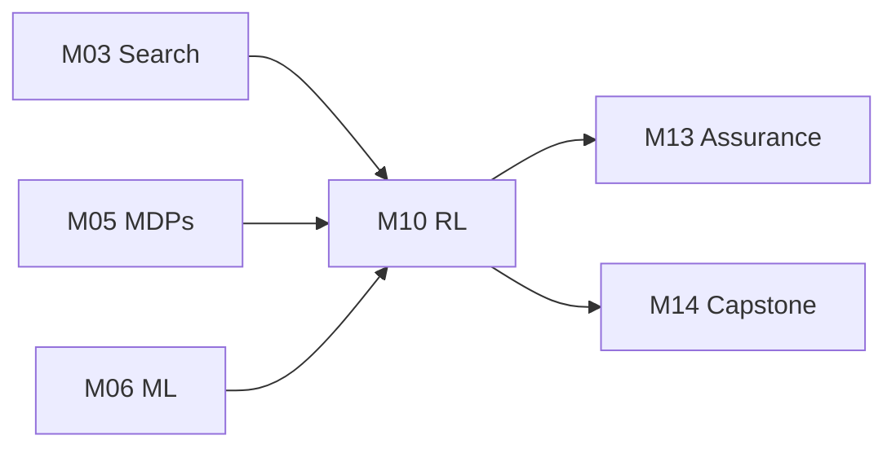

# M10 — Reinforcement Learning

| Level | 400 |
| :--- | :--- |
| Study time | 25 hours (module total) |
| Lessons published | 0 of 7 |
| Course outcome | CLO7 |
| Prerequisites | [M06 Machine Learning](../M06-machine-learning-fundamentals/README.md), [P03 Probability](../../prerequisites/P03-probability-and-statistics/README.md) |

[← Previous module: M09](../README.md#m09) · [Course home](../../README.md) ·
[Next module: M11](../M11-generative-ai-and-large-language-models/README.md)

> **Warning** — the lessons for this module are not written yet. This page exists so you can find the
> reference code and see what the module will cover.

## Overview

Learning from consequences rather than labels. The module formalises the interaction loop as a Markov
decision process, solves small problems exactly with dynamic programming, then removes the model:
Monte Carlo, temporal-difference learning, SARSA and Q-learning. It closes with function
approximation and policy gradients, and with the engineering reality that reward design decides what
your agent actually learns — including the failures you did not intend.

## Learning outcomes

By the end of this module you will be able to:

1. **Write down** an MDP for a real decision problem: states, actions, rewards, transitions, discount.
2. **Compute** optimal values by policy iteration and value iteration.
3. **Implement** tabular Q-learning and explain its convergence conditions.
4. **Train** a DQN on a small control task and diagnose instability from learning curves.
5. **Recognise** reward hacking and explain how a shaping term changed the policy.

## Reference code available today

The code runs offline on CPU and needs no environment package: it includes its own small
environments, which is deliberate, so you can read the whole loop.

| File | What it contains | Time |
| :--- | :--- | ---: |
| [`rl_envs.py`](code/rl_envs.py) | Gridworld and control environments used by the module | 20 m |
| [`tabular.py`](code/tabular.py) | Q-learning, SARSA and eligibility traces | 25 m |
| [`dp.py`](code/dp.py) | Policy iteration and value iteration | 20 m |
| [`dqn.py`](code/dqn.py) | Function approximation and a small DQN | 25 m |

## Where this module sits

*Text description of the diagram:* M10 draws on search (planning), M05's Markov decision processes
and M06's learning theory, and feeds the assurance module (reward hacking, failure diagnosis) and the
capstone.

## What to do while you wait

1. Read Sutton and Barto, chapters 3–6 — the module follows their structure
   ([free PDF](http://incompleteideas.net/book/the-book-2nd.html)).
2. Work through the MDP section of M05 if it is still unfamiliar; Bellman equations are the whole
   module's vocabulary.
3. Try the [M10 quiz](../../assessments/quizzes/quiz-m10.md) and the
   [self-assessment sheet](../../assessments/self-assessment/sa-m10.md).

## Key terms introduced

**Markov decision process**, **return**, **discount factor**, **policy**, **value function**,
**Bellman equation**, **temporal-difference learning**, **Q-learning**, **SARSA**, **exploration**,
**reward shaping**, **reward hacking**, **policy gradient**. Definitions:
[glossary](../../resources/glossary.md).

## Navigation

[← Previous module: M09](../README.md#m09) · [Course home](../../README.md) · [All modules](../README.md) ·
[Next module: M11](../M11-generative-ai-and-large-language-models/README.md)
