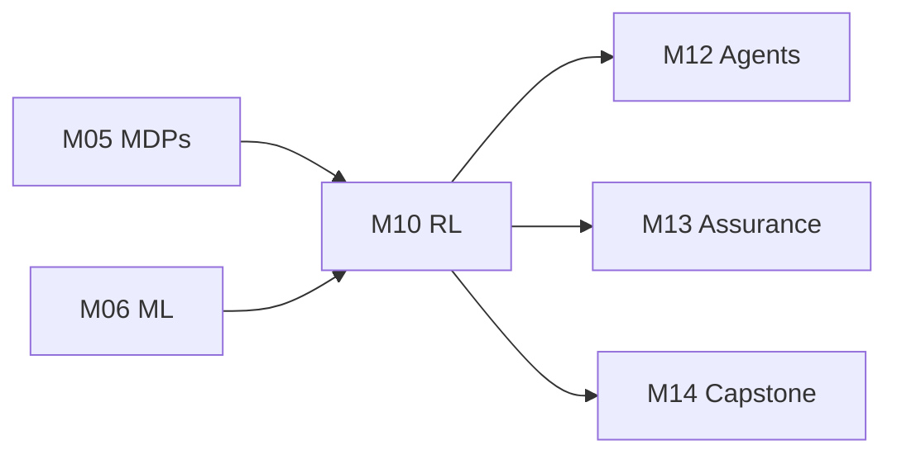

# M10 — Reinforcement Learning

| Level | 400 |
| :--- | :--- |
| Study time | 34.1 hours — guided 6.7 · practical 12.5 · assessment 5.9 · project 9.0 |
| Lessons | 5 |
| Notebooks | 3 |
| Labs | 4 |
| Course outcome | CLO7 — train an agent that improves from its own experience, and evaluate it honestly |
| Prerequisites | [M06 Machine Learning](../M06-machine-learning-fundamentals/README.md) · [M05 MDP section](../M05-uncertainty-bayesian-reasoning-and-fuzzy-logic/lessons/L05-01-probability-conditional-probability-and-bayes-theorem.md) · [P03 Probability](../../prerequisites/P03-probability-and-statistics/README.md) |

[← Previous module: M09](../M09-computer-vision/README.md) · [Course home](../../README.md) ·
[All modules](../README.md) · [Next module: M11](../M11-generative-ai-and-large-language-models/README.md)

## Overview

Learning from consequences rather than labels. The module formalises the interaction loop as a Markov
decision process, solves small problems exactly with dynamic programming, then removes the model: Monte
Carlo, temporal-difference learning, SARSA and Q-learning. It closes with function approximation, policy
gradients and PPO, and with the engineering reality that reward design decides what the agent actually
learns — including the failures you did not intend.

Everything runs on CPU. The module ships its own environments, so the first half needs no external package
at all; Gymnasium is used only for the CartPole labs, and a bundled fallback environment keeps those labs
runnable without it.

## Learning outcomes

By the end of this module you will be able to:

1. **Write down** an MDP for a real decision problem: states, actions, rewards, transitions, discount.
2. **Compute** optimal values by policy iteration and value iteration, and check a learned table against them.
3. **Implement** SARSA and Q-learning and explain the one line that separates them.
4. **Train** a DQN and diagnose instability from ablations rather than intuition.
5. **Compare** value-based and policy-based learning with matched budgets and seeds.
6. **Recognise** reward hacking and design the test that would have caught it.

## Study time

| Category | Hours | What it covers |
| :--- | ---: | :--- |
| Guided study | 6.7 | lesson reading, examples and self-checks |
| Practical | 12.5 | 4 labs and 3 notebooks |
| Independent assessment | 5.9 | quiz, programming assignment and self-assessment |
| Project | 9.0 | MP-10 inventory-control agent |
| **Total** | **34.1** | minimum guided path; extensions are extra |

*Convention:* guided is lesson time as stated in each lesson header; practical is lab and
notebook time; assessment is quiz + assignment + self-assessment; project is mini-project or
capstone time. Optional extension work is excluded and stated separately in the labs.

## Module map

| ID | Title | Type | Time | Link |
| :--- | :--- | :--- | ---: | :--- |
| L10-01 | Foundations of Reinforcement Learning | Lesson | 75 m | [Read](lessons/L10-01-foundations-of-reinforcement-learning.md) |
| L10-02 | Value-Based Reinforcement Learning | Lesson | 80 m | [Read](lessons/L10-02-value-based-reinforcement-learning.md) |
| L10-03 | Temporal Difference Learning | Lesson | 80 m | [Read](lessons/L10-03-temporal-difference-learning.md) |
| L10-04 | Deep Reinforcement Learning | Lesson | 90 m | [Read](lessons/L10-04-deep-reinforcement-learning.md) |
| L10-05 | Advanced Reinforcement Learning | Lesson | 80 m | [Read](lessons/L10-05-advanced-reinforcement-learning.md) |
| NB-10-01 | MDPs and Dynamic Programming | Notebook | 30 m | [Open](notebooks/nb-10-01-mdps-and-dynamic-programming.ipynb) |
| NB-10-02 | Tabular Control: SARSA and Q-Learning | Notebook | 30 m | [Open](notebooks/nb-10-02-tabular-control-sarsa-and-q-learning.ipynb) |
| NB-10-03 | Deep Reinforcement Learning | Notebook | 35 m | [Open](notebooks/nb-10-03-deep-reinforcement-learning.ipynb) |
| LAB-10-01 | Grid-World Navigation Using Q-Learning | Lab | 2.5 h | [Start](labs/lab-10-01-grid-world-navigation-using-q-learning.md) |
| LAB-10-02 | Compare SARSA and Q-Learning | Lab | 2.5 h | [Start](labs/lab-10-02-compare-sarsa-and-q-learning.md) |
| LAB-10-03 | CartPole Using Deep Q-Networks | Lab | 3 h | [Start](labs/lab-10-03-cartpole-with-deep-q-networks.md) |
| LAB-10-04 | Policy-Based Learning and PPO Introduction | Lab | 3 h | [Start](labs/lab-10-04-policy-based-learning-and-ppo-introduction.md) |
| MP-10 | Inventory-Control Agent | Project | 8–10 h | [Start](projects/mp-10-inventory-control-agent.md) |
| QUIZ-10 | Module self-check | Quiz | 40 m | [Take](../../assessments/quizzes/quiz-m10.md) |
| PA-10 | Q-Learning, Then DQN, on the Same Task | Assignment | 5 h | [Start](../../assessments/programming/pa-10-reinforcement-learning.md) |

## Reference code

| File | What it contains |
| :--- | :--- |
| [`rl_envs.py`](code/rl_envs.py) | Gridworlds, cliff walking, three Gymnasium-style environments, `MDPAdapter` |
| [`dp.py`](code/dp.py) | Policy evaluation, policy iteration, value iteration, exact policy values |
| [`tabular.py`](code/tabular.py) | MC prediction, TD(0), SARSA, Q-learning, expected SARSA, double Q, evaluation helpers |
| [`dqn.py`](code/dqn.py) | Replay buffer, Q-network, DQN, REINFORCE, actor–critic, PPO |
| [`experiments.py`](code/experiments.py) | Seeded comparisons used by the lessons and labs |

Run `python code/experiments.py` for the self-test and a printed SARSA/Q-learning comparison.

## Suggested study plan

| Day | Work | Hours |
| :--- | :--- | ---: |
| 1 | L10-01, L10-02, NB-10-01 | 3 |
| 2 | LAB-10-01 | 2.5 |
| 3 | L10-03, NB-10-02 | 2 |
| 4 | LAB-10-02 | 2.5 |
| 5 | L10-04, NB-10-03 | 2 |
| 6 | LAB-10-03 | 3 |
| 7 | L10-05, LAB-10-04, quiz | 4 |

## Dependencies and fallbacks

- **NumPy and Matplotlib** are required throughout.
- **PyTorch (CPU)** is required for LAB-10-03, LAB-10-04 and NB-10-03.
- **Gymnasium** is optional: `rl_envs.py` includes `RobotNavEnv`, `TrafficSignalEnv` and
  `ResourceAllocationEnv`, so every lab has a runnable environment without it. Record which environment you
  used in your report.
- No downloads, no GPU, no paid service. A full DQN solve is the only long-running exercise and is optional.

## Where this module sits

*Text description:* M10 draws on the MDP formalism from M05 and the learning theory from M06, and feeds the
agent module, the assurance module (reward hacking, failure diagnosis) and the capstone.

## Key terms introduced

**Agent**, **environment**, **policy**, **return**, **discount factor**, **Markov decision process**,
**Bellman equation**, **temporal-difference learning**, **SARSA**, **Q-learning**, **on-policy**,
**off-policy**, **experience replay**, **target network**, **DQN**, **policy gradient**, **actor–critic**,
**PPO**, **reward hacking**. Definitions: [glossary](../../resources/glossary.md).

## Navigation

[← Previous module: M09](../M09-computer-vision/README.md) · [Course home](../../README.md) ·
[All modules](../README.md) · [Next module: M11](../M11-generative-ai-and-large-language-models/README.md)
