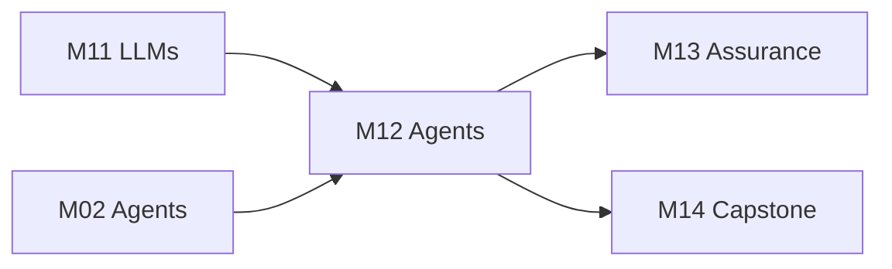

# M12 — AI Agents and Agentic AI Systems

| Level | 400 |
| :--- | :--- |
| Study time | 19 hours (module total) |
| Lessons published | 0 of 6 |
| Course outcome | CLO7 |
| Prerequisites | [M11 Generative AI and LLMs](../M11-generative-ai-and-large-language-models/README.md), [M02 Agents](../M02-intelligent-agents-and-environments/README.md) |

[← Previous module: M11](../M11-generative-ai-and-large-language-models/README.md) · [Course home](../../README.md) ·
[Next module: M13](../M13-responsible-explainable-secure-ai/README.md)

> **Warning** — the lessons for this module are not written yet. This page exists so you can find the
> reference code and see what the module will cover.

## Overview

A language model answers; an agent acts. This module turns a model into a system that uses tools,
keeps memory, plans across steps and coordinates with other agents — then spends equal effort on the
new risks that creates: runaway loops, injected instructions, over-broad permissions and untraceable
failures. The engineering discipline here is closer to distributed systems than to machine learning.

## Learning outcomes

By the end of this module you will be able to:

1. **Build** a tool-using agent with a bounded loop and a logged termination reason.
2. **Define and validate** structured tool interfaces rather than parsing free text.
3. **Add** planning and memory without making behaviour unpredictable.
4. **Apply** sandboxing, permission limits and audit logging.
5. **Red-team** your own agent and report what you found, including negative results.
6. **Evaluate** an agent on tasks, with steps, tool errors and cost reported.

## Reference code available today

The code is a complete small agent stack: loop, tools, guardrails, protocols and a multi-agent
example. It runs offline with a deterministic stand-in for the model, so every behaviour is
reproducible.

| File | What it contains | Time |
| :--- | :--- | ---: |
| [`agent_core.py`](code/agent_core.py) | The agent loop: plan, act, observe, terminate | 25 m |
| [`tools.py`](code/tools.py) | Tool definitions and argument schemas | 20 m |
| [`guardrails.py`](code/guardrails.py) | Permission checks and refusal paths | 20 m |
| [`protocols.py`](code/protocols.py) | Message and tool-call protocols | 15 m |
| [`multi_agent.py`](code/multi_agent.py) | Coordination between agents | 20 m |
| [`agent_data.py`](code/agent_data.py) | Task set and fixtures | 10 m |

## Where this module sits

*Text description of the diagram:* M12 combines M11's language models with M02's agent vocabulary,
then feeds the assurance module — where agent-specific attacks are audited — and the capstone.

## What you can complete today

The six lessons are not published, so **this module cannot be finished as a course module yet** —
that is a gap in the course, not a step you have missed. You can still reach a working agent:

1. [L02-01](../../modules/M02-intelligent-agents-and-environments/lessons/L02-01-agents-percepts-actions.md)
   for the agent vocabulary: percepts, actions and environment types.
2. [L11-04](../M11-generative-ai-and-large-language-models/lessons/L11-04-prompt-engineering-and-in-context-learning.md)
   and [L11-05](../M11-generative-ai-and-large-language-models/lessons/L11-05-retrieval-augmented-generation.md)
   for prompting and retrieval.
3. The reference code in reading order: `agent_core.py`, `tools.py`, `guardrails.py`,
   `protocols.py`, `multi_agent.py`. Each runs offline with a deterministic stand-in model.

There is no LAB-12 yet, and the M12 quiz covers unpublished lessons, so treat the quiz as a
preview rather than an assessment.

## What to do while you wait

1. Read ReAct (2023) — the reason–act loop most agents still follow
   ([arXiv:2210.03629](https://arxiv.org/abs/2210.03629)).
2. Re-read M02's PEAS description and environment classification; agents fail when the environment
   is misclassified, not only when the model is weak.
3. Try the [M12 quiz](../../assessments/quizzes/quiz-m12.md) and the
   [self-assessment sheet](../../assessments/self-assessment/sa-m12.md).

## Key terms introduced

**Agent loop**, **tool schema**, **function calling**, **planning**, **memory**, **multi-agent
system**, **guardrail**, **prompt injection**, **permission boundary**, **task success rate**.
Definitions: [glossary](../../resources/glossary.md).

## Navigation

[← Previous module: M11](../M11-generative-ai-and-large-language-models/README.md) · [Course home](../../README.md) ·
[All modules](../README.md) · [Next module: M13](../M13-responsible-explainable-secure-ai/README.md)
