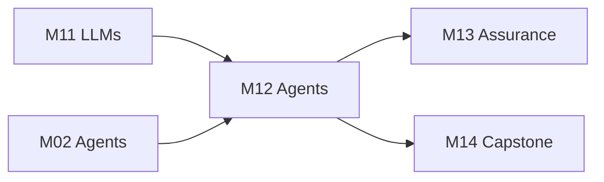

# M12 — AI Agents and Agentic AI Systems

| Level | 400 |
| :--- | :--- |
| Study time | 27.8 hours — guided 8.0 · practical 5.0 · assessment 5.8 · project 9.0 |
| Lessons | 6 |
| Course outcome | CLO7 — build, secure and evaluate an agent that uses tools to complete a task |
| Prerequisites | [M11 Generative AI and LLMs](../M11-generative-ai-and-large-language-models/README.md), [M02 Agents](../M02-intelligent-agents-and-environments/README.md) |

[← Previous module: M11](../M11-generative-ai-and-large-language-models/README.md) · [Course home](../../README.md) · [All modules](../README.md) · [Next module: M13](../M13-responsible-explainable-secure-ai/README.md)

## Overview

A language model answers; an agent acts. This module turns a model into a system that uses tools,
keeps state, plans across steps and coordinates with other agents — then spends equal effort on the
risks that creates: runaway loops, injected instructions, over-broad permissions and untraceable
failures. The engineering discipline here is closer to distributed systems than to machine learning.

Everything runs offline on CPU. The reference code uses a deterministic stand-in for the model, so
every behaviour in the lessons and labs is reproducible; a local model can be substituted without
changing the architecture.

## Learning outcomes

By the end of this module you will be able to:

1. **Design** an agent as four components (policy, tools, state, controller) and name each failure mode.
2. **Define** tools with schemas and enforce a validation and permission boundary.
3. **Plan** multi-step work with postconditions, retries and replanning that terminates.
4. **Persist** task state so a run can resume, and trace every step.
5. **Coordinate** multiple agents only when the cost arithmetic supports it.
6. **Defend and evaluate** an agent: injection resistance, approval binding, four outcome metrics.

## Module map

| ID | Title | Type | Time | Link |
| :--- | :--- | :--- | ---: | :--- |
| L12-01 | Foundations and Architecture of AI Agents | Lesson | 75 m | [Read](lessons/L12-01-foundations-and-architecture-of-ai-agents.md) |
| L12-02 | LLM Agents, Tool Calling and Structured Outputs | Lesson | 80 m | [Read](lessons/L12-02-llm-agents-tool-calling-and-structured-outputs.md) |
| L12-03 | Planning, Memory and Workflow Orchestration | Lesson | 80 m | [Read](lessons/L12-03-planning-memory-and-workflow-orchestration.md) |
| L12-04 | Agent Frameworks and Practical Implementation | Lesson | 80 m | [Read](lessons/L12-04-agent-frameworks-and-practical-implementation.md) |
| L12-05 | Multi-Agent Systems and Collaboration | Lesson | 75 m | [Read](lessons/L12-05-multi-agent-systems-and-collaboration.md) |
| L12-06 | MCP, Security, Evaluation and Reliable Execution | Lesson | 90 m | [Read](lessons/L12-06-mcp-security-evaluation-and-reliable-execution.md) |
| LAB-12-01 | A Tool-Using Support Agent | Lab | 2.5 h | [Start](labs/lab-12-01-tool-using-agent.md) |
| NB-12-01 | Agentic AI Workbench | Notebook | 90 m | [Open](notebooks/nb-12-01-agentic-ai-workbench.ipynb) |
| LAB-12-02 | Agent Security and Evaluation | Lab | 2 h | [Start](labs/lab-12-02-agent-security-and-evaluation.md) |
| MP-12 | Multi-Tool Agent for a Realistic Task | Project | 8–10 h | [Start](projects/mp-12-multi-tool-agent.md) |
| QUIZ-12 | Module self-check | Quiz | 30 m | [Take](../../assessments/quizzes/quiz-m12.md) |

## Reference code

| File | What it contains |
| :--- | :--- |
| [`agent_core.py`](code/agent_core.py) | The agent loop: plan, act, observe, terminate |
| [`tools.py`](code/tools.py) | Tool definitions and argument schemas |
| [`guardrails.py`](code/guardrails.py) | Permission checks and refusal paths |
| [`protocols.py`](code/protocols.py) | Message and tool-call protocols |
| [`multi_agent.py`](code/multi_agent.py) | Coordination between agents |
| [`agent_data.py`](code/agent_data.py) | Task set and fixtures |

## Where this module sits

*Text description of the diagram:* M12 combines M11's language models with M02's agent vocabulary,
then feeds the assurance module — where agent-specific attacks are audited — and the capstone.

## Suggested study plan

| Day | Work | Time |
| :--- | :--- | ---: |
| 1 | L12-01, L12-02 | 2.5 h |
| 2 | L12-03, start LAB-12-01 | 3 h |
| 3 | Finish LAB-12-01 | 2.5 h |
| 4 | L12-04, L12-05 | 3 h |
| 5 | L12-06, LAB-12-02 | 3.5 h |
| 6–8 | MP-12 | 8 h |

## Assessment for this module

| Component | What is checked | Weight |
| :--- | :--- | ---: |
| LAB-12-01 | Loop, schemas, permission boundary, evaluation | 30% |
| LAB-12-02 | Attack quality, layer analysis, metrics | 30% |
| MP-12 | Architecture, safety, reliability, handover | 30% |
| QUIZ-12 | Concepts of loops, schemas, injection, evaluation | 10% |

## Key terms introduced

**Agent loop**, **tool schema**, **function calling**, **planning**, **memory**, **multi-agent
system**, **guardrail**, **prompt injection**, **approval binding**, **task success rate**.
Definitions: [detailed glossary](../../resources/glossary/agents.md).

## Navigation

[← Previous module: M11](../M11-generative-ai-and-large-language-models/README.md) · [Course home](../../README.md) ·
[All modules](../README.md) · [Next module: M13](../M13-responsible-explainable-secure-ai/README.md)

## Assignment

[PA-13 — A Tool-Using Agent with a Bounded Loop](../../assessments/programming/pa-13-ai-agents.md)
