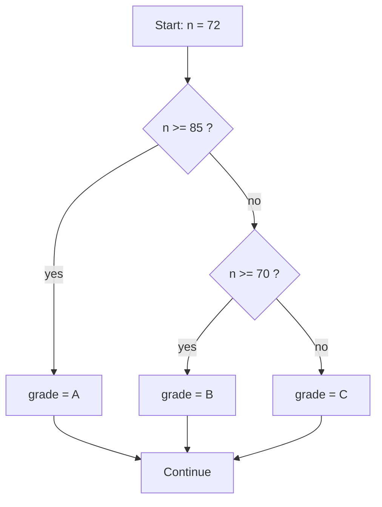

# LP01-03 — Conditionals, Loops, Comprehensions and Lambda

| Unit | P01 · Python Programming for AI |
| :--- | :--- |
| Level | 100 |
| Study time | 90 minutes |
| Prerequisites | [LP01-02](LP01-02-variables-types-and-operators.md) |
| Notebook | [NB-P01-01](../notebooks/nb-p01-01-python-fundamentals.ipynb) |
| Lab | [LAB-P01-01](../labs/lab-p01-01-student-results-analysis.md) |

[← Previous: Variables and Types](LP01-02-variables-types-and-operators.md) · [P01 home](../README.md) · [Next: Functions and Collections →](LP01-04-functions-and-collections.md)

## 1. Learning Objectives

By the end of this lesson you will be able to:

- **Write** multi-branch conditionals using `if`/`elif`/`else`, and predict which branch runs.
- **Choose** between `for` and `while`, and use `range`, `enumerate` and `zip` correctly.
- **Convert** a loop that builds a list into an equivalent list comprehension.
- **Use** `lambda` where it genuinely simplifies code — and recognise where it obscures it.

## 2. Prerequisite Knowledge

- Variables, types, comparison and logical operators: [LP01-02](LP01-02-variables-types-and-operators.md).

## 3. Conceptual Explanation

### 3.1 Conditionals choose a branch

```python
score = 72
if score >= 85:
    grade = "A"
elif score >= 70:
    grade = "B"
else:
    grade = "C"
```

Two details matter. First, **only the first true branch runs** — `72` satisfies `>= 70` but not
`>= 85`, so grade is `"B"` and the `else` is skipped. Second, **order encodes logic**: if you put
`score >= 70` first, every score above 70 would be a `B`, including 95. Conditionals are read top
to bottom, and the first match wins.

### 3.2 Truthiness

Any value can be tested as a condition. These are **falsy**: `False`, `None`, `0`, `0.0`, `""`,
`[]`, `{}`, `set()`. Everything else is truthy. So:

```python
items = []
if items:
    print("has items")
else:
    print("empty")          # this runs
```

This is why idiomatic Python writes `if items:` rather than `if len(items) > 0:`.

### 3.3 Loops repeat work

- `for` iterates over something that has items: a list, a string, a range, a file's lines.
- `while` repeats while a condition holds — use it when you do not know the count in advance.

```python
for i in range(3):          # 0, 1, 2
    print(i)
```

`range(stop)` starts at 0 and excludes `stop`. `range(1, 4)` gives 1, 2, 3.
`range(0, 10, 2)` gives 0, 2, 4, 6, 8. The exclusion of the endpoint is not an accident: it makes
`range(len(data))` line up exactly with valid indices.

Two helpers you will use constantly:

```python
names = ["ali", "sara"]
for position, name in enumerate(names):
    print(position, name)

scores = [90, 85]
for name, score in zip(names, scores):
    print(f"{name}: {score}")
```

`break` exits the loop immediately; `continue` skips to the next iteration. Overusing either is a
sign the loop is doing too much.

### 3.4 Comprehensions build collections in one expression

A loop that appends to a list:

```python
squares = []
for x in range(1, 6):
    squares.append(x * x)
```

is exactly the same as:

```python
squares = [x * x for x in range(1, 6)]
```

The comprehension is not a different algorithm; it is the same loop with the bookkeeping removed.
Add a filter with `if` at the end, and use braces instead of brackets for sets and dictionaries:

```python
even_squares = [x * x for x in range(1, 11) if x % 2 == 0]
lengths = {word: len(word) for word in ["ai", "agent", "search"]}
unique_firsts = {word[0] for word in ["ai", "agent", "search"]}
```

### 3.5 Lambda is a function without a name

`lambda x: x * 2` is the same function as `def double(x): return x * 2`, written inline. It earns
its place as an argument to something that wants a small function:

```python
people = [("Sara", 31), ("Ali", 24)]
by_age = sorted(people, key=lambda p: p[1])
```

Here `key` needs a function; naming it would add a line for something used once. Beyond that,
`lambda` cannot contain statements, cannot be documented well, and makes tracebacks less readable.
If it needs a name, use `def`.

## 4. Worked Examples

### Example 1 — trace the branches

```python
def classify(n):
    if n < 0:
        return "negative"
    if n == 0:
        return "zero"
    if n % 2 == 0:
        return "positive even"
    return "positive odd"
```

Trace `classify(-4)`: `n < 0` is true → returns `"negative"`, and the remaining tests never run.
Trace `classify(7)`: first two are false, `7 % 2 == 0` is false, so the final `return` runs.

Using `return` inside each branch is often clearer than assigning to a variable, because it makes
the exit obvious.

### Example 2 — FizzBuzz, the classic loop exercise

Print 1 to 15; multiples of 3 print `Fizz`, of 5 print `Buzz`, of both print `FizzBuzz`.

```python
for n in range(1, 16):
    if n % 15 == 0:
        print("FizzBuzz")
    elif n % 3 == 0:
        print("Fizz")
    elif n % 5 == 0:
        print("Buzz")
    else:
        print(n)
```

```text
1
2
Fizz
4
Buzz
Fizz
7
8
Fizz
Buzz
11
Fizz
13
14
FizzBuzz
```

The `% 15` test must come **first**. Reverse the order and 15 prints `Fizz`, because the first
matching branch wins — the same ordering rule as §3.1.

### Example 3 — a `while` loop that must terminate

```python
def digits(n: int) -> int:
    """Count decimal digits by repeatedly dividing by 10."""
    count = 0
    while n > 0:
        n //= 10
        count += 1
    return count

print(digits(90210))
```

```text
5
```

The loop ends because `n // 10` strictly decreases a positive integer and eventually reaches 0. If
you write a `while` loop, you must be able to state *why* it terminates; that sentence is the
difference between a loop and an infinite one.

## 5. Visual Explanation



*Text description of the diagram:* the score enters at the top; each diamond tests one condition in
order. The first "yes" takes its branch and skips all remaining tests, which is why the order of
conditions changes behaviour rather than merely style.

## 6. Mathematical Formulation

A comprehension is a set-builder notation with executable syntax. The mathematical statement

$$
S = \{\, x^2 \;\mid\; x \in \{1,\dots,10\},\; x \text{ even} \,\}
$$

becomes, almost word for word:

```python
S = [x**2 for x in range(1, 11) if x % 2 == 0]
```

This correspondence is worth internalising: when a paper writes a set or a sum with a condition,
you now have a direct translation into code — and, in the other direction, code you can read as
mathematics.

## 7. Python Implementation

```python
"""Grade a set of student scores, demonstrating loop/conditional patterns together."""

scores = [88, 74, 91, 52, 67, 79, 95]


def letter(score: int) -> str:
    """Map a numeric score to a letter grade."""
    if score >= 85:
        return "A"
    if score >= 70:
        return "B"
    if score >= 60:
        return "C"
    return "F"


grades = {score: letter(score) for score in scores}
passing = [s for s in scores if s >= 60]
average = sum(scores) / len(scores)

print(f"average = {average:.1f}")
print(f"passed  = {len(passing)} of {len(scores)}")
print(f"highest = {max(scores)} ({letter(max(scores))})")
print(sorted(grades.items(), key=lambda item: -item[1])[:3])
```

**Output**

```text
average = 78.0
passed  = 7 of 7
highest = 95 (A)
[(95, 'A'), (91, 'A'), (88, 'A')]
```

Note `key=lambda item: -item[1]`: sorting tuples by their second element, descending, achieved with
a one-line anonymous function — the legitimate use of `lambda`.

## 8. Practical Applications

- **Batch processing.** Every training loop you write later is a `for` loop over batches; the
  patterns here are the ones that make such code readable.
- **Feature construction.** Building a list of derived values from raw records is a comprehension in
  almost every data pipeline, and a `while` loop only where the count is unknown.

## 9. Common Mistakes

| Mistake | What you will see | Why it happens | Fix |
| :--- | :--- | :--- | :--- |
| Wrong branch order | Every high score graded `B` | First match wins | Most specific condition first |
| Off-by-one in `range` | One item missing from output | `range` excludes its endpoint | `range(n + 1)` when inclusive |
| Mutating a list while iterating | Skipped elements | Indices shift under the loop | Iterate over a copy: `for x in list(data)` |
| `while` with no state change | Program hangs | Condition never becomes false | Update the loop variable inside the body |

## 10. Self-Assessment

**1.** What does `list(range(2, 11, 3))` give?
<details><summary>Show answer</summary>

`[2, 5, 8]`. It starts at 2, adds 3 each time, and stops before reaching or passing 11.
</details>

**2.** Rewrite `[x * 2 for x in values if x > 0]` as a loop. What is the advantage of each form?
<details><summary>Show answer</summary>

```python
result = []
for x in values:
    if x > 0:
        result.append(x * 2)
```

The comprehension is shorter and states intent ("build this collection"); the loop is easier to
debug when you need to print or break mid-way. Use the comprehension for a single expression, the
loop when the body needs more steps.
</details>

**3.** Why does FizzBuzz test `n % 15 == 0` before `n % 3 == 0`?
<details><summary>Show answer</summary>

Because 15 is divisible by both 3 and 5. Testing 3 first would match 15 and print `Fizz`, never
reaching the combined case. The general rule is that conditions must be ordered from most specific
to most general.
</details>

**4.** What is wrong with `sorted(people, key=lambda p: p[1])` if `people` contains a `None` age?
<details><summary>Show answer</summary>

Comparison between `None` and an integer raises `TypeError`. Handle missing values first (filter
them, or map `None` to a sentinel), rather than hoping the sort will cope.
</details>

## 11. Further Reading

- [More Control Flow Tools](https://docs.python.org/3/tutorial/controlflow.html) — the official chapter covering `if`, `for`, `range`, comprehensions and `lambda`.
- [Data Structures](https://docs.python.org/3/tutorial/datastructures.html) — comprehensions and their performance characteristics.

## Mini-Lab

A sensor logs 24 hourly temperatures as a list. Produce: the count of readings above 35 °C, a list of
readings converted to Fahrenheit (a comprehension), and the hour index of the maximum reading
(`max` with `enumerate` or `.index`). Then handle a day where one reading is `None` — decide whether
to skip it or raise, and say why in one sentence.

## What to Do Next

Continue to [LP01-04 Functions and Collections](LP01-04-functions-and-collections.md), where these
loops move inside functions.
