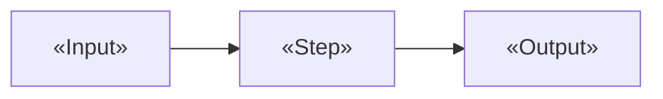

# L«MM»-«NN» — «Plain-language lesson title»

| Module | M«MM» · «Module title» |
| :--- | :--- |
| Level | «100 / 200 / 300 / 400» |
| Study time | «45» minutes |
| Prerequisites | `«L-MM-NN Lesson title»` — «or: None» |
| Notebook | `NB-«MM»-«NN» «Notebook title»` — «or: None» |
| Lab | `LAB-«MM»-«NN» «Lab title»` — «or: None» |

`← Previous: «Lesson title»` · [Module home](../README.md) · `Next: «Lesson title» →`

<!--
AUTHOR NOTES (delete before publishing)
• Title must be the plain-language name of ONE idea.
• Every prerequisite row links to the lesson that actually teaches it.
• First lesson of a module: use "Module start" instead of Previous. Last: "Module end".
-->

## 1. Learning Objectives

By the end of this lesson you will be able to:

- **«Explain»** «what, in one clause».
- **«Apply»** «the technique to a stated kind of problem».
- **«Evaluate»** «which choice is appropriate, and why».

<!--
3–5 objectives, each starting with a measurable verb: explain, derive, implement, compare,
choose, evaluate, diagnose. Never write "understand X" alone — it cannot be assessed.
-->

## 2. Prerequisite Knowledge

You should already be able to:

- «Do X» — see `«L0?-??»`.
- «Do Y» — see `«P0?»`.

<!-- If nothing is required, say so: "This lesson assumes only Module M01." Never leave it blank. -->

## 3. Conceptual Explanation

### 3.1 The intuition

«Start from a situation the student has met: a queue, a bus route, a doctor's diagnosis, a
search box. Name the problem in ordinary language before any formal vocabulary appears.»

### 3.2 The formal idea

«Introduce the definition, the vocabulary and the assumptions. Bold each key term the first
time it appears — the glossary check (V13) looks for those terms.»

### 3.3 Why it matters

«One short paragraph: what breaks if you ignore this idea, or what becomes possible once you
have it. This is where a student decides whether to keep reading.»

## 4. Worked Examples

### Example 1 — «small, hand-checkable»

«Give the inputs, every intermediate step, and the answer. Use numbers small enough that the
student can verify the arithmetic on paper. State the result in a sentence, too.»

### Example 2 — «one step harder, or a contrasting case»

«Show where the naive approach fails and why the technique handles it. This is the example a
student will remember.»

## 5. Visual Explanation



*Text description of the diagram:* «Describe, in prose, what the diagram shows and what the
student should notice — the shape of the flow, where a decision branches, which path is
expensive. This paragraph is mandatory: the diagram must make sense with the image removed.»

## 6. Mathematical Formulation

«State the formal definition or the quantity being computed. Define every symbol.»

| Symbol | Meaning |
| :--- | :--- |
| «x» | «what it is, with units if any» |
| «f(x)» | «what the function returns» |

$$
«\text{the formal statement, e.g. } f(n) = \sum_{i=1}^{n} w_i x_i»
$$

«Then one sentence on the assumptions that make this valid. If the lesson has no meaningful
formulation, write: "This lesson is conceptual; no formulation is required." — never leave the
section empty.»

## 7. Python Implementation

```python
«Complete, runnable code. Self-contained: imports included, no dependency on a previous cell
or on state the reader cannot see. Type hints on functions, NumPy-style docstring, fixed seed
if there is any randomness.»
```

**Output**

```text
«Paste the real output of the block above. If you have not run it, you cannot paste it.»
```

«One or two sentences connecting the output back to Example 1: the numbers should agree.»

## 8. Practical Applications

- **«Domain» — «system or product class».** «What this technique buys them, concretely: latency,
  cost, accuracy, interpretability.»
- **«Domain» — «system or product class».** «Same.»

<!-- Two at minimum, real domains, no filler ("used in games"). Prefer systems a student can name. -->

## 9. Common Mistakes

| Mistake | What you will see | Why it happens | Fix |
| :--- | :--- | :--- | :--- |
| «Wrong mental model» | «Symptom, e.g. a result that looks plausible but is off by a factor» | «The cause» | «The correction, in one line» |
| «Off-by-one / sign / index error» | «…» | «…» | «…» |
| «Misapplied method» | «…» | «…» | «…» |

## 10. Self-Assessment

**1.** «Recall question — can the student state the idea?»
<details><summary>Show answer</summary>

«Answer with reasoning, not just the result.»

</details>

**2.** «Apply question — a small numerical case they must work through.»
<details><summary>Show answer</summary>

«Worked answer.»

</details>

**3.** «Judgement question — which method for this situation, and why?»
<details><summary>Show answer</summary>

«Answer, including when the other choice would be right.»

</details>

«5–10 questions total. Mix roughly 30% recall, 50% application, 20% judgement. Every answer
goes inside a `<details>` block.»

## 11. Further Reading

- «Author (Year). *Title*. Publisher / URL» — «one line: why read it, and what it adds beyond
  this lesson.»
- «Author (Year). *Title*. URL» — «…»

<!-- 2–5 entries, annotated. A bare bibliography is not acceptable. -->

## Key Terms

- **«Term»** — «one-sentence definition» → see `glossary`.

## What to Do Next

«One sentence: the notebook to run, the lab to attempt, or the lesson that builds on this.
Link it.»
